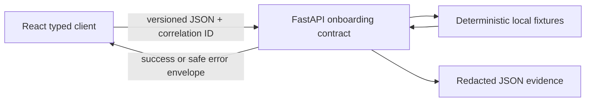

# R0 thin vertical-slice local proof

This proof demonstrates the smallest approved FinEx integration path. It is
intentionally local-only, uses synthetic fixtures, and needs neither Docker,
cloud access, credentials, real authentication, nor real personal data.



## Automated evidence

| Acceptance point | Enforced by | What is checked |
| --- | --- | --- |
| Repeatable controlled data | `app.fixtures.s1_dat_01` and `verify_r0_thin_slice.py` | Fixture reset returns the same five synthetic scenarios. |
| Live API route and health | `verify_r0_thin_slice.py` | The mounted FastAPI app returns health, consent, profile, and completion responses. |
| Correlation continuity | `verify_r0_thin_slice.py` | One supplied correlation ID appears in every success/error header and envelope. |
| Safe failure state | `verify_r0_thin_slice.py` and `onboardingContract.api.test.ts` | An unsupported consent version returns `UNSUPPORTED_CONSENT_VERSION`, which the client preserves. |
| Typed client compatibility | `onboardingContract.api.test.ts` | FastAPI `snake_case` data is decoded into the React client's `camelCase` result types. |
| Visible web success/retry behavior | `ConsentPage.test.tsx` and `OnboardingPage.test.tsx` | Consent advances on success; a contract failure exposes an accessible retry action. |

The backend proof emits an aggregate-only JSON record. It does not contain
fixture records, user IDs, display names, profile labels, or secrets.

## Reproduce locally

Run the backend proof from a bootstrapped backend environment:

```powershell
Push-Location .\backend
.\.venv\Scripts\python.exe .\verify_r0_thin_slice.py --format json
```

Run the two client-side proofs from the React directory:

```powershell
Push-Location .\frontend-react
$env:CI = 'true'
npm test -- --watchAll=false --runInBand src/services/onboardingContract.api.test.ts
npm test -- --watchAll=false --runInBand src/pages/ConsentPage.test.tsx src/pages/OnboardingPage.test.tsx
```

For a manual local walkthrough, start the backend using the documented helper,
then start React in API mode. Use a synthetic display label only.

```powershell
# terminal 1, repository root
.\scripts\run-backend.ps1 -Reload

# terminal 2, repository root
Push-Location .\frontend-react
$env:REACT_APP_ONBOARDING_MODE = 'api'
$env:REACT_APP_FINEX_API_BASE_URL = 'http://127.0.0.1:8000'
npm start
```

Walk through consent, profile submission, and completion. To observe the safe
failure state, stop the backend and repeat a submission; the UI must show a
retry action rather than a silent failure.

## CI, limits, and reversal

Backend Quality Gates runs the local proof and publishes the redacted JSON in
the Actions job summary. React Quality Gates runs the typed client/API test and
the existing UI tests when the React source changes.

This is integration evidence, not production acceptance: it does not validate
an external identity provider, persistence service, deployment, or financial
advice flow. If a change breaks the proof, revert the responsible feature
change through a new pull request and rerun the proof; do not bypass the
versioned contract or patch a downstream environment directly.
