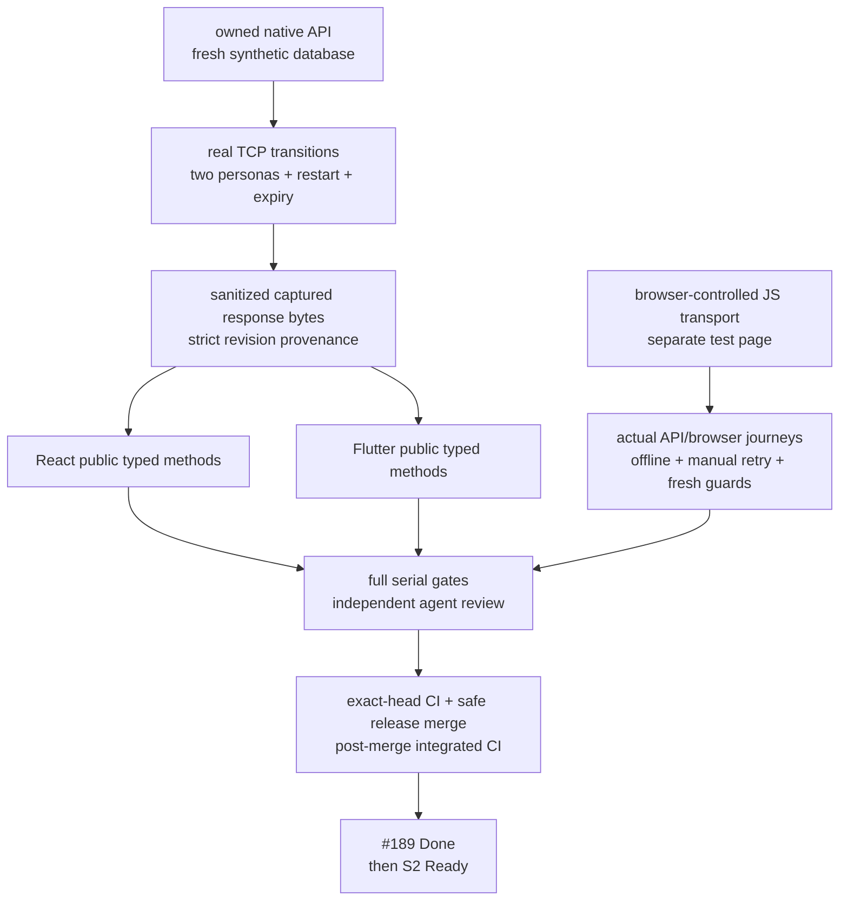

# Full S1 owned application acceptance

Story: [#189](https://github.com/IgnAite-Showcase/Finex/issues/189) · Tracker: [#184](https://github.com/IgnAite-Showcase/Finex/issues/184) · Target: `release/2026-W40` only.

Master: [V9.1](https://github.com/IgnAite-Showcase/Finex/blob/docs/v9.1-master-handbook/docs/governance/FinEx_Master_Product_Design_Delivery_Handbook_v9.1.pdf), pages 59–60 and 90–91, templates S1-CON-01/S1-UAT-01, FR-01 through FR-03. The [delivery supplement](../features/local-application/S1-S4-delivery-contract.md) freezes the owned API and its scope; this record does not replace the master or certify production authentication.

## Current status and provenance

**Formal S1 acceptance candidate, not yet accepted.** Its accepted W40 parent is `28631a0a70a0d77e4c5c011713044f7494ccef3d`, the squash merge of independently reviewed Flutter [PR #207](https://github.com/IgnAite-Showcase/Finex/pull/207). Its tree `ec80974ed25ea3e73a93cf83650735d34b5971a4` matches the tested Flutter candidate. All three post-merge checks passed: [release evidence](https://github.com/IgnAite-Showcase/Finex/actions/runs/38142551773), [S1 evidence](https://github.com/IgnAite-Showcase/Finex/actions/runs/38142551775) and [Flutter quality](https://github.com/IgnAite-Showcase/Finex/actions/runs/38142551637).

Anand answered “Yes. Keep CI free only.” to the explicit question asking for a $0 Actions paid-usage budget with “Stop usage when budget limit is reached” enabled. This is direct user attestation, not independent billing-API verification; the current member/token cannot read that setting. Resume only free-only CI and stop hosted runs if the free quota is exhausted. No available allowance, charges or billing-setting change is claimed.

Historical acceptance preparation started from the reviewed combined parent `0becfd89c776d46277e138a1b73b9fb50cf3bdf4`, with the same `ec80974ed25ea3e73a93cf83650735d34b5971a4` tree, in a separate detached workspace. The provisional runs recorded below exercised uncommitted/dirty preparation source. Their native reports identify that fact and source hashes; reporting only the parent SHA would not certify the changed source.

The later clean preparation freeze `0c089d18bb13c9231b52da3c28ad5c186b1aafe4`, tree `239640c6cf5c4a7a64b4fd4951a7d26f84a7f920`, passed its own clean native proof, full serial gates, independent changed-code review and redacted tracked-snapshot secret check. Its [exact evidence on #189](https://github.com/IgnAite-Showcase/Finex/issues/189#issuecomment-6106752489) remains historical preparation, not formal release acceptance.

The formal branch `feature/189-s1-full-acceptance-w40` is now created from accepted W40 `28631a0a70a0d77e4c5c011713044f7494ccef3d`, after #188 acceptance, with the reviewed preparation applied. Its updated provenance must receive fresh exact-commit/tree proof, independent review, tracked-snapshot secret checks, exact-head CI and post-merge W40 CI. Record executed results on #189/the PR rather than manufacturing a self-referential tested SHA in this file. No S2 implementation or Ready status is authorized by a provisional local result.

| Prerequisite | Accepted evidence | Remaining distinction |
|---|---|---|
| API #186 | [PR #205](https://github.com/IgnAite-Showcase/Finex/pull/205); 525 backend tests, native persistence/HTTP, secret snapshot and exact-head/post-merge CI | API slice, not full-client acceptance |
| React #187 | [PR #206](https://github.com/IgnAite-Showcase/Finex/pull/206); 170 tests, strict types/build, controlled UI and green head/post-merge CI; [record](s1-owned-react-acceptance.md) | Accepted React slice |
| Flutter #188 | [PR #207](https://github.com/IgnAite-Showcase/Finex/pull/207), accepted W40 `28631a0a70a0d77e4c5c011713044f7494ccef3d`; 232 tests, strict analysis/web build, controlled UI, six green head runs and all three post-merge checks above; [record](s1-owned-flutter-acceptance.md) | Accepted Flutter slice; Windows CI compile is not native GUI proof |

## What the proof must demonstrate

| Requirement / risk | Required evidence layer | Pass condition |
|---|---|---|
| FR-01 sign-in/out and isolation | Native TCP, store/atomicity regressions, both guarded clients | Stable approved persona identity; owner from bearer only; durable revocation and real expiry; other session/persona unaffected |
| FR-02 current versioned consent | Native transitions, strict shared wire cases, both clients | Valid notice/version/time; withdrawal invalidates; reacceptance alone never recompletes |
| FR-03 partial profile/resume | Native same-file process restarts and actual client reload | Nullable full-replacement draft; validated explicit completion; identical repeat preserves time, changed content invalidates |
| NFR authorization/configuration | Boundary/OpenAPI/launcher regressions | Local opt-in and loopback only, denied before DB where applicable, six protected operations documented without changing runtime status codes |
| NFR minimal data/privacy | Sanitized harness/corpus regressions and tracked secret snapshot | Synthetic aliases/labels only; bearer in memory; no login responses, headers, cookies or SQLite exported |
| NFR reliability/rollback | Atomicity/persistence suite and actual failure/manual retry | Failure does not claim saved/logged-out success; existing dirty input retained; no automatic mutation replay or startup reset |
| NFR accessible failure UX | Both client suites and recorded browser checks | Focusable React async alerts/invalid field; Flutter semantic live notices/retry/sign-out; bounded small-screen layout |
| NFR contracts/diagnostics | OpenAPI/DTO/version/meta tests; shared byte corpus | Required nullable keys, correct scope/versions/UTC and operation confirmations; no raw exception/token reflection |
| NFR resource/setup/architecture | Native runbook and serial component verifier | No Docker/cloud/emulator required; 8 GB component workflow; SQLite remains an adapter, not cloud-readiness proof |

A decoder cannot infer a previous profile value from one response. Changed-profile invalidation is tested as a **native transition**, not a fabricated stateless-decoder assertion. For captured validation/version errors, clients replay the response through a canonical typed method; they do not emit the server's deliberately invalid request. Successful cases additionally verify emitted canonical inputs.

## Tests-first preparation evidence

| Change | Actual command/result | Classification |
|---|---|---|
| Owned CI dependency/corpus/provenance/artifact gates | `python -m pytest -q --no-cov tests/unit/test_s1_ci_contract.py`: six assertion failures against the prior workflow, then six passed after the narrow workflow changes | Genuine RED → GREEN; no GitHub run was triggered |
| PowerShell wrapper tool preflight | `python -m pytest -q --no-cov tests/unit/test_s1_ci_contract.py tests/unit/test_s1_acceptance_launcher.py --basetemp <new isolated directory>`: nine passed | GREEN-only coverage; initial sandbox default-temp setup errors were tooling, not RED |
| Wrapper syntax and formatting | PowerShell parser passed; Ruff lint and format checks passed for the two root-authored test files | Local static checks, not full regressions |
| Node/npm lifecycle and relative tool paths | Two real launcher assertions failed for ignored/mismatched interpreter selection, then five passed; two additional relative-path assertions failed, then all seven passed. An independent reviewer reran seven successfully | Genuine launcher RED → GREEN, with an explicitly stubbed native proof; not application acceptance |
| Process environment cleanup | Two new absent-option assertions failed after both successful and failed stub proof; two existing-value/empty-value controls already passed. Explicitly removing originally absent options corrected the gap; all 11 launcher and seven CI assertions then passed together (18 total, 9.22 seconds), with lint/format passing | Genuine wrapper-lifecycle RED → GREEN; the stub never contacts an application API. Exact pre-call values/presence are restored on either outcome |
| Fixed probe server CI coverage | One added assertion failed for missing trigger/lint/test coverage, then seven CI assertions passed | Genuine CI-coverage RED → GREEN; no workflow was run in GitHub |
| Hosted-CI type-platform portability | The first formal PR head failed Linux mypy with two Windows-only standard-library attribute errors. The same two errors were reproduced locally with `--platform linux --python-version 3.13`. One added CI-contract assertion failed because only the default type platform was checked; after the narrow guard/workflow correction, both explicit platform checks passed (106 source files each), and eight CI plus 37 harness assertions passed together (45, 0.30 seconds) | Genuine CI-contract assertion RED → GREEN plus reproduced type-gate RED → GREEN. A separate sandbox attempt had nine fixture-directory setup errors; those are tooling failures, not TDD RED or application defects |
| PowerShell diagnostic portability | Corrected head `325ea2af5c21ed0677fe2e80807651218df0ef96` passed both hosted type targets, but Linux Pytest reported one launcher failure / 601 passed: terminal formatting split an expected error phrase. A new exact-message regression failed locally against the terminal-rendered output; the test-only invocation now catches the real exception and writes its full message directly to stderr with exit 1. All 12 launcher and eight CI-contract assertions then passed (20 total, 13.35 seconds) | Genuine diagnostic-harness RED → GREEN. Production wrapper/API behavior, nonzero failure, full message and no-proof assertions are retained; no test skip, regex removal, status suppression or CI bypass |
| Fixed asset server | Eleven isolated loopback HTTP tests passed: two fixed assets, no checkout listing/query reflection, no-store, network-denied CSP, HEAD and safe missing-build failure | GREEN-only helper coverage; only owned test listeners were reaped |
| API security documentation | One OpenAPI assertion failed because protected operations lacked the bearer scheme, then ten contract assertions passed | Genuine contract-documentation RED → GREEN; strict runtime 401/403/409/422 behavior preserved |
| Native harness | Initial 22 safety assertions failed against an explicitly incomplete fail-closed skeleton; nine added cleanup/semantic guards failed before fixes; a real first native run failed closed on Windows SQLite cleanup; two explicit-close regressions failed before correction; final 37 unit checks passed | Harness RED → GREEN, not fabricated API failures. The failed run wrote no successful corpus; its internally owned temporary DB was removed after verified child reaping |
| React shared-corpus reader | Seven added exact-case semantic guard assertions failed before correction; 174 fixture + baseline tests and strict types passed. Actual required-native capture + fixture + baseline then passed 261 tests | Harness-validation RED → GREEN; native provenance matched the actual checkout, no fallback |
| React namespace test isolation | The full suite with the documented configured API origin reproduced one failure in an older test that implicitly used configuration but hard-coded port 8000. The test now explicitly covers both loopback origins; its 60 focused assertions passed under both default and 8082 configuration, with independent read-only review | Genuine test-isolation RED → GREEN; exact scoped DTO, POST, omitted cookies and redirect rejection were retained. No production behavior was changed |
| Flutter response parity/privacy | Three diagnostic-reflection guard assertions failed before safe boolean comparisons; 29 focused tests passed with handcrafted data and separately with actual mandatory-native captured bytes | Test-harness RED → GREEN; illegal request cases remain response-only decoding replay |
| Controlled compiled Flutter JS checker | Empty/wrong Authorization checker unit controls failed before exact private comparison; three checker unit controls passed. Root then operated the actual compiled page and visibly verified all 13 browser outcomes PASS | Controlled browser Responses/streams/options, not real network, cookie-jar or device proof |

Full regressions, final source freeze, combined real-client UI checks and release CI are recorded only after execution, not predicted here. Tooling-only sandbox/Python/dependency failures are not TDD RED evidence.

### First formal candidate and scoped CI correction

The first clean formal commit `0fe3fe454b18c0fc8b35732761ce2231be7018c7`, tree `fae8d6e234ba0d5710308685ed7bd62dc8faa39a`, passed fresh serial native/full-client/secret checks and was published as [PR #208](https://github.com/IgnAite-Showcase/Finex/pull/208), head `26446486d3a6f0182199849fa9c708bfecc78705`, with that identical tree. This is not accepted release evidence: its [Linux backend CI](https://github.com/IgnAite-Showcase/Finex/actions/runs/38144048010) failed mypy on `socket.SO_EXCLUSIVEADDRUSE` and `subprocess.CREATE_NO_WINDOW`. The original local default Windows type check had passed.

The correction uses mypy-recognized `sys.platform == "win32"` guards, retaining Windows exclusive loopback binding and hidden child creation, while other platforms use no Windows constant. It does not suppress errors with Any/ignore or change application API behavior. The existing backend quality job now explicitly checks **both** Linux and Windows type targets at Python 3.13; the runbook and CI regression enforce that distinction. Local target typing is not a claim of running native Linux on Windows. The corrected clean commit needs its own native/full/secret proof, independent review and new exact-head CI; never merge the failed first head or reuse its native provenance as the corrected revision's certificate.

The clean type correction `7c9df5d7926eff18abdee7e602ce15bfc635c084`, tree `b9ede04404100b3ebc0d9b4f29eea3d567999462`, passed fresh local native/full-client/secret checks and independent review, recorded on #189/PR #208, and was published as head `325ea2af5c21ed0677fe2e80807651218df0ef96` with that identical tree. Its four other required PR workflows passed, but [backend CI](https://github.com/IgnAite-Showcase/Finex/actions/runs/38145902360) failed the terminal-rendered missing-Python diagnostic assertion (one failed / 601 passed, 947 warnings, 44.90 seconds). The prerequisite itself correctly rejected the missing interpreter before native proof. The narrow test-harness correction above makes exception capture independent of terminal color/wrapping; it does not change the production wrapper. This new revision still requires its own clean native/backend/secret proof, independent review, all exact-head checks and post-merge release checks. Earlier full client/build/browser results remain revision-bound historical evidence, not newly executed tests on this correction.

## Provisional local results (2026-10-11)

Root independently ran the complete serial `scripts/verify-s1.ps1 -Component All` with the existing Python 3.12.14, Node 24.19/npm 11.6.2 and Flutter 3.47.2/Dart 3.13.2 tools. It passed all 24 required native checks, then 202 React parity assertions and 29 Flutter parity assertions against its own newly captured native corpus. No handcrafted fallback was used for the required-native gate.

The native run started five owned loopback children, performed two real application restarts against the same fresh temporary database, waited 60.359 seconds for a real one-minute session to become invalid, reaped every owned child and removed that internally created database. The report recorded the actual parent commit/tree above, `working_tree_dirty=true` and 104 runtime source hashes; this remains a dirty preparation snapshot, not accepted clean-commit/release proof.

Sanitized artifacts retained in the local verifier's printed evidence directory:

| Artifact | SHA256 |
|---|---|
| `s1-owned-proof.json` | `414944433A0E9EB65509F07D89A1EDBD6ED215967392920E41ED821FEB903DCF` |
| `s1-owned-corpus.json` | `4081659896205EB03E55F90FC4233A7DFF746EE4A16BE9AB4AE884DD5313D965` |

The separate author native run also passed 24/24, including real expiry at 60.312 seconds; its capture hash was `9A1B43A03C31EA02735BA25DF3FC18EAC5F264B9D09E6437AB71AF2A72B22CF4`. Both client authors independently required that real capture. These runs have different honest timestamps/identities and therefore different byte hashes; neither is the handcrafted fixture.

Final full backend gates passed after the environment-cleanup correction: Ruff lint, Ruff format (182 files), `python -m mypy app verify_s1_application.py verify_r0_thin_slice.py verify_s2_risk.py verify_secret_snapshot.py` (106 source files), and `python -m pytest --basetemp <new isolated directory> --cov=app --cov-report=term-missing --cov-fail-under=70`: **601 passed**, 947 reported deprecation warnings, 60.25 seconds, **83.39% coverage** against the unchanged 70% threshold. The local boundary/router/DTO each reached 100%, local service 99%, SQLite adapter 97%. The earlier 597-test run preceded the four new wrapper-lifecycle controls. This does not certify legacy unimplemented portfolio routes or S2 behavior.

Root then ran the full React suite with `FINEX_REQUIRE_LOCAL_S1_CORPUS=1`, its own native corpus above and `REACT_APP_FINEX_API_BASE_URL=http://127.0.0.1:8082`: **15 suites / 373 tests passed**, 16.833 seconds. Standalone `tsc --noEmit` passed and the production build compiled successfully (**72.86 kB JS / 3.51 kB CSS gzip**). Both npm and lifecycle children used the existing Node 24.19 process-only PATH. Earlier Router future/dependency deprecation warnings remain visible. A separate runner attempt with a present-but-empty optional environment variable failed the fail-closed corpus preflight; that runner configuration error is not counted as TDD RED or a production defect.

Root full Flutter gates also passed serially: `flutter analyze --no-pub --fatal-infos` reported no issues (6.4 seconds), `flutter test --no-pub --concurrency=1 --reporter=expanded` passed **261 tests**, and `flutter build web --no-pub --dart-define=FINEX_API_BASE_URL=http://127.0.0.1:8082` compiled successfully in **49.7 seconds**. These full Flutter regressions used the labelled fixture; the separate mandatory-native 29-case run above used the real capture. Existing cached dependency configuration was reused; the preparation workspace's offline pub attempt encountered Windows plugin-symlink prerequisites, and no OS setting was changed. This is not fresh-laptop or native-device proof.

The newly compiled app artifacts used for the combined browser repeat are not committed:

| Artifact | SHA256 |
|---|---|
| React `build/index.html` | `C59A4F00BCD30B30A8629C59214530B5B27E21FD37D4E7637E351EE68E53D9C5` |
| React `build/static/js/main.965af615.js` | `2DA6368A4EC5AC15103F999FCB2836DD51B2ED6B34042ED158C635E7EF32C91A` |
| Flutter `build/web/index.html` | `4257872A59859886248FA8CF67CAB8B31E2559340F86C8C99EB0583C945F4081` |
| Flutter `build/web/main.dart.js` | `818F0243D0D9FC579E199FAD33045190A77139E4A8E0B9F9D1DFCB8BAE94B670` |

The actual compiled controlled-browser probe passed 13/13 through the browser UI. Root inspected its accessibility result and inline screenshot, then closed only its temporary test tab. No saved screenshot file is claimed. Compiled JS SHA256: `2BDA0A0B636ABB7D65E66693D8A24C6BAC89CE7FE5E4C1787D538C0DD5F4CD33`. This is a separate test page with network-denied CSP, not a claim that the production app contacted an API or exercised a native device.

## Actual combined browser / native-process repeat

Root served the newly compiled app artifacts above on the isolated loopback test ports 3003/3004, against this preparation API on 8082 and a newly created **unsynced, synthetic-only** SQLite file. The prior developer API8000, clients3001/3002 and earlier acceptance API8081/data were untouched. Input came only through visible app controls; no bearer, storage credential, request header or login-response bytes were inspected.

- React cold launch required synthetic sign-in. Invalid Complete focused the missing display label and showed the validation message. Saving `S1 combined learner A` with no experience confirmed a partial draft at `2026-10-11T07:10:56.905936+00:00`; reloading deliberately returned to sign-in.
- Flutter signing into the same learner resumed that exact partial label/time. Recording consent did not complete onboarding. Choosing beginner and explicitly completing saved the profile at `2026-10-11T07:11:43.574847Z` and completion at `2026-10-11T07:11:43.675563Z`. React subsequently loaded the same values and passed its fresh dashboard gate.
- Flutter confirmed withdrawal at `2026-10-11T07:11:55.826151Z`. React's next protected risk entry returned to onboarding. React reacceptance at `2026-10-11T07:12:03.085093+00:00` alone still could not open the dashboard; explicit completion at `2026-10-11T07:12:14.553566+00:00` restored access. Flutter Reload showed that authoritative state without its obsolete withdrawal receipt.
- Confirmed React logout and learner-B sign-in showed an empty independent profile with no accepted consent. Learner-A remained signed in in Flutter. No synthetic persona copied the other's progress.
- Root entered different unsaved labels in both clients, verified the exact owned API8082 process/listener and stopped only that process, preserving its database. Both real failed Save actions showed safe unavailability and retained input; neither claimed a successful save. Both failed Sign out actions retained their learner/form and exposed accessible, enabled explicit retry controls. Flutter's actual screenshot and semantic tree included the failure and **Retry confirmed sign-out**.
- Restarting the same API/file allowed both real sign-out retry controls to confirm logout. Subsequent sign-in resumed learner-A's exact original saved label, draft/consent/completion times: neither unsaved failed-save label had overwritten that progress. One initial non-mutating React dashboard check returned truthful API unavailability while a separate loopback liveness check was healthy; its visible explicit retry succeeded. The precise transport phase is unknown, and no deterministic source defect or invented fix is claimed.
- The restarted test API issued new **one-minute** sessions. Both clients initially loaded the same persisted completed state; without reload, mock responses or clock manipulation, both later returned to sign-in and visibly stated the local session had ended. This proves the compiled clients' real-time expiry UI, not which internal timer/request caused each transition. The independent native harness above separately proves real server rejection after expiry.

Root inspected the real UI screenshots inline, then closed only the two temporary test tabs. After revalidating command lines and listener ownership, root reaped only the four new acceptance/probe processes and removed their internally generated disposable synthetic browser database; it is regenerable test data, not developer data. The earlier compiled test servers were restored. No saved screenshot file or native-device GUI evidence is claimed. Earlier narrow-screen/keyboard client-slice checks remain explicitly in their own acceptance records; this new combined repeat does not invent a fresh small-screen or human-UAT run.

## Reproduction and artifact boundaries

After bootstrap, use the [native runbook](../runbooks/native-local-application.md) and `scripts/verify-s1.ps1 -Component Backend|React|Flutter|All`. The component selector is explicit: Backend alone does not claim both clients passed. The verifier creates a fresh unsynced temporary DB, starts and reaps only its owned loopback child, preserves that same DB across restarts and waits for real one-minute expiry. It has no option to target a running developer server/database or reset saved developer data.

The Python CLI produces only new report/corpus files; it does not overwrite an existing evidence file. Both clients require the generated corpus when `FINEX_REQUIRE_LOCAL_S1_CORPUS=1`, reject malformed/incomplete/wrong-revision provenance and never silently fall back to the separately labelled handcrafted fixture. CI retains only those two allowlisted sanitized files for seven days. No child logs, login/token/header records, databases, WAL/SHM files or arbitrary directory glob is uploaded.

The browser-controlled Flutter web probe is a test-only Dart-to-JS page, not a production route, server/network proof or native GUI. It executes the default conditional transport using browser Response/arrayBuffer/ReadableStream objects. Root-operated UI checks must be recorded separately. Do not claim compiled JavaScript/cookie behavior based only on a Dart MockClient test.

## Acceptance and rollback ledger

| Gate | Current status |
|---|---|
| New harness/OpenAPI/shared corpus implementation and focused regressions | Independently reviewed formal type correction `7c9df5d7926eff18abdee7e602ce15bfc635c084`; new diagnostic-only regression passed locally, independent review/freeze pending |
| Real native TCP/restart/expiry report and both required-corpus parity gates | Clean formal type correction passed 24 native / 202 React / 29 Flutter, real expiry 60.078 seconds, five starts/two restarts and cleanup; report/corpus hashes are recorded on #189/PR #208. A fresh report must identify the new diagnostic-correction commit, not this historical SHA |
| Actual compiled JS probe and combined UI acceptance | Controlled compiled page 13/13 and the real combined browser/API journeys above passed on preparation builds; agent-operated web evidence, not human UAT/native-device acceptance |
| Full backend lint/format/mypy/coverage, React tests/types/build, Flutter analysis/tests/web build | Formal type correction passed backend 602 / 83.39%, both type targets, React 373 with mandatory-native corpus plus strict types/build, and Flutter 261 with mandatory-native corpus plus strict analysis/web build. These remain revision-bound local results; the new test-only correction needs fresh backend/native gates and all exact-head client CI before acceptance |
| Frozen local commit/tree, independent changed-code review, tracked snapshot secret check | Formal type correction's clean tree, independent review and tracked secret check passed and matched published head `325ea2af5c21ed0677fe2e80807651218df0ef96`. The new diagnostic revision needs its own independent review and exact-commit secret/proof record; no dirty or historical report certifies it |
| Published #189 PR, exact-head and post-merge W40 CI | PR #208 is open. Head `325ea2af5c21ed0677fe2e80807651218df0ef96` has four required PR workflows green but failed backend diagnostics; never merge that failed head. New correction publication/all-green exact-head and post-merge checks remain pending. Free-only cost guard is user-attested, not independently verified |
| #189 Done / S2 Ready | Not accepted / not Ready |

Rollback is a reviewed forward-fix, or disable the local feature while preserving data. A prior schema-compatible binary may be used only after checking schema compatibility and retaining a safe SQLite backup. Never reset the database, rewrite consent/history, force-push or promote main/dev/uat/prod as a shortcut. The accepted release reference above is provenance, not an instruction to overwrite another checkout.

External #129 fresh-laptop evidence, #132 credential-owner action, #134 cloud/auth/provider/deployment/cost approval, native-device GUI and human UAT remain explicit external gates. Delegated technical agent review does not fabricate any of those approvals. No real PII, real money, live-market guarantee or production-readiness claim is made.
