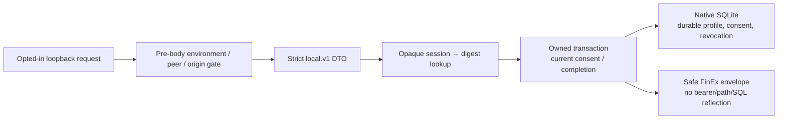

# S1 owned local API: delivery evidence

Story [#186](https://github.com/IgnAite-Showcase/Finex/issues/186), release `release/2026-W40`. Contract: [S1–S4 supplement](../features/local-application/S1-S4-delivery-contract.md); master V9.1 S1 pages 57–60, FR-01–FR-03 and the shared ownership/privacy requirements. FR-04 (the risk questionnaire) belongs to S2. This accepts only the API/native storage slice. React #187, Flutter #188 and cross-client acceptance #189 remain separate gates.

## What changed

Synthetic `learner-a` / `learner-b` selection is not real-person authentication. Tokens are random, memory-only on the client and digest-only in storage. The server does not trust correlation IDs, forwarded IPs, supplied owner IDs or historical client flags as ownership. Later domain writes must use `authorized_transaction(..., onboarding_required=True)` inside the same transaction as the mutation.

## TDD and native verification

Actual local interpreter: Python **3.12.14**. CI must separately pass the repository's Python **3.13** toolchain. Commands below are from `backend` unless marked repository root; `python` refers to the existing native validation interpreter, not a new cloud/container runtime. Each pytest invocation used `-p no:cacheprovider` and a unique temporary `--basetemp`, never the developer's saved DB.

| Check | Actual result before independent-review corrections |
|---|---|
| Root: `python -m pytest backend/tests/contract/test_local_s1_api.py -q --no-cov` | RED: 25 failed for missing behavior; GREEN: 25 passed after implementation. |
| Root: settings + contract suites | RED: 4 failed / 43 passed for TTL parsing, origin ports and first nullable draft timestamp. |
| Root: `backend/tests/test_local_request_boundary.py` | RED: 9 failed for pre-body denial, trace bounds/redaction and body-key reflection. |
| Read-only UOW + native-file settings tests | RED: 3 failed before enforcing query-only reads and rejecting memory/URI storage. |
| Root launcher boundary tests | RED: 3 failed for non-loopback binding; then 1 failed / 3 passed for missing safe dry-run/log flags. GREEN: 4 passed. |
| Full `python -m pytest -q --tb=short` | 487 passed, 83.31% total coverage (401 baseline + 82 S1 + 4 launcher). |
| `python -m ruff check .`; `python -m ruff format --check .` | Passed; 174 files already formatted. |
| `python -m mypy app verify_r0_thin_slice.py verify_s2_risk.py verify_secret_snapshot.py` | Passed, 105 source files. |
| `git diff --check` | Passed. |

The independent reviewer found two additional failure-path cases through independent probes: embedded bearer text / malformed Authorization could be echoed in a trace, and a malformed stored timestamp could escape the safe storage envelope. Corrections were tested first: trace regressions initially gave **2 failed / 1 passed**; the further single-part header and persisted-time matrix gave **12 failed / 5 passed**, then **20 passed** after correction. Five additional BLOB timestamp cases failed before the stored-type guard; three delimiter variants failed before generalized bounded token-window redaction. Both are now covered, without printing raw tokens.

Final frozen implementation gates passed:

| Final gate | Actual result |
|---|---|
| Full `python -m pytest -q -p no:cacheprovider --basetemp <unique-temp> --tb=short` | **525 passed**, **83.38%** total coverage, 28.54 seconds in the author's final run; 401 baseline + 124 S1/review/launcher tests. |
| Ruff lint + format check | Passed; **175** files already formatted. |
| Mypy command above | Passed; **105** source files. |
| Independent S1 suites with isolated temporary DBs/no shared cache or coverage output | **124 passed**, 9.76 seconds. |
| Additional independent diagnostic probes | **13 passed**: arbitrary malformed separators, token in another auth part, 64 KiB Authorization, 128-character trace boundary and safe static diagnostics. No raw values printed. |
| Permanent independent invariants | **10 GREEN-only tests** in `tests/integration/test_local_s1_atomicity.py`; real SQL precommit pause/competing write proves revocation and withdrawal ordering, plus rollback, exact TTL, per-session revocation and digest-only storage. No invented RED phase for behavior already implemented. |

The independent agent accepted the corrected implementation; it authored verification tests, not the application code. Its frozen 23-path source/test/launcher manifest (sorted `path|fileSHA256`, joined with LF) is SHA-256 `34FF0E2711DF34E009D29B857C129177F62FEDB84AFA7F07B852217E74F22B2B`. Critical reviewed file hashes: middleware `D1E9300A62264E6E80BFA9530B8A185E4B12E41B7A2E30D3B23767E54F3E2B21`; native adapter `27C55A51B7BDACAE3D6E6DBD7237DDA1DCE13D645A6779789885FC6F199890EF`. These are local reviewed-file provenance, not a claim that Windows and Linux line endings have identical raw hashes.

Existing legacy datetime/lifespan deprecation warnings remain and were not hidden or converted into a weakened gate. Release acceptance still requires the **exact committed/published tree**, green PR CI, the scoped release merge and green post-merge CI. Those SHAs, workflow results and review readback are recorded in the PR/story; implementation review is not a fabricated human approval or full S1 acceptance.

## Real local HTTP and process restart

Executed the new API in a separate native process on `127.0.0.1:8081` with `LOCAL_APP_ENABLED=true`, an isolated ignored `backend/.local/s1-api-smoke-20261011.sqlite3`, the two test-client loopback origins, `LLM_PROVIDER=none`, and `MARKET_DATA_PROVIDER=mock`. Direct uvicorn execution included `--no-proxy-headers --no-access-log`; this bypassed only the absent worktree virtual environment, not application safeguards.

Actual assertions passed:

- Initial consent is null; draft nullable fields are present. A partial draft saves without claiming completion.
- Accepted consent plus an incomplete profile returns `409 PROFILE_INCOMPLETE` on completion.
- A valid profile explicitly completes; repeat completion preserves its timestamp.
- Learner B remains empty while learner A has saved consent/profile/completion.
- An unapproved Origin returns `403`; forged forwarded-peer text does not replace the actual loopback peer.
- An exact-token correlation ID is replaced. Logout makes the previous session return `401 SESSION_INVALID`.
- OpenAPI includes all seven local auth/onboarding paths.
- After stopping and starting a **different server process against the same file**, learner A retained the same ID and completed state; learner B retained its distinct ID and empty state.
- Raw HTTP completion timestamps were verified as UTC (`Z` / `+00:00`), rather than relying on PowerShell's local DateTime conversion.
- DB/WAL/SHM paths were confirmed ignored with `git check-ignore`. No bearer was printed, pasted into evidence or persisted by the smoke driver. Both smoke sessions were signed out and the isolated server stopped.

The existing user pilot on ports 8000/3001/3002 was not restarted or reset.

## Acceptance boundaries and rollback

Use [the native runbook](../runbooks/native-local-application.md) for setup, low-memory execution, safe inspection and SQLite-aware backup. Unsupported/foreign schemas fail closed without changing their bytes or journal mode. No destructive reset or migration command is supplied. `LOCAL_APP_ENABLED=false` disables the new routes while preserving the database; rollback is a schema-compatible corrective feature PR, not erased state or rewritten history.

Not claimed: real identity verification, React/Flutter acceptance, fresh developer-machine validation (#129), historical credential revocation (#132), cloud readiness/deployment (#134), paid/live market or AI providers, or any promotion to `main` / `dev` / `uat` / `prod`.
