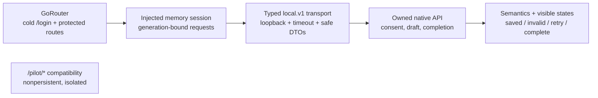

# S1 Flutter owned application: delivery evidence

Story [#188](https://github.com/IgnAite-Showcase/Finex/issues/188), FR-01–FR-03, NFR-01/03/05/06/07/09/10. V9.1 S1-MOB-01, pages 59–60 and 91. Contract: [local.v1 supplement](../features/local-application/S1-S4-delivery-contract.md). Approved release: `release/2026-W40` only.

This working record is not yet client acceptance. The accepted API dependency is [PR #205](https://github.com/IgnAite-Showcase/Finex/pull/205), W40 `deef08e3424c62348e1fd571709a08ea53f05053`; its tested/published/merged tree is identical and all exact-head/post-merge workflows passed. React #187 and full cross-client S1 #189 remain separate gates.

## One contract, an injected client boundary

SharedPreferences completion flags and the older mock identity are not authority for the full app. The injected session holds an opaque bearer in memory only. A cold client signs out; selecting the same synthetic persona resumes durable server progress. A failed network logout must show retry rather than falsely claim revocation. Current-session expiry/401 and persona change clear owned state; stale requests must not affect a newer session.

## Actual tests-first provenance and tooling

Local toolchain: installed Flutter **3.47.2**, Dart **3.13.2**, DevTools **2.60.0**, satisfying the repository Dart 3.13 constraint. Work occurred in the dedicated `feature/188-s1-flutter-owned-journey-w40` worktree, not the user's original main checkout or running Flutter pilot on port 3002.

| Stage | Actual result |
|---|---|
| `flutter pub get --offline` | Cached dependency resolution produced valid package configuration; command exited 1 at Windows plugin symlink setup because Developer Mode/symlink support is unavailable. No OS/SDK setting was changed. |
| Unchanged baseline: `flutter analyze --no-pub --fatal-infos` | Exit 0; no issues. |
| Unchanged baseline: `flutter test --no-pub --concurrency=1 --reporter=expanded` | Exit 0; **67 tests passed**, about 28 seconds. |
| New `local_app_baseline_red_test.dart` against unchanged app | **0 passed / 2 failed**, exit 1: cold-launch approved synthetic sign-in is absent and legacy completion remains authoritative. These are real behavior failures, not missing dependencies/imports. |
| Early transport negative probes | Three genuine RED behavior gaps were reproduced: non-401 response carrying `SESSION_INVALID`, stalled-body HTTP 401 and loopback port 0. After correction, these probes plus the two cold-launch/legacy-flag assertions were **5/5 GREEN**. This is targeted author evidence, not final client acceptance. |
| Operation-specific confirmation probes | **5 genuine RED failures**, then GREEN: normalized nullable draft matches the request with a saved timestamp, consent records the exact current-version decision, and completion returns valid completed state. A well-formed but contradictory success DTO is rejected. |
| DTO/session targeted GREEN | **72/72 passed**: stale A login/me/state/mutation/logout success or 401 cannot affect B; only actual current-session 401 ends authorization; failed logout retains retryable state; withdrawal/re-entry and UTC/version/nullability are checked. UI/full gates remain separate. |
| UI/HTTP targeted GREEN | Author ran **72/72 GREEN**, including 320 px / 200% text-scale rendering and visible failed-save feedback. These are widget/transport tests, not browser or device proof. |
| Final isolated dependency resolution | A later `flutter pub get --offline` completed with **exit 0 / Got dependencies**, using cached locked packages. The initial symlink failure is retained above; no OS/SDK settings were changed and this cached setup is not fresh-laptop proof. |
| Full strict analysis | Author ran `flutter analyze --no-pub --fatal-infos`: **exit 0 / No issues**. |
| Full serial regression | Author ran `flutter test --no-pub --concurrency=1 --reporter=expanded`: **216/216 passed**, preserving all 67 baseline tests plus 149 new tests. |
| Working-tree whitespace | Author ran `git diff --check`: exit 0. The final committed-tree check remains a separate gate. |
| Pre-review web build | `flutter build web --no-pub --dart-define=FINEX_API_BASE_URL=http://127.0.0.1:8081`: exit 0; **46.7 seconds**, `build/web` produced. A successful Wasm dry run is not a tested Wasm application target. |

Implementation GREEN results, strict full gates/build, independent review, real API/browser parity and exact committed/published/merged SHAs are appended only after actual verification. No test, build or device evidence is invented here.

## Targets, limitations and recovery

The active implementation is in `frontend_flutter`, not the disconnected `mobile-flutter` placeholder. Full application and `/pilot/*` compatibility use separate state and contracts. A Flutter web build/browser smoke is evidence for that target, not Android/iOS device validation. Windows native build depends on local symlink support and the installed C++ toolchain; its result and independent Windows CI result are recorded separately. Missing native prerequisites are not hidden by changing OS settings or weakening analysis/tests.

Use [the native runbook](../runbooks/native-local-application.md) and the client README's exact public API-origin configuration. One API plus one client is the intended 8 GB development mode; run tests serially and avoid simultaneous React/Flutter builds. API fixtures and saved data remain strictly synthetic. No real OAuth/provider credentials, client financial calculations, paid services, public distribution, downstream branch changes, intern reassignment or legacy-card closure.

Acceptance requires the frozen reviewed tree, full relevant gates, actual local API/client proof, green exact-head CI, a scoped W40 merge and green post-merge checks. Independent agent technical review is not a fabricated human pair approval. Full S1 #189 and fresh-laptop/credential-owner/cloud gates remain separate.

The new full-app control palette uses white on solid `#047857` (**5.48:1**) with visible focus, leaving the compatibility pilot theme unchanged. Final semantics, text-scale, responsive and actual-target checks remain part of the pending frozen-client review; this scoped contrast measurement is not a complete accessibility certification.

## Actual browser proof on the pre-review candidate

Root served compiled Flutter web on `127.0.0.1:3004` against the accepted native API on `127.0.0.1:8081` and a new ignored synthetic SQLite file. Old user demos and API8000 were untouched. Flutter web semantics were activated with the visible **Enable accessibility** control using Enter, then the real journey used semantic controls; no token/header or real data was inspected.

- Flutter signed into learner-A and visibly resumed the partial display label previously saved from React, with its exact saved UTC time and no false completion.
- Selecting beginner and recording current educational consent did not complete onboarding. Explicit Complete saved the owned profile, confirmed server completion and offered Continue to saved dashboard; the real dashboard showed only saved S1 state and honest pending later features.
- Consent withdrawal cleared completion. React's next protected route also gated that persona; React reacceptance required explicit recompletion.
- The actual Flutter web viewport was **320 x 800**, with document width **320 px**. The notice, checkbox, controls and saved-state text wrapped without horizontal overflow. The temporary browser viewport override was restored.
- With only isolated API8081 stopped, a real sign-out failure visibly retained learner-A/form state, stated revocation was not confirmed and displayed a retry action. The pre-fix Flutter web semantic snapshot omitted that visible error/retry region, so final semantics/retry verification remains required. Restarting the API against the preserved file allowed the accessible app-bar Sign out action to revoke the session.

Independent review found an injected session/API replacement lifecycle/ownership gap and default native HTTP environment-proxy routing. Genuine RED regressions and scoped fixes are recorded below. The pre-fix web build/proof is not final acceptance and does not prove native transport execution. Rebuilt browser proof, exact committed/published tree and CI remain required.

## Review-driven corrections and final local gates

The author reproduced eight genuine lifecycle RED regressions for same-key injected session/API replacement, captured session ownership/disposal and stale callback isolation; corrected them without changing server state. A native Dart HTTP regression genuinely observed the synthetic request reaching an isolated test proxy before the transport was changed to an explicit **DIRECT** `HttpClient`/`IOClient`. No real token or proxy environment value was printed, and no global networking setting was changed.

A 320 x 360 / 200% text-scale failed-logout probe reproduced **546 px** of overflow. A bounded independently scrollable banner/retry region corrected the layout. Enabled semantic-tree regressions then reproduced the actual browser omission: the nested router Navigator's `BlockSemantics` hid the shell banner/retry. Explicit semantic boundaries for the route child and safe live-region notices corrected the source; both desktop and compact probes assert the safe label, live-region flag, enabled/tappable retry and confirmed return to login. These are tests-first source fixes, not changes to browser selectors.

Final author commands on the corrected client:

- `flutter analyze --no-pub --fatal-infos`: **exit 0 / No issues**, 8.5 seconds.
- `flutter test --no-pub --concurrency=1 --reporter=expanded`: **228 tests passed**, 34 seconds, preserving 67 baseline tests plus 161 new tests. Twelve review-driven regressions are included.
- `git diff --check`: exit 0.

The corrected web rebuild completed with exit 0 in **48.4 seconds**: `flutter build web --no-pub --dart-define=FINEX_API_BASE_URL=http://127.0.0.1:8081`. A Wasm dry-run success is compile tooling evidence only, not a tested runtime/device.

An independent agent reviewed all 30 changed client paths and reran the corrected lifecycle/ownership nine, enabled-semantics two, and isolated native-DIRECT/proxy one: **12/12 passed**, 7 seconds, exit 0. No remaining concrete source blocker was found in that reviewed scope. The frozen client fingerprint (sorted `path SHA256`, UTF-8 LF lines) is **`A977F9F11397926A6EB877D572A93DB474D33306D83A6F1A9B444E3ACE7F8D74`**. This is technical agent review, not human-pair approval or actual native-device interaction.

The root actual-browser repeat and committed/published/release gates are still pending; these local results alone do not mark #188 Done.

## Corrected production-build browser and native-process proof

Root reopened the corrected compiled Flutter candidate rather than reusing the pre-review browser document. On the isolated API8081 and preserved synthetic SQLite file, React and Flutter independently loaded learner-A's saved draft, consent and completion; learner-B remained separate. Protected React entry after Flutter withdrawal returned to onboarding. Reacceptance alone remained incomplete; explicit completion restored the server gate.

One initial Flutter withdrawal returned a truthful safe transport error. A separate synthetic memory-only API probe confirmed it had not committed, and a bounded manual retry succeeded. Its precise transport phase is unknown; no invented cause or deterministic source fix is claimed.

With only the verified isolated API8081 process stopped, both the actual desktop Flutter semantic tree and a **320 x 800** Flutter viewport exposed the safe failed-sign-out notice and enabled **Retry confirmed sign-out** control. The learner/form remained present rather than falsely claiming revocation. The compact document width was **320 px**; screenshots were inspected. Restarting the API against the same file allowed the real retry to confirm sign-out. Signing into learner-A again resumed the exact saved draft, consent and completion timestamps also displayed by React. The old user servers on 8000/3001/3002 were untouched; temporary browser viewports were reset and agent-only test tabs closed.

### Final review correction: stale action receipts on reload

The root browser repeat found a concrete contradiction: Flutter showed accepted, completed server state after another client recompleted onboarding, but retained its earlier withdrawal success notice. The author wrote `test/local_reload_notice_red_test.dart` before correcting that behavior: **3 genuine RED failures and 1 already-passing control**, then **4/4 GREEN**. The cases cover withdrawal followed by external recompletion, completion followed by external withdrawal, failed reload/retry reviving an old receipt, and the safe failed-consent control. Positive controls are not counted as RED.

The scoped correction clears only the historical success notice before explicit reload or load-error retry. It does not discard unsaved fields or current validation. Final author commands:

- `flutter analyze --no-pub --fatal-infos`: exit 0, no issues.
- `flutter test --no-pub --concurrency=1 --reporter=expanded`: **232/232 passed**, 37 seconds, preserving all 67 baseline tests plus 165 new tests.
- `flutter build web --no-pub --dart-define=FINEX_API_BASE_URL=http://127.0.0.1:8081`: exit 0, **45.3 seconds**.
- `git diff --check`: exit 0.

An independent agent reviewed the two changed paths and independently reran the four-case test: **4/4 passed**, runner 3 seconds, tool wall time 8.84 seconds. The notice-only change was technically approved without pretending to be human-pair approval or native-device UAT. Final frozen **31-path** client fingerprint: **`0A1FFF0360D0947640D3F8AED741002AA1F48BC3F19B9E487EDE9EEFB8E801E7`** (en-US sorted forward-slash path, one ASCII space, uppercase file SHA256, UTF-8 LF including terminal LF). Final compiled `main.dart.js`: `8EE0A0E198A5B7739038CF3AEF3FD97ED63FCEB51979038CA6876FF58B1EADC2`; `index.html`: `4257872A59859886248FA8CF67CAB8B31E2559340F86C8C99EB0583C945F4081`. Build files are not committed.

Root reopened that final build and used real semantic controls to reproduce both change directions. Flutter confirmed withdrawal; React then explicitly accepted and completed onboarding at `2026-10-11T06:13:42.001018+00:00`. Flutter Reload displayed that authoritative completion, removed the old withdrawal receipt, and visibly retained `S1 unsaved reload check` without claiming it was saved. After Flutter confirmed completion and React withdrew consent at `2026-10-11T06:14:11.421761+00:00`, Flutter Reload showed incomplete onboarding, removed the obsolete completion receipt and retained `S1 unsaved reverse reload`. Screenshots and visible semantic states corroborated the narrow source regression.

Root also stopped only the reverified isolated API8081 process without changing the file, then used Flutter's actual Reload control. The screen truthfully reported the API unavailable and exposed **Retry loading saved onboarding**, without the earlier consent-success receipt. After a native-process restart against the same file, that real retry loaded accepted consent at `2026-10-11T06:14:34.663589Z`, retained the visible unsaved `S1 unsaved reverse reload`, left onboarding correctly incomplete and did not revive the obsolete receipt. No mock response or reset was used. Both temporary browser sessions were then explicitly signed out.

The final source review, tests/build and corrected browser checks are complete for publication. Exact committed/published tree, required head CI, safe W40 merge and post-merge CI remain separate publication gates. Full integrated S1 #189, fresh-laptop, actual native-device, credential-owner and cloud acceptance are not claimed by this client record.

### Combined release-base verification

The Flutter worktree was safely fast-forwarded, without reset or loss of its reviewed changes, to React's W40 merge **`765535270eb6d11f098ea86154d0dcdef758aba7`**. That base changed only React and its four scoped documents; `git diff --name-only deef08e3 HEAD -- frontend_flutter` was empty. On this combined base the author reran `flutter analyze --no-pub --fatal-infos` (**no issues, 9.5 seconds, exit 0**) and `flutter test --no-pub --concurrency=1 --reporter=expanded` (**232/232 passed, 37 seconds, exit 0**). The 31-path source fingerprint and both compiled hashes above remained identical before/after the rerun, so no rebuild or source change was needed. `git diff --check` also passed. Release CI remains independently checked before publication/acceptance.
