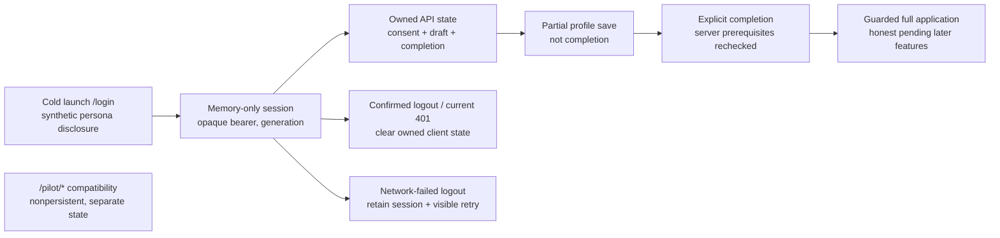

# S1 React owned application: delivery evidence

Story [#187](https://github.com/IgnAite-Showcase/Finex/issues/187), FR-01–FR-03, NFR-01/03/05/06/07/09/10. V9.1 S1-WEB-01, pages 58–60 and 90. Contract: [local.v1 supplement](../features/local-application/S1-S4-delivery-contract.md). Approved release: `release/2026-W40` only.

This working record is not yet client acceptance. The accepted API dependency is [PR #205](https://github.com/IgnAite-Showcase/Finex/pull/205), W40 `deef08e3424c62348e1fd571709a08ea53f05053`; its local, published and merged trees match and its six exact-head plus three post-merge workflows passed. Flutter #188 and full cross-client S1 #189 remain separate gates.

## Authority and visible states

The full application must not mount the historical default-authenticated provider. Legacy localStorage flags, correlation IDs and unapproved mock mode cannot grant access. The client displays backend state; it does not calculate identity, consent validity or authoritative completion. Loading, invalid responses and failures cannot become success.

## Actual tests-first provenance

Local Node: **24.19.0**, bundled runtime; npm **11.6.2** invoked from the installed npm CLI with a process-only PATH. CI separately uses the repository's **24.20.0** pin. Locked dependencies were installed in this isolated worktree with a dedicated temporary npm cache; the user's existing client on port 3001 was untouched.

| Stage | Actual result |
|---|---|
| Unchanged accepted API-base client: `CI=true npm test -- --runInBand --watchAll=false --no-cache` | 10 suites / 65 tests passed, 13.037 seconds. |
| Unchanged baseline: `CI=true npm run build` | Compiled successfully; 75.63 kB JS / 2.29 kB CSS gzip. |
| Before implementation: `CI=true npm test -- --runInBand --watchAll=false --no-cache --runTestsByPath src/App.local.test.tsx` | **8 failed / 8 total**, 6.504 seconds, for genuine behavior gaps: cold launch/root, legacy storage authority, four unguarded full routes and pilot separation. No missing import or tool failure is counted as RED. |
| Typed transport before/after implementation | Author observed **27 failed / 1 passed** contract tests, then **28 passed**. Cases cover unsafe origins before fetch, scoped/versioned DTOs, UTC/nullability, omitted cookies, forbidden redirects and bounded fetch/body reads. |
| Memory session before implementation | Author observed **16 failed / 2 passed** of 18 context tests: identity/persona validation, stale login/state/mutation/401/logout, truthful failed logout, no browser credential storage and fresh server state. |
| Targeted context plus transport GREEN | **46 tests passed**, 2.332 seconds. This is targeted author evidence, not full client or browser acceptance. |
| Active form/journey before implementation | Author observed **11/11 genuine RED** behavior failures against the unchanged active app. Additional RED regressions reject unconfirmed draft/consent/completion responses and mutable request snapshots. |
| Full client regression after implementation | Author ran `CI=true npm test -- --runInBand --watchAll=false --no-cache`: **14 suites / 143 tests passed**, 14.207 seconds; all original 65 regressions plus 78 new tests. This is full local test evidence, not browser or release acceptance. |
| Standalone strict TypeScript | Author ran `node node_modules/typescript/bin/tsc --noEmit`: exit 0 after correcting test-only Jest mock signatures; application types were not weakened. |
| Final pre-review freeze rerun | **14 suites / 143 tests passed**, 13.333 seconds, after the test-helper type correction. |
| Pre-review production build | `CI=true npm run build`, public API origin `http://127.0.0.1:8081`, process-only 1536 MB Node heap: compiled successfully; **72.64 kB JS / 3.51 kB CSS gzip**. Only a dependency `fs.F_OK` deprecation was reported. |

Targeted transport/session/route/UI results, full GREEN gates, independent review, real browser/API smoke and exact committed/published/merged SHAs are added only after they actually run. This draft does not invent any of those results.

## Acceptance and recovery scope

Use [the native runbook](../runbooks/native-local-application.md). API-only full-app configuration, accessible validation/focus, memory-only sessions, generation-bound requests, confirmed completion and truthful failure/retry are mandatory. Compatibility pilots remain separately tested and clearly nonpersistent. A successful API save is durable; a browser reload intentionally signs out and requires selecting the same approved synthetic persona to resume.

Independent implementation/review agents are not presented as a human pair approval. Client acceptance requires a frozen reviewed tree, full tests/build, real local HTTP/browser proof, green exact-head CI, a safe W40 merge and green post-merge CI. Full S1 is not accepted by this client story alone. No downstream promotion, public/cloud launch, real identity/money, secret browser storage, intern reassignment or legacy-card change. Fresh-laptop, owner credential and cloud gates remain external.

### Critical interaction checks

| Situation | User-visible truth to verify |
|---|---|
| Cold launch / forged legacy flags | Synthetic sign-in, no prior owner or full-app authorization. |
| Login/state loading or invalid response | A bounded loading/error state, never an authorized feature flash. |
| Save a partial draft | Confirmed saved draft and resumable input, not completed onboarding. |
| Invalid completion | Readable error, useful field focus and preserved input; no navigation to success. |
| Confirmed completion | Loaded server consent/profile/time, then guarded navigation. |
| Failed logout | Current input/session retained with explicit retry, not a false signed-out claim. |
| Current 401 / stale prior-owner 401 | Current session ends; a prior generation cannot end or alter the newer session. |
| Withdrawal in the other client | Re-entry/refresh reloads the server gate; reacceptance alone does not restore completion. |
| Later features / compatibility pilots | Honest pending full-app features; clearly separate nonpersistent pilots. |

Scoped new-control palette review measured white on solid `#047857` at **5.48:1**, and `#94a3b8` on `#0f172a` at **6.96:1**. This informs critical controls/help text; actual focus, labels, keyboard flow and responsive checks still require the frozen UI. These two contrast calculations are not a whole-app accessibility certification.

## Actual browser proof on the pre-review candidate

Root served only the compiled React candidate on `127.0.0.1:3003`, Flutter on `127.0.0.1:3004`, and the accepted native API on `127.0.0.1:8081` with a new ignored synthetic SQLite file. Existing user demos on 3001/3002 and API8000 were untouched. The browser used semantic controls and visible snapshots/screenshots; no bearer, storage credential, header or real data was inspected or captured.

- Cold launch showed synthetic persona selection. An invalid Complete click focused `local-display-label`, marked the field invalid and left onboarding incomplete.
- React saved the partial `S1 learner A` label with no experience. Reload intentionally signed out; Flutter signing into the same persona showed the persisted partial draft and its saved UTC timestamp.
- Flutter recorded current consent and completed the profile; React's fresh route check loaded the same accepted consent, beginner experience and server-confirmed completion. Pending risk showed no fabricated saved score or metrics.
- Flutter withdrew consent. React's next protected route entry returned to onboarding. React reacceptance alone still returned to onboarding; its explicit Complete action then navigated to the real saved dashboard.
- Confirmed React logout followed by learner-B login showed an empty independent draft and no accepted consent; it did not copy learner-A progress.
- In a temporary **320 x 800** tab, the actual React viewport was 320 px and body/document width 312 px, with no horizontal overflow. Invalid completion visibly focused the missing label with its invalid state. The viewport was restored and only that temporary tab was closed.
- Root temporarily stopped only the verified isolated API8081 process, preserving the SQLite file. A real failed save retained `Unsaved B retry`; a failed logout retained the learner-B session/input, stated sign-out was not confirmed and exposed **Retry sign out**. This was a real HTTP-offline failure, not a fixture or mocked success.
- Restarting the same API/file allowed confirmed logout retry. Signing back into learner-A resumed the exact saved profile, consent and completion timestamp; its Open dashboard action passed a new server gate. This proves local native-process persistence, not cloud resilience.

This proof is explicitly **pre-review**. Independent review subsequently found strict response gaps for a completed state without a draft-save timestamp and missing/wrong envelope metadata. The author reproduced 18 genuine RED failures, corrected them and ran 164 full tests GREEN, then root confirmed a separate narrow-screen consent-error issue: at 320 x 800 with API offline, the safe error's top/bottom were 1166.65/1274.97 px, outside the viewport, and focus fell to the body. The author reproduced three genuine RED focus/scroll regressions and corrected async consent/save/completion feedback while preserving input and field-level validation. A later review reproduced two genuine RED transport cases for a stale nested consent version; exact `consent.v1` decoding corrected those cases. The hypothetical blank-label concern was retracted after reading the accepted API, which trims whitespace to an empty string; its positive wire-parity test is GREEN-only, not a fabricated defect.

## Final frozen local gates and independent source review

- `CI=true npm test -- --runInBand --watchAll=false --no-cache`: **14 suites / 170 tests passed**, 16.045 seconds; all 65 baseline tests plus 105 new tests.
- `node node_modules/typescript/bin/tsc --noEmit`: exit 0, 3.778 seconds.
- `CI=true npm run build`, with **`REACT_APP_FINEX_API_BASE_URL=http://127.0.0.1:8081`** and a process-only 1536 MB heap: compiled successfully in 13.683 seconds; **72.86 kB JS / 3.51 kB CSS gzip**. The other similarly named API variable is not the active client's configuration. Only the dependency `fs.F_OK` deprecation was reported.
- `git diff --check`: exit 0.
- Independent agent reruns: **105 targeted tests passed** across transport/session/routing/forms/pilot isolation; a separate final transport/journey rerun passed **73/73**, 5.57 seconds. Both reviewers found no remaining concrete source blocker in their reviewed scope. These are independent technical agent reviews, not human-pair approvals.

The frozen 19-path client review fingerprint (sorted `path SHA256`, UTF-8 LF lines) is **`18DC610FC0BBB3334188A509556A471EAD8B7B183EF04C8F63CF89094B999AE8`**. Corrected compiled assets: index `EDD982E451A161ABCADB8C6785A9D2D170F66B684A5F4D8B39910D9A0CA1B949`, JS `4C8A5A5FDB8CD4F6DDB4F72ECCFF4F11949107C1F9C9520A06273E3CA943AD61`, CSS `62214E8CC7BCA4A90DF2007EC753854D50B51621914C716137247BDCF3708E9B`. These build files are not committed.

## Corrected production-build browser and native-process proof

Root reopened the corrected compiled build, rather than reusing the pre-review browser document. The real API remained bound to `127.0.0.1:8081` and the existing synthetic acceptance SQLite file; the old user demos/API were untouched. Source and compiled fingerprints above remained unchanged during these checks.

- React and rebuilt Flutter signed into learner-A and loaded the same persisted `S1 learner A` label, beginner experience, current consent and server completion times. React's Open dashboard action passed a new API state check and displayed saved S1 data only.
- A Flutter withdrawal initially returned a truthful safe transport failure. A separate synthetic, memory-only API probe confirmed that attempt had **not committed**; a bounded manual Flutter retry confirmed withdrawal. Its exact transport phase is not known, and no deterministic source bug or fabricated fix is claimed. React also confirmed a healthy withdrawal. Subsequent protected React entry returned to onboarding; explicit reacceptance and completion returned to the saved dashboard.
- Confirmed React logout followed by learner-B sign-in showed an empty independent label, no experience and no accepted consent. At an actual **320 x 800** viewport, body/document widths were **312 px**. Invalid Complete focused the display field and showed its error without copying learner-A data.
- Real keyboard smoke at **1280 x 720** and **320 x 800** used Enter for sign-in/completion/logout and Space for the consent checkbox. Invalid completion focused `local-display-label` with `aria-invalid=true` in both viewports. Toggling the checkbox alone still showed current consent not accepted; no server decision was fabricated. Logout was confirmed, the temporary viewport was restored and only the test tab was closed.
- With only the verified isolated API process temporarily stopped, React kept `S1 B unsaved retry` after failed consent and draft saves. The corrected async alert was focused and fully visible: **top 346.08 / bottom 454.40 px** in the 800 px viewport, rather than the pre-fix off-screen position. Screenshots were visually inspected. A failed logout kept the same learner/input and exposed **Retry sign out**, without claiming revocation.
- Rebuilt Flutter also retained its learner/form on failed logout; its corrected **Retry confirmed sign-out** was present in the actual desktop and 320 px semantic trees, visible and enabled in the compact viewport. This corroborates the separate client review, not native-device proof.
- The API was restarted against the **same file**, without reset, replacement or deletion. Both clients' real retry controls confirmed sign-out. React signing back into learner-A resumed the same draft time `2026-10-11T05:40:35.655399+00:00`, consent time `2026-10-11T05:59:56.726565+00:00` and completion time `2026-10-11T06:00:05.054469+00:00`. The compact Flutter client independently loaded those same saved values.

Browser checks use semantic controls and read-only visible-DOM geometry only; no bearer, credential storage or request headers were inspected. Temporary viewport overrides are restored and only agent-owned test tabs are closed. Genuine fresh-laptop, native-device and cloud evidence remains outside this record.

The React candidate's local technical review, full gates and corrected real-browser checks are complete for publication. Exact local/published SHA, identical tree, required head CI, safe release merge and post-merge CI are recorded in the PR and Project 21 only after they occur; until then #187 is not Done. Full S1 #189 remains a separate acceptance gate.
