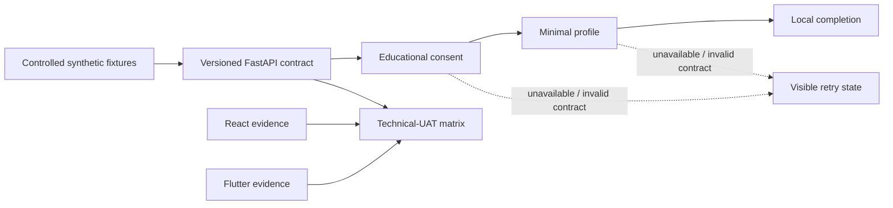
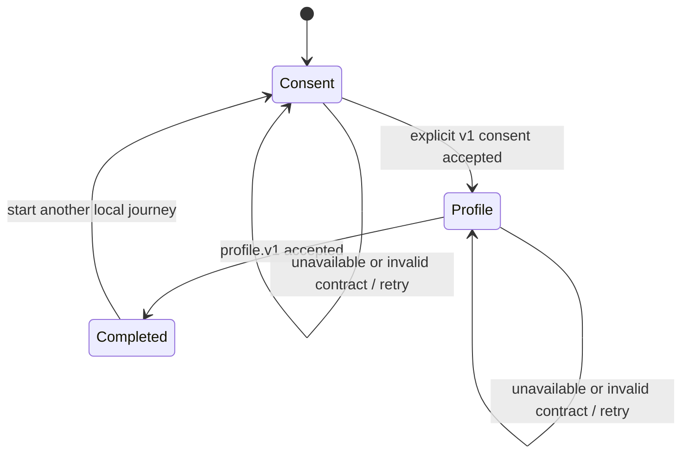
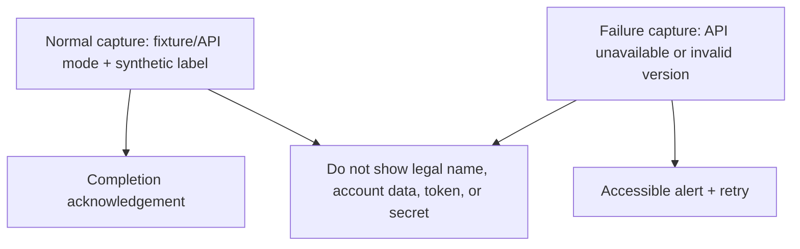

# S1 onboarding pilot — technical UAT evidence

This is the reproducible evidence package for the Sprint 1 educational
consent-and-profile pilot. It is intentionally a **technical-UAT** record:
it proves the selected release candidate using synthetic local data. It is not
approval to collect real personal data, give financial advice, or deploy to a
production environment.

The `S1 UAT Evidence` workflow runs on every relevant pull request and on the
resulting release-branch push. Its job summary records the exact selected
commit SHA, so the release evidence remains tied to the code that was tested.



## What is accepted

| Acceptance scenario | React proof | Flutter proof | Contract/fixture proof |
| --- | --- | --- | --- |
| Educational wording and explicit consent | `ConsentPage.test.tsx` checks the named checkbox, disabled action, and v1 payload. | `s1_onboarding_page_test.dart` checks the explicit checkbox gate and educational copy. | `test_s1_api_01_consent_profile.py` validates the versioned consent endpoint. |
| Normal completion | `OnboardingPage.test.tsx` completes profile + local completion state. | `s1_onboarding_page_test.dart` completes consent, profile, and local state. | `verify_r0_thin_slice.py` verifies health → consent → profile → completion with one correlation ID. |
| Validation and loading | React actions remain disabled until required consent/profile input exists; the consent action exposes `aria-busy` while pending. | Flutter actions remain unavailable until consent/input is valid; the pending control keeps a labelled progress state. | Typed payload versions are checked before the API is called. |
| Unavailable/error and retry | Component tests assert `role=alert` and the retry control. | Widget tests assert the live semantic error and retry control. | The thin-slice proof exercises a safe `UNSUPPORTED_CONSENT_VERSION` error. |
| Contract drift | `onboardingContract.api.test.ts` decodes FastAPI `snake_case` into the typed client contract. | `s1_onboarding_contract_test.dart` accepts the approved HTTP shape and rejects a malformed successful envelope. | API unit/contract tests constrain the published envelope. |
| Accessibility and responsive intent | Named native controls, semantic headings, alert state, `aria-disabled`, and `aria-busy` are tested. | Semantics labels cover steps, integration mode, errors, and in-progress submission; `SingleChildScrollView` and constrained layout support small screens. | Not applicable beyond user-visible correlation-safe error semantics. |

## Redacted visual-walkthrough record

The automated tests above use only labels such as `Local Tester` and fixture
mode; no screenshots containing a real identity, account detail, or credential
are permitted. The two state diagrams below are the required redacted visual
record for the local evidence package. A human demo may capture an additional
local screenshot only after confirming that it shows fixture mode and a
synthetic display label.





## Reproduce the evidence locally

Run only native processes. Docker, cloud credentials, real authentication, and
real user data are not required.

```powershell
# Backend contract and controlled fixture proof
Push-Location .\backend
.\.venv\Scripts\python.exe .\verify_r0_thin_slice.py --format json
.\.venv\Scripts\python.exe -m pytest -q --no-cov tests/test_s1_api_01_consent_profile.py tests/test_r0_thin_slice.py

# React visible success, validation, error/retry, and typed API adapter
Push-Location ..\frontend-react
$env:CI = 'true'
npm test -- --watchAll=false --runInBand
npm run build

# Flutter visible success, validation, error/retry, semantic loading state, and API adapter
Push-Location ..\frontend_flutter
flutter analyze --fatal-infos
flutter test
```

For a local visual walkthrough, use the commands in
[`local-development.md`](../local-development.md) to start the native backend,
then run React in API mode or Flutter with
`--dart-define=FINEX_ONBOARDING_MODE=api`. Use only a synthetic display label.

## Decision, limits, and reversal

**Technical-UAT decision rule:** ACCEPT when the `S1 UAT Evidence` workflow
passes on the selected `release/2026-W40` commit; RETURN TO DEVELOPMENT when
any row in the matrix fails. The workflow summary is the immutable record of
the tested SHA and commands. This rule deliberately does not claim a production
approval.

Known limits: there is no real identity provider, persistence service,
cross-device continuity, market data, risk questionnaire, recommendation,
cloud deployment, or production monitoring in this slice.

If a critical scenario fails, create a corrective W40 feature branch, restore
the failing automated test first, and merge only after the same evidence
workflow passes. Do not patch `dev`, UAT, production, or `main` directly.
