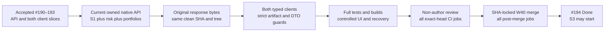

# S2 combined technical acceptance and developer handoff

Story [#194](https://github.com/IgnAite-Showcase/Finex/issues/194), branch `feature/194-s2-full-acceptance-w40`, target `release/2026-W40`. This gate covers FR-04 through FR-08 and applicable NFR-01 through NFR-10 in [FinEx V9.1](https://github.com/IgnAite-Showcase/Finex/blob/docs/v9.1-master-handbook/docs/governance/FinEx_Master_Product_Design_Delivery_Handbook_v9.1.pdf), pages 63–64 and 92, S2-QA/UAT. The accepted starting release is `a018951f1aecca062c31b18a22619f7940e175fc`, tree `a8fe249843593a5c89c6f83f1e59bb27d8d3db0d`, containing accepted API and client stories #190–193.

S2 completion requires the actual persistent API, React and Flutter to agree on saved risk and manual portfolios. A green mock, historical corpus or S1-only client check is not that certificate. The [delivery ledger](../features/local-application/S1-S4-delivery-contract.md#6-acceptance-ledger-and-known-external-gates) and final issue/PR acceptance comments record the actual reviewed, tested, published and merged identities once those gates pass; S3 does not start earlier.

## Requirements and proof boundaries

| Requirement | Delivered behavior | Required verification |
|---|---|---|
| FR-04 questionnaire | Ten ordered versioned server questions, replacement partial draft, reload/resume | Native draft/query capture, both public typed clients, route/journey tests and cross-client resume |
| FR-05 scoring | Approved deterministic scorer, original rules/input/result/time snapshot, stable history | Independent golden/domain tests, original equivalent retry, conflict without another row, cursor boundary after insertion |
| FR-06 explanation | Server educational explanation matching the immutable assessment | Both decoders preserve content; no client/LLM rescore or advice |
| FR-07 manual portfolios | Owned durable portfolio/holding CRUD, bounded supported catalogue and exact decimal strings | Native operations, parent/owner denial, migration/restart/concurrency tests, both-client create/edit/delete/isolation |
| FR-08 metrics | Server Decimal cost/value/gain/allocation, versioned synthetic prices, honest nulls | Six independent native golden cases, strict typed replay, empty/zero-cost/partial/unavailable UI states |

Session, consent and completion are rechecked for protected operations. Private bearers are memory-only; responses and evidence never export owner selectors, session digests, credentials or database paths. Schema 3 preserves S1/risk records through exact forward migrations. Changed behavior retains tests for safe faults, accessible errors/retry, stale request suppression, ownership races, bounds and failed-transaction rollback. Source and contract versions are explicit. No Docker, broker, paid provider or real money is involved.



## Test first history

These runs exercised importable tooling scaffolds before behavior was implemented. They are acceptance-tool TDD, not new screen/API feature RED or real TCP evidence.

| Scope | Actual failing checkpoint | Passing controls and limitation |
|---|---|---|
| Launcher and CI contract | 41 failed, 11 passed, 52 total, 19.43 seconds; exit 1, no setup errors | Required three native producers, six outside-checkout artifacts, mandatory both-client inputs, altered/wrong-revision/failure/cleanup controls and process-option restoration. Earlier Windows temp setup failures are excluded. |
| Backend capture, shared writer and expiry guards | 41 failed, 177 passed, 218 total, 3.18 seconds; exit 1, no setup/import errors | Original Unicode file/digest mismatch, nonfinite write rejection, strict capture/report/current-source guards and risk checks within the existing portfolio expiry phase. No child/API/real sleep ran in this unit checkpoint. |
| React artifact loader | 5 failed, 212 passed, 217 total, 9.118 seconds; exit 1 | Complete-pair and explicit absence/configured gate assertions failed against the fail-closed stub. Negative guards passed only because that stub rejected everything. Sixty public-method unit/historical replay controls were already green, not native proof. |
| Flutter artifact loader and public-method controls | 160 failed, 3 passed, 2 explicit optional-input skips, 165 total, about 20 seconds; exit 1 | Missing loader behavior caused genuine boolean failures. Optional native replay did not run without inputs; missing required inputs must fail, not skip. No collection/import error was counted as RED. |

Normal test-first commits `28803d8685dfa5c3b26048915fcd3e2cb0d41e9f` and `56adbdf331cfbb4a572c84d3bd12cadd403f9e59` preserve these checkpoints before their respective implementations. No amend, reset or rewritten history is used. The first commit covers root/backend/React paths; the second covers only the Flutter test scaffold and exact cached dev dependency `crypto: 3.0.7`.

Offline Flutter package resolution added only that lock entry. It then returned the existing Windows plugin-symlink prerequisite error; it is not a successful native build. The subsequent `--no-pub` test command collected and ran against resolved packages without changing OS settings. Local build prerequisites and hosted desktop compilation remain separately reported.

### Independent-review regression checkpoints

Non-author review reproduced additional acceptance-tool gaps. The following normal commits preserve real failing assertions before their fixes; they do not replace the later clean-checkout TCP, full-suite, browser or CI gates.

| Regression scope | Genuine RED result | Preserved checkpoint |
|---|---|---|
| Launcher/CI complete-pair invocation | 6 failed, 49 passed, 55 total, 50.32 seconds; no setup errors | `8ccc80743709ef5a25159e8556f84d71ca08c32b` |
| React producer inventory and duplicate JSON members | 53 failed, 223 passed, 276 total, 10.662 seconds; valid escaped-key/Unicode controls remain accepted | Same checkpoint |
| Flutter duplicate JSON members | 28 failed, 169 passed, 2 explicit optional-native skips, 199 total, about 23 seconds; no collection errors | Same checkpoint |
| Backend body-byte limit and escaped known private values | 15 failed, 7 passed, 67 deselected, 0.93 seconds; failures cover the boundary plus one and decoded token/owner/path reflection | `34bef3bac017080cf1ace367e42f78caeef22d3c` |
| Passive complete-pair validator | 261 failed, 4 scaffold failure-output controls passed, 265 total, 9.28 seconds; importable no-op interface, no setup errors | Same checkpoint |
| React recursive private-field policy | 21 failed, 286 passed, 307 total, 7.95 seconds; all replay/history snapshots remain consistent so rejection tests the privacy boundary | `a480cf7305a2428240c08d687e9926697879a350` |
| Actual expiry-polling decoded private values | 6 failed, 4 passed, 2.35 seconds; escaped token, owner and database-path messages in both polling-200 and final-401 branches | `c0053620b56dd3f3c865a84833ccbf65b44cb3a1` |
| Actual producer-to-validator bindings | 3 failed, 9 passed, 286 deselected, 2.28 seconds; no setup errors. Two hashed empty package-source fixtures and one source-derived portfolio check chronology fail; empty artifacts, duplicate/missing/false checks, cleanup and provenance failure controls pass | `d4376e8c1a13d22a524e64f3f78b8d0d42e9daeb` |
| React cross-client portfolio-list reconciliation | 9 failed, 9 passing controls, 18 older tests filtered out, 36 total, 15.841 seconds; no collection/setup errors in the completed run. Both refresh buttons retain a removed selected record or old metadata; read failure, cancelled/old-owner work and route-departure controls already pass | `03b388b8cedf23c58febaeb18bb3de6ab22225ba` |
| Flutter legal portfolio trim boundary | 4 failed, 31 passed, 35 selected; exit 1, about 2 seconds of runner time (7.790 seconds including version query/child setup). Both padded update/no-op loader cases and public typed replay fail; exact-field/type/version/currency/null/bounds/privacy and non-portfolio controls pass | `ca78439999c8462d3cbf898f44941a35b41d264c` |
| Approved `dev` checkpoint evidence trigger | 1 failed, 8 passed, 0.33 seconds; the native/secret release workflow previously selected feature/release pushes but omitted `dev` | `79b445a4785ea719ddc2264a0339f85c92b23313` |

The launcher/CI unit seam is deliberately mocked and cannot certify the actual passive validator. The validator's own behavioral tests, current native producer output and mandatory consumer replay are separate gates. Ordinary JSON decoding may silently keep the last duplicate member; both clients now check decoded member identity in original artifact/body text first, including escaped-equivalent names. Privacy checks apply recursively to response bodies and request DTOs, not legitimate allowlisted repository-relative provenance.

The expiry regression calls the real polling method with fake HTTP and a fake clock, not a real one-minute wait. Its safe 200-to-401 control passes; rejection must preserve the count of earlier safe responses without counting an unsafe response or setting a successful expiry result. The corrected native polling method checks the same known private values in original bytes and decoded strings on both branches. Full type checks retain these runtime guards; typing corrections do not bypass validation.

At clean candidate `deb5f638dfa6b39b5c15cbb81c3051bb9a122fc8`, all three real native producers passed, but the final passive pair gate failed. That attempt is not combined acceptance. Diagnosis found valid zero-byte Python package sources rejected as though they were empty JSON, and completed portfolio checks serialized in execution order rather than the frozen summary order. The regression above uses real empty fixture files and static approved check IDs, with mocked lifecycle effects; it is not replacement TCP evidence. Source-only reads may accept zero bytes while retaining actual hashes, regular-file/identity checks and limits; JSON artifacts remain nonempty. A canonical summary may contain only the exact unique, already-passed checks after confirmed cleanup and unchanged provenance. Original captured response bytes, case order, check/schema versions and strict consumer ordering are not changed. Final acceptance requires a fresh clean-candidate native run after these corrections.

Flutter's first corrective replay attempt had two environment-loading errors because process variables were present but empty; these were setup failures, not RED or a client product regression. Removing only the seven optional evidence variables from that test child process produced 197 passed plus 2 explicit optional-native skips in 15 seconds. No invalid empty flag was made acceptable. Two subsequent strict-analysis style fixes retained the same reader branch and null-omitting history query, without disabling analyzer rules or changing assertions.

At clean candidate `a7c43cde6a6ebe33841e0cc971f50729c2bf13a2`, the three native producers and passive pair validation passed and React's mandatory same-pair replay passed (569 tests). Flutter's same-pair command had 224 passing tests and two loader failures, so this attempt also is not combined acceptance. The two valid captured portfolio update/no-op requests contain outer whitespace that the existing public Flutter `PortfolioInput` intentionally trims. Changing captured bytes or the production DTO to make an evidence test pass is not permitted. The contract-specific test boundary below distinguishes canonical emitted requests from original response-byte replay; all provenance, privacy, ownership, artifact and non-portfolio request guards remain required.

The controlled compiled-browser journey separately found React retaining the selected portfolio's stale details after an authoritative owned list reported that the other client had removed it. The test-first correction (`72e0a32e692213bc3ada50ce369c65692ddea8c6`) passes all 36 journey tests plus standalone TypeScript. It reconciles only inside the existing guarded success callbacks: a surviving selected record receives authoritative metadata without losing dirty controllers or confirmed holdings/metrics; a vanished selected record loses only its dependent details/edit/confirmation/retry state. Independent unsaved portfolio creation input is retained. A failed or cancelled read never certifies deletion or a save. Final full suites, rebuilt browser verification, clean native replay and exact-head CI are still separate gates.

The narrowly reviewed Flutter test-support correction passes all 35 trim-boundary regressions, all 231 tests in the two changed files (one additional explicit optional-native skip), and strict analysis without changing production DTOs or any RED assertions. Those optional-input results are unit evidence only; the final clean-checkout command below must require the actual current complete native pair in both consumers.

## Run the current native and client checks

Use the [native runbook](../runbooks/native-local-application.md#combined-s2-technical-acceptance) from a clean committed checkout. Bootstrap only needed components on 8 GB machines; run tests/builds serially and avoid emulators. Every native verifier owns its temporary loopback child and database, not a running demo or configured developer database.

```powershell
.\scripts\verify-owned-s2.ps1 -Component All
```

Existing interpreter overrides are `-Python`, `-Node` together with `-NpmCli`, and `-Flutter`. `Backend`, `React` and `Flutter` selections are useful during development, but only `All` selects both client parity checks. This command does not install packages, change persistent environment values, request GitHub credentials or perform a cloud deployment.

The serial native proof produces six sanitized files outside the checkout:

| Slice | Report and corpus | Native acceptance scope |
|---|---|---|
| S1 | `s1-owned-proof.json`, `s1-owned-corpus.json` | Original 24 checks, five owned starts, two real restarts and genuine expiry |
| Saved risk | `s2-saved-risk-proof.json`, `s2-saved-risk-corpus.json` | Original 17 checks plus complete-corpus check, four starts, two restarts, 29 exact original-wire cases |
| Manual portfolio | `s2-manual-portfolio-proof.json`, `s2-manual-portfolio-corpus.json` | Existing 26 checks and 31-case v1 corpus, five starts, two restarts, genuine expiry with risk access denial/recovery in that same window |

S2 reports hash the exclusively written UTF-8 corpus bytes. Every report/corpus pair has its own matching source list/manifest and current clean commit/tree; consumers rehash actual raw source files. The passive pair validator checks complete report/corpus schemas and bindings before either the local launcher or CI producer can declare success. The inventories may differ across domains, but overlapping files must bind to the same actual bytes and both pairs must identify the same revision. Source line endings are not normalized for hashing. The existing S1 writer and portfolio case/check schema remain unchanged. Both S2 response corpora use a 262,144-byte per-body cap matching the client transport boundary.

Both consumers require all four `FINEX_LOCAL_S2_RISK_CORPUS`, `FINEX_LOCAL_S2_RISK_REPORT`, `FINEX_LOCAL_S2_PORTFOLIO_CORPUS`, `FINEX_LOCAL_S2_PORTFOLIO_REPORT` paths with `FINEX_REQUIRE_LOCAL_S2_CORPUS=1`. Unknown flags, partial/missing files, stale revisions, wrong digests, malformed JSON/UTF-8, duplicate or escaped-equivalent JSON members, private fields, incomplete case/check lists or unconfirmed cleanup fail safely. Captures check known private values in decoded strings as well as original bytes, without normalizing or replacing the original response. Optional unconfigured unit runs are not native acceptance. The CI producer's success-only artifact has an exact six-file allowlist and seven-day retention; it does not upload databases or raw server logs.

Successful saved-risk and holding mutation replay uses the original request DTO exactly. Flutter's public `PortfolioInput` already emits the documented canonical name/description strings: successful portfolio create/update replay must prove the actual outgoing body equals `input.toJson()` and equals a copy of the original exact four-field request after **only outer name/description trimming**. Null remains distinct from an empty description; version, currency, types, bounds, all other fields/operations and confirmation against the saved record remain exact. Neither captured request/artifact bytes nor original response bytes are rewritten. React's typed transport retains the captured legal request DTO. This is a contract-specific request-emission distinction, not a claim that Flutter emitted the original padded wire string byte for byte.

Saved-risk history/detail replay also preserves original captured cursor/UUID targets. Error captures for illegal inputs replay a legal public call to verify error handling, not illegal typed request emission. Portfolio v1 has no URL-target field: successful replay freezes IDs from original captured DTOs; error replay uses legal canonical targets and proves response handling only. Separate native and HTTP tests prove real route/parent/owner behavior.

## Full regression and controlled journeys

Run the exact complete backend commands in `.github/workflows/backend-quality.yml`, including unchanged 70% coverage and both Linux/Win32 Python-3.13 type targets. Run complete serial React tests, standalone `tsc --noEmit` and production build. Run Flutter strict analysis, all tests and web build. Record installed versions accurately: local Windows Python 3.12.14 and Node 24.19.0 are not the guide's Python 3.13/Node 24.20.0 or hosted Linux runtime. The release's configured hosted checks remain mandatory.

The controlled UI acceptance uses synthetic personas and disposable owned state:

1. In React, complete current consent/profile, save a partial risk draft, sign out/reload and resume it. Save an assessment, open immutable history/detail and retry without creating another row.
2. Sign into the same persona in Flutter. Resume the same server draft/history, deliberately save another assessment and check both clients reflect the same records and original times.
3. Create a manual portfolio and holding, edit them from the other client, and confirm exact server quantity/cost/metrics. Exercise empty, zero-cost, mixed available/unavailable and unavailable-only states without fabricated values.
4. Delete only the disposable selected manual holding/portfolio, confirm the other client reflects the server state, and verify saved risk/consent history remains.
5. Use the second persona: no previous owner's draft/history/manual records appear. Confirm logout/withdrawal/expiry/failure regate safely and stale responses cannot restore the old owner.
6. Check keyboard/error focus and narrow layout. Record actual browser dimensions and text/zoom state; automated Flutter text scale is distinct from browser zoom. Never claim a 200% browser check if the browser did not actually apply it.

The prior accepted client records contain real shared S2 API/browser journeys and separately labelled historical-wire observations. A later validation must identify its actual checkout and running source; a build or fixture replay alone is not browser E2E. Preserve unrelated local servers, databases and the user's tabs. Stop only owned processes and clean only internally created temporary state after verified reaping.

### Controlled current S2 browser observations

The owned loopback API and compiled clients used two synthetic personas in a newly created disposable database. React's rebuilt `main.13be9e9b.js` has SHA-256 `6B98D944CC0A6B4E5CCC130D431908141B5D3654C655EDA1FD1A4284CEFDFA1F`; Flutter's unchanged accepted production bundle has SHA-256 `4FBCE4412609F064CB360D2F8AF59152C175D314C9029B984BD1C22F4D617069`. Neither app used a developer database or a cloud service. Actual screenshots remain local/ignored; native and final revision evidence is recorded separately.

| Journey | Observed result and boundary |
|---|---|
| Draft and immutable risk history | Learner A's partial draft resumed across reload/sign-out and both clients. React saved the first Moderate 50 record at `2026-10-11T22:13:55.998749+00:00`; Flutter deliberately saved a second at `2026-10-11T22:15:09.236227+00:00`. Both clients retained the two original records, scores, rules snapshot and times after owner switches and later manual deletions. React disables the save action after confirmation; successful equivalent-retry idempotency is native/API evidence, not a claimed GUI retry. |
| Manual and unavailable metrics | Both clients agreed on empty null/zero states, a zero-cost holding with undefined gain percentage, peer-edited quantities/cost, mixed available/unavailable holdings and unavailable-only valuation. Missing values stayed null rather than being invented or renormalized. Only explicitly created disposable records were removed through guarded owned API calls; no permanent-delete button action is claimed. |
| Learner B isolation and regating | No A draft/history/manual records appeared for B. Empty risk submission focused a validation alert without saving. Consent withdrawal blocked protected Flutter reads; reacceptance still required explicit onboarding completion. After completion at `2026-10-11T22:37:56.512303+00:00`, Flutter resumed protected reads and B still had no portfolios. Switching back to A preserved its original two assessments. |
| Rebuilt React refresh reconciliation | A Flutter metadata edit was reflected in React's selected record while independent unsaved create text survived. After guarded removal of each of two empty test portfolios, both **Refresh owned portfolios** and **Reload catalogue and portfolios** cleared dependent details, holdings and valuation without clearing that independent text. Flutter's read refresh also showed the authoritative empty list. |
| Read failure and recovery | Intermittent browser transport failures displayed safe feedback and retained input/last-confirmed state; they did not certify deletion or trigger another mutation. Explicit read-only refresh recovered and confirmed the server result. Owned API health/read probes were successful; no unsupported root `/health` probe or failed diagnostic setup is counted as acceptance. |
| Narrow layout and accessibility | Actual views included 312-pixel React and 320-pixel Flutter layouts without horizontal overflow; the rebuilt final React reconciliation view measured 320/320 client/scroll width. Real validation focus was observed. Browser 200% zoom and native-device GUI were not exercised; automated Flutter text-scale tests are separate proof. |

Full serial React regression passed **754 tests in 25 suites**, followed by standalone TypeScript and production build. Flutter's narrow support correction also passed its original strict controls as recorded above. Complete backend/Flutter suites, fresh clean native proof, final source review and hosted checks remain separately bound in the story/PR acceptance record; these browser observations do not substitute for them.

The complete backend run passed **2,172 tests**, unchanged **86.82% coverage** against the required 70% threshold, Ruff lint/format checks and both Linux/Win32 Python-3.13 type targets (129 source files each). The local test interpreter was Python 3.12.14; hosted Python 3.13 remains a required distinct check. These tests used frozen reviewed implementation/test bytes; a subsequent evidence-only document commit does not change them. Final native acceptance and hosted jobs must identify the actual final commit/tree, not reuse an earlier failed pair or a supplied revision label.

Flutter 3.47.2 / Dart 3.13.2 strict analysis found no issues; the complete serial suite passed **654 tests**, with **three explicitly optional replay skips** when no corpus was configured. This does not certify native replay. The final `All` launcher and hosted consumer jobs must supply and require current captures so those checks run rather than skip.

### Hosted native import-root correction

The original #213 published head `99c1d160bd7e2af5733a1c6b71caafbac57303a0` was **not accepted**: both S1 UAT Evidence events reached the direct saved-risk CLI and failed with `ModuleNotFoundError: No module named 'ai'`. The separate R0/S2 workflow passed because it already declares `PYTHONPATH=..` for commands run from `backend`; pytest's `pythonpath` setting does not configure later independent CLI processes.

Regression-first local commit `191bcaa3b373ad3500a926a2400ce7841fae9d68` adds the same explicit job import-root requirement to both producer workflows: **one real failing assertion and one passing control** before the correction. The minimum correction declares `PYTHONPATH: ".."` only on the S1/S2 owned native producer job. No command, capture/check requirement, timeout, coverage threshold, skip rule or success-only artifact rule is removed or relaxed. The bounded CI regression set then passes **28 tests**; direct saved-risk and manual-portfolio CLI help imports also pass with that declared environment. The passive pair command intentionally has no help option and is verified through its import and actual pair-validation gates, not a claimed help check.

This correction changes workflow/test/evidence bytes, not the application or client implementations. The earlier 2,172-test/full-client and clean `940e18f` native results remain honestly labelled earlier evidence. A corrected clean commit/tree, fresh combined native capture/mandatory consumers, non-author review, new published exact-head CI and post-merge CI are required before acceptance; successful jobs at the old head do not accept the corrected head.

### Acceptance corrections must retrigger complete client quality checks

Before publishing the correction, inspection found that the React and Flutter complete-quality `push` filters did not select an S2 acceptance-evidence change. A new correction head would therefore lack those two push workflows, even though the PR's cumulative client diff selects the PR workflows. The required five-workflow, both-event policy must not be weakened or satisfied with old-head jobs.

Tests-first commit `67f2ffe6734af2c150f94be1a4be04577e03bb0d` captured **four genuine failing assertions** for the two workflows' two events. The narrow correction adds only `docs/evidence/s2-full-acceptance.md` to each existing React/Flutter `push` and `pull_request` path filter. It leaves every original path, job, command, runner, permission and condition intact. A bounded CI regression run, fresh clean native proof and actual new-head/post-merge jobs are still required; a workflow declaration alone does not certify that a hosted job ran.

## Handoff and recovery

Develop from the latest accepted W40 release on the exact branch named in your story. Keep S3 routes honest pending states until #194 is accepted. The [risk](../features/local-application/S2-saved-risk-contract.md), [portfolio](../features/local-application/S2-manual-portfolio-contract.md) and [data dictionary](../features/local-application/local-data-dictionary.md) are the implementation authority, with V9.1 requirements above. Clients own presentation, not scoring or financial math.

For uncertain assessment saves, retain the original input snapshot and retry UUID; changed input uses a deliberate new submission. For uncertain manual POST, refresh the owned list before a deliberate retry because create is not idempotent. PUT replaces only mutable documented fields and preserves timestamps on normalized no-op. Failure feedback must not say a save completed.

Before a migration, use SQLite's backup API or close/checkpoint all owning connections before a file copy. Keep the backup, WAL/SHM and database local/ignored. Verify snapshot integrity/schema and retained S1/risk/manual records before relying on recovery. An older schema-1/2-only binary must reject schema 3, not downgrade metadata. Prefer a reviewed forward correction or `LOCAL_APP_ENABLED=false` with preserved state; do not erase immutable history, restore old data over newer writes, reset another developer's database or force-push history.

Final acceptance requires non-author source/evidence review, reviewed exact-path publication, every applicable exact-head job green, a SHA-locked merge only to W40 and every actual post-merge job green. Then #194 may become Done and closed completed and #195 may start. A missing, skipped, queued or failed job is not a pass. GitHub COMMENT technical review records independent agent findings; no human APPROVE is fabricated.

Anand approved safe, tested `release/2026-W40` → `dev` PR merges at completed sprint checkpoints on 2026-10-11. After accepted #194, the first promotion must preserve divergent `dev` work and validate the actual combined merge result, not overwrite it with a release snapshot. Record the promoted release SHA, tested merge tree, PR/checks and resulting `dev` SHA separately; no promotion has yet been claimed.

The existing read-only R0/S2 native/secret evidence workflow now also selects `dev` pushes, so a checkpoint cannot lose that gate after merging. Its contents permission remains read-only and it performs no branch promotion or deployment. This only adds the missing validation trigger; all actual candidate and resulting-`dev` jobs must still pass, and no quota or paid-usage allowance is inferred.

External gates remain explicit: genuinely fresh developer machines #129, historic credential-owner rotation #132, approved free-tier cloud/auth/privacy/platform deployment #134, actual native-device GUI and human UAT. The local prototype, hosted desktop compilation and delegated technical acceptance do not certify those gates. No `main`/`uat`/`prod` promotion, real identity verification, live provider, real-money action, paid usage or production hosting is authorized here.
