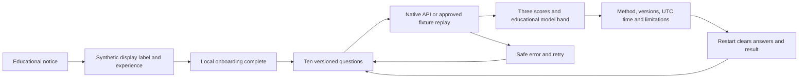
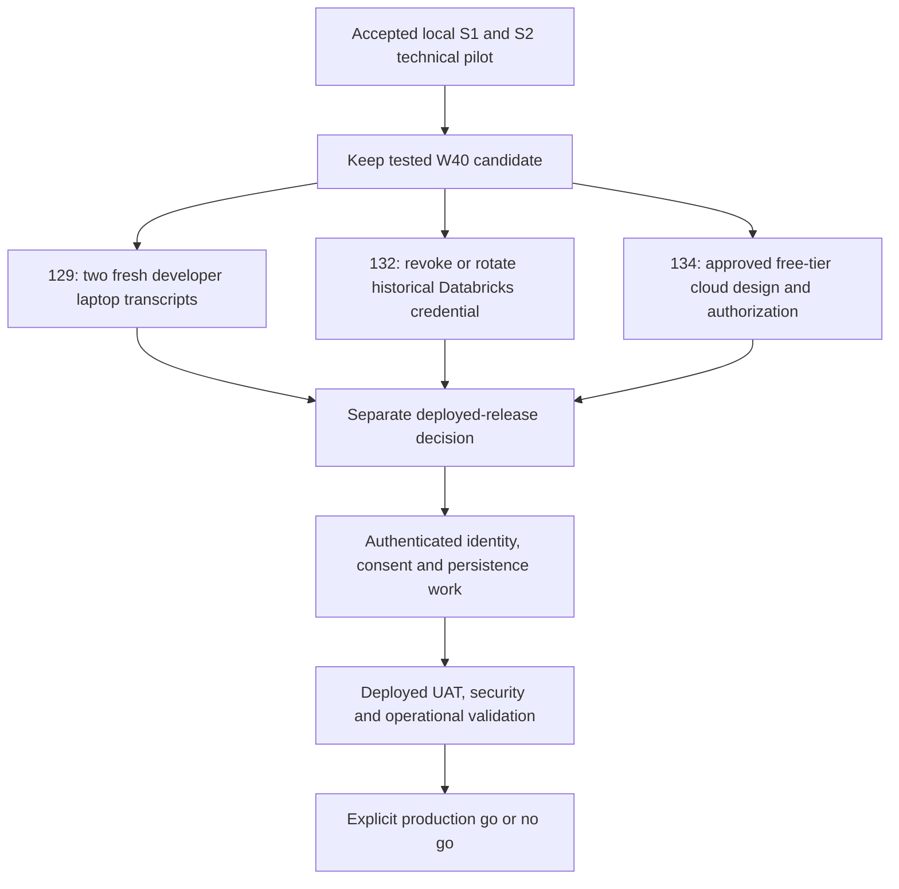

# FinEx Sprint 2 local acceptance

The W40 recovery delivers a working, stateless educational pilot through Sprint 2: synthetic consent and profile capture, ten versioned risk questions, deterministic scoring, and the same educational explanation in React and Flutter. Technical acceptance applies to this **local pilot only**. It does not authorize production deployment, authenticated financial decisions, persistent assessments, or promotion to another branch.

This acceptance closes the integrated technical work in #138 and #164 and records the #158 historical-release disposition. Quality evidence is maintained by #133 and #144. Requirements remain anchored to [V9.1](https://github.com/IgnAite-Showcase/Finex/blob/docs/v9.1-master-handbook/docs/governance/FinEx_Master_Product_Design_Delivery_Handbook_v9.1.pdf), §§7, 10, 12–14, 16, 20 and 24. The approved logical contract is `s2-risk-contract/v1.0`, questionnaire `risk_questionnaire_v1` / `v1`, and scorer `deterministic_v1.0.0`.

## Delivered journey



The API computes the numeric score using deterministic rules, not an LLM. Clients send logical answer codes; neither client implements a second scoring formula. Offline mode replays approved synthetic vectors only. Arbitrary answer combinations require the loopback API. Scores and answers remain in memory; S1 device flags are convenience state, not authenticated identity or proof of server-authorized consent.

## Acceptance matrix

| Requirement | Evidence and result |
| --- | --- |
| Consent before minimal profile, then completion | S1 contract tests and both actual browser journeys; 201 consent, 201 profile, 200 completion. Only a synthetic label and self-declared experience are used. |
| Integrated consent to risk | Nineteen new integration tests: nine valid end-to-end vectors, nine deployed-environment denials, and application-settings isolation. |
| Every approved score and boundary | Nine valid vectors exercise normal cases, reachable 32.5/35 and 65/67.5 boundaries, and two willingness/capacity tensions. Independent expected scores and categories match the domain and HTTP API. |
| Invalid input and deterministic precedence | Seven invalid vectors cover malformed input, wrong version, duplicate/unknown/missing questions, undefined codes, and cross-question codes. HTTP errors have stable codes and never return partial scores. |
| React and Flutter parity | Both assets exactly match the canonical replay. Actual adapter tests execute all sixteen vectors. Both live browser journeys produce Moderate and composite/willingness/capacity 50/100 for ten midpoint answers. |
| Safe explanation | Method, versions, server UTC time, self-reported limitations and no-persistence notice are present. Numeric scoring is independent of explanation generation. |
| UX and accessibility | Native labeled controls, progress, loading, duplicate-submit prevention, retry, back navigation and restart are covered by client tests. Desktop walkthroughs and the React 390-pixel viewport passed; Flutter narrow-width and 150% text-size widget tests passed. |
| No fabricated signed-in user | Consent, onboarding and risk use the React pilot shell. The consent-route regression failed before the correction and passes afterward. Other shell modules remain demos, not accepted Sprint 2 features. |
| No anonymous deployment bypass | Consent/profile/completion and risk pilot routes reject dev/UAT/production with `LOCAL_PILOT_ONLY`. Trace identifiers and local flags are not authentication. |
| Useful CI failure evidence | The deliberate in-memory client-version drift caused the PR #180 evaluation gate to fail and retain a safe report. The corrected exact head passed every applicable run. |
| Secret detection | Checksum-pinned free Gitleaks detects a nonexistent synthetic probe and verifies redaction before scanning committed HEAD. The accepted W40 current snapshot is clean; historical credential revocation is a separate gate. |
| Native low-memory development | Backend, React and Flutter web run without Docker, hosted databases, paid cloud services, credentials or an Android emulator. Downloads require internet; use one client at a time on 8 GB machines. |

The full native backend suite passes **401 tests with 80.89% app coverage**; Ruff lint and formatting pass, and Mypy passes on the checked application and verification tools. React passes **62 tests in 10 suites** and its optimized build. Flutter passes **67 tests** and strict analysis; compiled web walkthroughs pass. Flutter PR #179 also passed its applicable CI Windows build. A build is not a mobile-device or production-load qualification.

## Tests first and candidate provenance

Final acceptance tests initially produced nine passes and ten failures: anonymous onboarding was not denied outside local mode, and the route used cached global configuration rather than the application's settings. The implementation now uses a router-level local-only guard and the application's fixture mode. React's new consent-route test likewise failed before the pilot-shell correction. Both regression sets and the full suites pass after the changes.

The final acceptance worktree starts from local commit `d62186d9e090a4ec120d03c7ee1bc36b0759b22b`, identical to PR #180's corrected published tree `ab31a44f62e02ab367ff2bdc7c65e901c3e64634`. That PR merged into W40 as `1803178586998a8e63b833fd8bda11603e70d8a0`. The final PR records its local commit, published head and identical tree; CI summaries record the tested checkout SHA and candidate head. These are reproducible technical reviews under Anand's delegated recovery authority, **not independent human approvals**.

After restarting the native API from the final acceptance worktree, React's live midpoint result was calculated at `2026-10-11T02:53:01.212436+00:00`; Flutter's at `2026-10-11T02:55:01.417723+00:00`. Both clean onboarding journeys and all ten questions completed successfully. Both clients displayed 50/100 for all three dimensions, the same versions and educational limitation. Flutter restart returned to question one with all options unselected. Fixture timestamps are fixed synthetic data and must not be described as live market freshness.

The recorded browser screen states below retain the observable result without personal data. Actual desktop screenshots were visually inspected during the walkthrough; this text record is not a pixel screenshot, video, or automated CSS assertion.

```text
React /consent: Sprint 1 LOCAL PILOT; Educational pilot; No saved assessment.
React /onboarding: Your local completion state is saved; continue to risk.
React /risk: LOCAL API PILOT; Moderate; Composite 50; Willingness 50; Capacity 50.
  Questionnaire v1; deterministic_v1.0.0; server UTC time; educational limitation.
  Answers and results stay in memory only. This pilot does not save an assessment.
Flutter /#/onboarding: API mode; educational consent; synthetic profile; complete.
Flutter /#/risk: LOCAL API PILOT; Moderate; all three scores 50/100.
  Same questionnaire/scorer versions, method, UTC time and limitation as React.
Flutter restart: Question 1 of 10; five radio options, each Value 0.
```

## Run the integrated pilot on Windows

Use a fresh checkout of the accepted `release/2026-W40` revision. Install the repository baseline: Python 3.13, Node.js 24 LTS and Flutter 3.47.2 / Dart 3.13. Bootstrap only the component needed:

```powershell
.\scripts\bootstrap.ps1 -Component Backend
.\scripts\bootstrap.ps1 -Component React
.\scripts\bootstrap.ps1 -Component Flutter
```

Flutter plugin resolution on Windows may require Developer Mode for symlinks. Resolve that prerequisite before claiming a fresh Flutter laptop is ready. Windows desktop also needs the Visual Studio C++ toolchain; the lightweight web target does not need an emulator. Anand's local backend validation used an existing Python 3.12.14 interpreter; CI validates the documented 3.13 baseline. These checks do not replace #129's two fresh-laptop setup transcripts.

Start the backend **from the repository root**, not from `backend`. The root import path is required for the shared `ai` package. In a dedicated PowerShell terminal:

```powershell
$env:APP_ENV='local'
$env:FIXTURE_MODE='s1_dat_01'
$env:LLM_PROVIDER='none'
$env:MARKET_DATA_PROVIDER='mock'
$env:ALLOWED_ORIGINS='["http://127.0.0.1:3001","http://127.0.0.1:3002"]'
$env:ALLOW_CREDENTIALS='false'
.\backend\.venv\Scripts\python.exe -m uvicorn app.main:app --app-dir backend --host 127.0.0.1 --port 8000
```

Verify [API documentation](http://127.0.0.1:8000/docs) or GET `/api/v1/risk-contract/questionnaire`; `/` is not the health endpoint. Do not bind this anonymous pilot to a public interface or deploy it with `APP_ENV=local` as an authentication workaround.

For React, use a second terminal at `frontend-react`:

```powershell
$env:NODE_OPTIONS='--max-old-space-size=1536'
$env:HOST='127.0.0.1'
$env:PORT='3001'
$env:BROWSER='none'
$env:REACT_APP_ONBOARDING_MODE='api'
$env:REACT_APP_RISK_MODE='api'
$env:REACT_APP_FINEX_API_BASE_URL='http://127.0.0.1:8000'
npm start
```

For Flutter web instead, stop React if memory is constrained and run at `frontend_flutter`:

```powershell
flutter run -d web-server --web-hostname 127.0.0.1 --web-port 3002 --dart-define=FINEX_ONBOARDING_MODE=api --dart-define=FINEX_RISK_MODE=api --dart-define=FINEX_API_BASE_URL=http://127.0.0.1:8000
```

Open `/onboarding` in React or `/#/onboarding` in Flutter. Acknowledge the non-binding educational notice, enter `LocalTester`, select beginner and complete onboarding. Continue to risk, select the third option on each of the ten questions, and calculate. Confirm Moderate, all three scores 50/100, versions, UTC time, method and limitations. Restart and verify no answers are selected. Use synthetic data only.

## Reproduce quality evidence

Run these sequentially to avoid unnecessary memory pressure. At `backend`, with repository root in `PYTHONPATH`:

```powershell
$env:PYTHONPATH=(Split-Path -Parent (Get-Location).Path)
python -m ruff check .
python -m ruff format --check .
python -m mypy app verify_r0_thin_slice.py verify_s2_risk.py verify_secret_snapshot.py
python -m pytest
python -m app.fixtures.s2_dat_01 --format json
python verify_s2_risk.py --tested-sha (git rev-parse HEAD)
python verify_secret_snapshot.py --gitleaks <checksum-verified-gitleaks-executable>
```

Select the active virtual environment's interpreter, not an unrelated system Python. From the repository root, `scripts/verify-s2.ps1 -TestedSha (git rev-parse HEAD)` sets and restores the import path; `-Python` can select an existing interpreter. For OneDrive pytest locks, use `-p no:cacheprovider --basetemp <new-task-specific-temp-directory>` and preserve other processes' temporary files.

At `frontend-react`, run `npm test -- --runInBand --watchAll=false --silent` with `CI=true` and the 1536 MB Node heap, then `npm run build`. At `frontend_flutter`, run `flutter analyze --fatal-infos`, `flutter test --concurrency=1`, then `flutter build web --debug --no-web-resources-cdn`. First-time downloads are not an offline guarantee; the resolved pilot itself needs no cloud access.

The [quality matrix](../runbooks/r0-s2-quality-matrix.md) explains exact-SHA reports, negative probes, path-aware component jobs and safe retained artifacts. PR candidates may test the merge checkout rather than the raw feature head; both identifiers are recorded. The additional release-evidence job runs on every PR so a new file path cannot bypass its secret gate.

## Remaining release gates



- **#129 remains in review.** Obtain two independent fresh Windows setup transcripts, including the Flutter symlink prerequisite and the supported versions. Existing resolved runtimes are not proof that every intern's laptop is ready.
- **#132 remains in review.** The old Databricks token-shaped value is removed from current W40 source, but old Git history still contains it. Anand must revoke or rotate any active credential in its issuing account and confirm completion. Do not paste the credential into an issue or chat. No history rewrite or cloud-account change was performed.
- **#134 remains backlog.** Cloud account, IAM, billing, deployment and downstream promotion need their own approved work. A free-tier prototype still requires isolation, authentication, verified consent, retention/persistence policy, observability, operational safeguards and deployed UAT before production acceptance.

Historical W36 remains **NO GO for promotion**; see the [integrity disposition](w36-integrity-disposition.md) and per-file inventory. The audit can be Done while its release remains quarantined. Do not merge the mixed W36 implementation merely because its backend tests pass.

## Safe release and rollback

Merge only the exact fully green acceptance head into `release/2026-W40`. Keep `main`, `dev`, `uat` and production unchanged. Update only verified recovery-card statuses and W40/V9.1 references; preserve assignments and open issue states. Done means the story's explicitly described local technical deliverable was accepted, not that all production requirements have been completed.

If a regression appears, create a new W40 rollback PR against the exact feature change and rerun the relevant gates. Do not reset shared branches, force-push the release, rewrite history, remove another developer's work, or silently weaken protections. Restart the local onboarding journey to clear its convenience flags; never use real account or financial data during the pilot.
