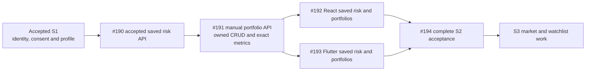
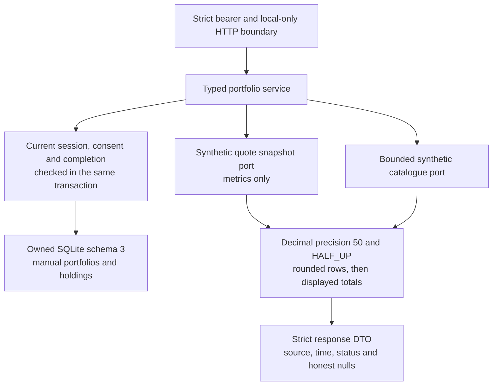
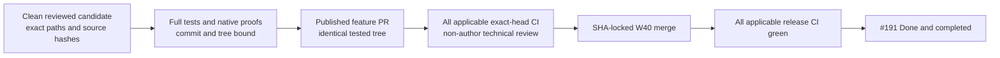

# S2 manual portfolio API validation

Story [#191](https://github.com/IgnAite-Showcase/Finex/issues/191) delivers durable, user-owned manual portfolios and deterministic educational metrics. It implements FR-07 and FR-08 from [FinEx V9.1](https://github.com/IgnAite-Showcase/Finex/blob/docs/v9.1-master-handbook/docs/governance/FinEx_Master_Product_Design_Delivery_Handbook_v9.1.pdf), pages 61–64 and 92, through the S2-SPEC, S2-DAT and S2-API portfolio work. The accepted starting release is `26f7261189cbf3aa6be61ce44b6fdcf0ee2489b9`, including the saved-risk API in [PR #209](https://github.com/IgnAite-Showcase/Finex/pull/209).

The [frozen portfolio contract](../features/local-application/S2-manual-portfolio-contract.md) defines the twelve operations, strict fields, numeric units, golden examples and failure precedence. Its SHA-256 is `0C5718E1CF32E4C3BF8E5F7D908E938A7AA4163D2AF844E9712750EC1AE1363A`. The server owns every calculation. Neither client may replace an unavailable quote with cost, zero or a fabricated live price.

## Delivery order



API acceptance alone is not complete S2. React and Flutter must implement the saved-risk and portfolio journeys against the accepted contracts, followed by integrated acceptance in #194. S3 starts only after that gate.

## Storage and calculation boundaries



Schema 3 adds two manual tables to the shared local database. Fresh creation and forward migrations from exact schemas 1 and 2 preserve identity, sessions, consent history, onboarding, risk drafts, risk snapshots and sequence state. Unknown, foreign, future or weakened schemas fail before journal changes. No migration resets records or replays a failed domain write.

Every read includes owner and parent predicates. Writes acquire one native lock, recheck current S1 prerequisites, apply the mutation and confirm it only after commit. Portfolio capacity is 20 per owner; holding capacity is 100 per portfolio. Real two-writer tests cover quota, duplicates, parent deletion, last-committed full PUT and both authorization race orders. Holding changes do not update the parent portfolio timestamp, and normalized no-op PUTs preserve the stored timestamp.

Numeric inputs are bounded, canonical strings: six decimal places for quantity and four for cost or quote price. SQLite stores integer micro-units and cost units, never floating-point products. Metrics use an explicitly isolated Decimal context, round each holding to cents, then sum those displayed values. A missing price keeps known cost but makes total value and value-dependent allocation outputs null. The default catalogue and quote source are synthetic, never live market data or broker positions.

## Actual test first evidence

The following runs preceded final candidate acceptance. Their source scope is explicit; none is a substitute for clean-commit regression, native proof or hosted CI.

| Check | Actual result | What it established |
|---|---|---|
| Initial HTTP contract against accepted release source | 72 failed and 1 existing disabled-boundary control passed, 297 warnings, 21.64 seconds | Missing portfolio behavior, not import or fixture failure. Initial test SHA-256 `B7E34F3B385F59D6D1249186AFABCF7F2103D19C0A595B5821F024F48375F03E`. |
| Corrected UTC-instant assertions against unchanged accepted production source | 72 failed and 1 control passed, 297 warnings, 20.03 seconds | The contract permits UTC `Z` and `+00:00`; tests compare instants without forcing one spelling. Test SHA-256 `8E90C0FB78C390BA71A4E57E24190D1B4FB2AF88F1ACAA4DC81CA55212B3EBBB`; test-only commit `8783163678f9d8e9f7a1d4af73b78fa620160967` retains these assertions. |
| Pure domain validators with importable behavior stubs | 116 failed, 0.55 seconds; then 116 passed, 0.16 seconds | Exact units, bounds and immutable record validation. Test SHA-256 `A447912272D675ABC5F086749E1B8FEB47CFE0D9E6606994D1B54C7A76AD3959`; implementation commit `40bf234f083719f8cfd41e4dccab92e729e37184`. |
| New physical schema and adapter behavior | 23 failed, 1.10 seconds; then 23 passed, 1.09 seconds | Missing manual tables and schema-3 capability, followed by preserving migrations and owned persistence. |
| Recognized schema with foreign SQLite owner markers | 6 failed, 0.52 seconds; then 6 passed, 0.35 seconds | Exact schemas with nonzero `application_id` or `user_version` remain foreign and are rejected before WAL. |
| Service, strict DTO, synthetic ports and arithmetic | 98 failed and 22 strict-shape controls passed, 5.25 seconds | Genuine missing runtime behavior with clean collection. Subsequent edge tests caught inherited Decimal traps and integer values masquerading as boolean deletion confirmations. The final author-focused matrix passed 182 cases, 0.65 seconds. |
| Required response authority in OpenAPI | 1 failed, 73 deselected, 1.17 seconds | Scope, versions and currency must be required wire fields rather than defaults invented by the decoder. |
| Partial injected-store capability | Interface RED: 1 failed, 42 deselected, 0.88 seconds. Fallback RED: 2 failed, 41 deselected, 0.80 seconds. Corrected guards: 3 passed, 0.66 seconds. | Explicit portfolio-only injection must not silently construct unrelated S1 or risk stores, including falsey test doubles. Malformed credentials still fail before construction. |
| Mandatory portfolio CI proof | 4 failed, 0.22 seconds; corrected portfolio and retained S1/risk CI matrix: 17 passed, 0.59 seconds | Native execution, exact checkout binding, both type-platform targets and explicit sanitized artifact retention are mandatory. |
| Native validation tool review corrections | 39 failed, 2 controls passed, 70 deselected, 3.79 seconds; corrected author harness: 116 passed, 1.31 seconds | The tool now checks `schema_metadata.version = 3` while both SQLite owner PRAGMAs remain zero, rejects non-text envelope messages and duplicate or unsorted list records, and isolates its independent Decimal oracle. These are mocked lifecycle and disposable SQLite controls, not real server acceptance. |
| First clean-commit portfolio TCP proof | Failed `WIRE_INVALID` before accepting any check or response; its one owned child was reaped and temporary directory removed | At local commit `e7ffbd9eb2f14c9ded0469876eb234c150d5fa40`, the verifier expected four error fields but the unchanged response builder supplies five, including legacy `detail`. S1's 24 native checks and saved risk's 17 passed on that commit; the portfolio proof did not. |
| Real error serializer regression and verifier correction | 11 failed and 15 controls passed, 3.88 seconds; corrected complete author harness: 142 passed, 1.29 seconds | Error fixtures now use actual `APIResponse.error(...).body`. The verifier requires the exact existing five-field shape and matching text `detail`, top-level message and nested message. Missing, non-text or divergent detail is rejected. Production API and compatibility responses are unchanged; this focused result is not a successful TCP rerun. |
| Integrated HTTP operations, transport and provider failures | 122 passed, 501 warnings, 31.12 seconds | Exact success/error wire shapes, CRUD, ownership, quota, no-op times, goldens, unavailable values, injection and opaque provider failures through actual ASGI requests. Intermediate working-tree evidence. |
| Independent storage and concurrency regression | 167 passed, 17.53 seconds | Separate non-author run of all six storage/migration/journal/race files. Existing preservation, lock budgets and rollback assertions remain intact. |

Additional race, context-default and provider-failure regressions that were first executed after implementation are GREEN verification, not manufactured RED evidence. Import collisions, unsupported temporary-directory permissions and other test setup failures do not count as application TDD failures.

## Reproduce validation

Use the bootstrapped native Python environment from the [local runbook](../runbooks/native-local-application.md). From `backend`, run serially with a new disposable pytest directory, not a developer database:

```powershell
$portfolioTestTemp = Join-Path ([IO.Path]::GetTempPath()) ('finex-portfolio-tests-' + [guid]::NewGuid().ToString('N'))
python -m pytest tests/contract/test_local_s2_portfolio_api.py tests/contract/test_local_s2_portfolio_transport.py tests/contract/test_local_s2_portfolio_failures.py tests/unit/test_local_portfolio_domain.py tests/unit/test_local_portfolio_schema.py tests/unit/test_local_portfolio_sql.py tests/unit/test_local_portfolio_store.py tests/unit/test_local_portfolio_strict_dto.py tests/unit/test_local_portfolio_synthetic_ports.py tests/unit/test_local_portfolio_decimal_math.py tests/unit/test_local_portfolio_owned_service.py tests/integration/test_local_portfolio_atomicity.py tests/unit/test_local_s2_portfolio_native_harness.py tests/unit/test_local_s2_portfolio_ci.py --no-cov --basetemp $portfolioTestTemp
```

Then execute the complete backend lint, formatting, both Linux/Win32 type targets and full pytest suite using the unchanged 70% coverage floor. Run the existing S1 and saved-risk native proofs as well as the portfolio proof on the exact clean committed candidate. Windows Python 3.12 validation and type targets do not replace hosted Linux Python 3.13 execution.

The portfolio verifier creates its own loopback process, dynamically selected port and disposable database. It checks actual HTTP operations, independent Decimal goldens, ownership, schema-3 preservation, enabled restarts, consent gating, durable logout and real elapsed session expiry. Process ownership and cleanup are part of success; an exception or failed cleanup must not become a passing report. Its safe response corpus supports later React/Flutter decoder parity.

```powershell
$portfolioEvidence = Join-Path ([IO.Path]::GetTempPath()) ('finex-portfolio-evidence-' + [guid]::NewGuid().ToString('N'))
New-Item -ItemType Directory -Path $portfolioEvidence | Out-Null
$portfolioCommit = git rev-parse HEAD
$portfolioTree = git rev-parse 'HEAD^{tree}'
python verify_s2_manual_portfolio.py --report (Join-Path $portfolioEvidence 's2-manual-portfolio-proof.json') --corpus (Join-Path $portfolioEvidence 's2-manual-portfolio-corpus.json') --tested-sha $portfolioCommit --tested-tree $portfolioTree --format json
```

Keep reports outside the source checkout. They contain outcomes, source hashes, exact commit/tree provenance and approved safe response data; they must not contain login payloads, credentials, private database paths, raw server logs or SQLite files. The workflow retains only explicitly named sanitized outputs for 14 days. The tracked-snapshot secret scan and genuine synthetic detection probe remain required; they are not a scan of historical Git credentials.

## Merge and acceptance



Publish only the reviewed feature to `release/2026-W40`. Keep the test-first local history; a new normal publication candidate may carry the same reviewed tree with a different commit SHA. Record the tested local commit, published commit, identical tree, independent review, all applicable workflow/job URLs and merged release SHA in the PR and acceptance comment. A missing, skipped, queued or failing required check is not a passing gate. Technical agent review is not a fabricated human approval.

Only verified release acceptance permits #191 to become Done and closed completed. Existing assignments and legacy issue states remain unchanged. This validation guide does not claim a future commit's own hash, a completed client journey, human UAT or cloud deployment.

## Recovery and handoff

If a portfolio save is uncertain, keep the form input and reload the owned list before deliberately creating another record. POST is not automatically idempotent; blindly retrying may create duplicates. PUT replaces only mutable fields, and a normalized unchanged PUT keeps the previous timestamp. Never reuse another user's portfolio or holding ID to bypass authorization.

Before migrating a saved local database, make a native SQLite backup or stop all owning processes and preserve a closed/checkpointed file together with any required sidecars. Do not copy only the main file of an active WAL database. After migration, verify S1 access, original risk snapshots and portfolio records without modifying history.

For a runtime failure, disable the local application with `LOCAL_APP_ENABLED=false` and restart the owned API, or deliver a reviewed forward-fix PR. An older schema-2 binary intentionally rejects schema 3. Do not downgrade metadata, drop new tables, restore an older backup over newer records or reset an active developer database. A rollback to a separately preserved pre-migration copy loses later writes and requires an explicit bounded recovery decision.

The accepted scope is a native, no-Docker educational prototype with synthetic personas, quotes and money. External fresh-laptop verification (#129), historical credential-owner rotation (#132), cloud/privacy/cost deployment gates (#134), native-device GUI checks and human UAT stay separate. No production hosting, live-data provider, financial suitability determination, real trade or paid usage is authorized by this slice.
