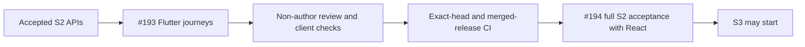

# Flutter saved risk and manual portfolio validation

Story [#193](https://github.com/IgnAite-Showcase/Finex/issues/193) implements the full local application's saved-risk and manual-portfolio journeys. It maps to FR-04 through FR-08 and NFR-01, 04, 05 and 06 in [FinEx V9.1](https://github.com/IgnAite-Showcase/Finex/blob/docs/v9.1-master-handbook/docs/governance/FinEx_Master_Product_Design_Delivery_Handbook_v9.1.pdf), pages 63–64 and 92, template S2-MOB-01.

Implementation starts from accepted W40 `949b54fffe5bb698a3d41e7d1c5a356ccb094bfc`, tree `99c08f21b9f00a8877449cca824da9a70f7cca2d`, on `feature/193-s2-flutter-risk-portfolios-w40`. The accepted #190/#191 API evidence does not replace this client's tests or #194 combined S2 acceptance.



## Required journeys

Use the [saved-risk contract](../features/local-application/S2-saved-risk-contract.md) and [manual-portfolio contract](../features/local-application/S2-manual-portfolio-contract.md). Render the ten server questions, replacement draft saves, immutable saved history and server explanations; the old five-question compatibility calculator is not the application authority. Request two history items per page and preserve server sequence and cursor strings. Deep-snapshot each assessment's answers and retain the same generated retry UUID through uncertain outcomes.

Owned portfolio and holding forms use the synthetic catalogue and decimal text, not floating-point calculations. Display server allocation, gain/loss, concentration and educational spread with source, version and original quote time. Partial and unavailable valuations preserve nulls, including all weights; the priced subset is not renormalized. After an uncertain create, refresh the owned list before any deliberate repeated POST.

## Session and accessibility checks

| Situation | Required result |
|---|---|
| Logout attempt | Advance a private request epoch immediately; stale results and late 401s remain ignored even if logout fails. |
| Failed logout or transient server check | Keep the same previously authorized owner's form mounted with unsaved input. Hidden content is offstage, excluded from focus and semantics, and noninteractive. |
| Initial authorization | Do not mount feature content before the current prerequisite check passes. |
| Confirmed logout, persona change or current 401 | Dispose previous-owner inputs, receipts and results. |
| Onboarding becomes incomplete | Regate through onboarding while preserving existing server records. |
| Validation, network or storage failure | Show safe visible retry and retained input rather than false success. |
| 320-pixel layout and 200% text | Forms and feedback remain usable, with tested semantics and keyboard behavior. |

Keep bearer and domain adapters private. Optional typed S2 injection must preserve the existing S1 API and its mocks; missing capabilities fail safely rather than reaching an unrelated default database or adapter. Preserve loopback origin validation, bounded response bytes/timeouts, no-cookie/no-redirect transport and `/pilot/*` separation.

## Initial failing tests and workspace checks

`flutter test --no-pub --concurrency=1 --reporter=expanded test/local_s2_baseline_red_test.dart` exited 1 with three genuine behavior failures: both full S2 routes still showed Pending, and a failed logout disposed an already-authorized dirty child once. The earlier silent sandbox invocation is tooling-only and excluded from RED.

That RED is preserved in normal test-only commit `73a78f387e1ebd2e88d0de15a68fc4baa9fb800b`, parent `949b54fffe5bb698a3d41e7d1c5a356ccb094bfc`. The original test SHA-256 is `6BBF0F60FFF86B0FD57B9BEED32238095346F7A25E611A9DF4FB22EF146A3BE1`. Tool elapsed time was 6.449 seconds; the Flutter runner took about one second.

The separate command `flutter test --no-pub --concurrency=1 --reporter=expanded test/local_response_size_red_test.dart` then failed one real behavior test: an active stream crossing the unchanged 262,144-byte limit and stalling at EOF waited for timeout rather than reporting `INVALID_API_RESPONSE`. The original test SHA-256 is `DF3B5C5DEEAD10F58C0B094D71FE067833E04944209FBF36D9CC30FC892B5D12`, preserved in normal test-only commit `8e635c4e85d0db49256d26f0076c45e968c2a08c`, parent `73a78f387e1ebd2e88d0de15a68fc4baa9fb800b`. The downstream Dart correction passed its focused guard. The actual conditional-JS browser adapter was tested separately as described below; the limit was not increased.

The following commands use `C:\flutter\bin\flutter.bat test --no-pub --concurrency=1 --reporter=expanded` from `frontend_flutter`, followed by the exact paths/options shown. They are focused author checkpoints, not final integrated acceptance.

| Focused paths/options | Observed result |
|---|---|
| `test/local_s2_models_test.dart` | First execution: 41 passed, 4.860 seconds. GREEN coverage only; no claimed RED. |
| `test/local_s2_transport_test.dart test/local_response_size_red_test.dart test/local_s2_models_test.dart` | 63 passed, 8.215 seconds, after correcting a UTF-8 response fixture. The fixture error is not an application regression. |
| `test/local_s2_session_test.dart` | Genuine RED: three stale success/error/401 failures and five passing controls; 3.864 seconds. |
| `test/local_s2_session_test.dart test/local_s2_baseline_red_test.dart --plain-name logout` | Corrected logout-focused selection: four passed, 6.453 seconds. This does not claim all eight session cases passed. |
| `test/local_s2_models_test.dart --plain-name "bounded metric"` | Reviewed output-range regression: 14 genuine failures and 26 passing boundary controls, 4.524 seconds. |
| `test/local_s2_transport_test.dart --plain-name MISSING_REQUIRED_QUESTION` | Partial-draft wrong-operation regression: one genuine failure and one passing submission control, 5.113 seconds. |
| `test/local_s2_models_test.dart test/local_s2_transport_test.dart` | After exact scaled-integer output bounds and submission-only missing-question errors: 109 passed, 5.270 seconds. |

The non-author reviewer rechecked the two core corrections and their boundary/operation tests. All seven reviewed hashes were unchanged before and after review (manifest `A7CFE82D09D0020FB4B5CC14CFDCEFEB950629CFC562F734AA388E06406CAC7C`). No concrete blocker remained in that correction scope: monetary values retain exact strings, nullable states remain intact and partial draft PUT no longer accepts a submission-only missing-question code. This source disposition is separate from the author's 109-test GREEN execution and is not whole-client acceptance.

The private request epoch and retained feature gate are connected without exposing a bearer getter or changing stable owner identity after failed logout.

## Whole-client non-author review corrections

The reviewer found four concrete failure paths; the author reproduced each before changing the implementation. Focused widget executions use the same serial test command above with `test/local_s2_widgets_test.dart` and the relevant test-name selection.

| Regression | Genuine failing result | Correction |
|---|---|---|
| Valuation 503 with confirmed owned holdings | One behavior failure | Preserve independently confirmed manual records and show valuation as unconfirmed; retrying reads never replays writes. |
| Catalogue 503 with confirmed portfolio records | One behavior failure | Keep independent portfolio CRUD available; no fabricated holding list, quote or valuation. |
| Coalesced logout/re-login for A→A and A→B | Two behavior failures | Bind prerequisite checks to generation as well as stable owner. A stale unresolved check cannot strand or finish the new session's check. |
| Malformed optional replay request JSON | One behavior failure | Safe boolean comparison catches parser failure without exposing raw request or credential-bearing diagnostics. |

The author then ran all 33 S2 widget tests successfully (runner approximately 15 seconds). The optional historical wire selection passed 30 tests in 4.5595 seconds: 29 original-response replays plus the safe comparison guard. The additional same-owner old-form-disposal control was GREEN on its first execution and is not claimed as RED. Formatting the four correction paths made no changes; the subsequent format check and `git diff --check` passed.

The full 26-path frontend freeze has ordinal path/SHA-256 manifest `144776F3059DCB4F865CBC6C4D5D0D3DCB35D72AD353F290BD1DFC64B42401E9`, excluding this evidence note and generated outputs. An independent agent who did not implement these Flutter changes inspected all 26 paths and verified the same manifest before and after rereview. No concrete blocker remained. This is source/test inspection, not that reviewer's execution of Flutter gates, API interaction, device checks or human UAT.

Root's full strict analysis, suite, application builds and actual API-mode journey are recorded below. Focused author checkpoints do not replace those whole-client checks.

The first whole strict-analysis gate reported 98 informational lint findings and exited 1. The official Dart fixer proposed and applied exactly 98 mechanical corrections in 12 of the owned paths: 92 brace guards, one override annotation, two null-aware collection elements, one unused wildcard spelling and two initializing formals. The latter syntax is supported by the existing Dart `^3.13.0` constraint. No analyzer suppression, assertion removal, dependency or machine setting changed; the other 14 owned paths and 188 existing tracked Flutter files were unchanged. Formatting altered three of those 12 paths. Strict analysis then passed with zero issues (runner 5.8 seconds).

The mechanically corrected 26-path freeze is `0F2A039BC63655C7934796E933058676E41BD800E7D6CB506E8267FEDC175D30`. Pre-fix hashes and official fixer diagnostics were retained, but not a pre-fix byte snapshot; an exact byte-diff comparison is not claimed. The non-author reviewer instead rereads the current full source and binds its hashes. Lint correction is not behavioral TDD RED.

Root's first complete test run passed 449 tests and failed only the two old S1 assertions that risk/portfolio were still pending S2. The runner took approximately 82 seconds. The root updated those test expectations to the delivered screen headings and the explicit no-fallback error when the S1-only mock lacks S2, retaining all prerequisite, no-invented-money and S3/S4 pending checks. A focused run passed all 39 existing application-widget tests; the stronger final heading assertions and formatting were then included in the new 27-path freeze `BE8390FEE0DDF0254C69D151ECF537CCBC61DAC5FDEFE9E709D73BB78B285E90`. This expectation maintenance and one corrected test-class typo are not product RED. Final full-suite, build and browser results remain separate.

## Final root-executed client gates

The independent, non-author reviewer inspected all 27 frozen frontend paths, verified the same manifest before and after inspection and reported no concrete blocker. This source disposition does not imply that the reviewer executed these commands.

| Command from `frontend_flutter` | Root-observed result |
|---|---|
| `flutter analyze --no-pub --fatal-infos` | Passed, zero issues; runner 8.1 seconds. |
| `flutter test --no-pub --concurrency=1 --reporter=expanded` | Passed all 451 tests; runner approximately 66 seconds. The optional historical risk-wire input was explicitly configured; it is not a required current-checkout corpus. |
| `flutter build web --no-pub --no-web-resources-cdn --dart-define=FINEX_API_BASE_URL=http://127.0.0.1:65128` | Passed; compiler 51.3 seconds. The temporary public loopback origin is acceptance-only, not a deployment endpoint. |
| `flutter build windows --debug --no-pub` | Exited 1 before compilation because this machine does not enable Windows plugin symlink support. No Windows, SDK or security setting was changed. This is not a native-build pass; the existing Windows CI build remains mandatory. |

The compiled web application's `main.dart.js` SHA-256 is `6E603ED846D184F768BC8FB0D5DD12B07E6E1BB760F55CD8709FB9787A5CBF65`; `flutter_bootstrap.js` is `B10BE329DBC1FE9B3E1AEAC7AE3E697511577A52A4C2D59879205F331FEE1317`. Generated builds and temporary response artifacts are not committed. Browser validation uses this compiled application and the unchanged accepted API with a disposable native SQLite database; it does not use injected feature mocks.

### Executed compiled-browser API journey

The Flutter application signed into the same synthetic learner used by React and resumed its confirmed profile, consent, three-answer risk draft and original immutable assessment. The remaining seven answers were selected using the actual dropdowns; the complete draft was saved, then the API returned a new Moderate assessment with willingness, capacity and composite scores all 50/100. History showed both original and new records with their original times and rules digest. No score was calculated by the device.

Flutter opened the React-created manual portfolio and read its exact canonical holding strings and backend valuation. It added an unavailable-price holding, retained the saved record and displayed incomplete overall valuation, null allocation weights and explicit missing-source/time states rather than zero or priced-subset renormalization. Editing the priced holding to `3` / `20` saved `3.000000` / `20.0000`; React independently read that changed record and the incomplete valuation. Confirmed deletion of the unavailable-price holding restored the backend's complete cost `60.00`, value `600.00` and gain `540.00`, which React also confirmed.

A separately created, validator-owned synthetic portfolio was renamed and removed through Flutter's explicit confirmation. The original shared portfolio remained unchanged. Keyboard Enter activated holding save and delete confirmation. At a temporary 320-pixel browser override, controls and wrapped labels remained usable; the override was reset. The embedded browser did not apply the zoom shortcut, so the actual-browser check does not claim 200% zoom. Automated text-scaling cases and native-device/human checks remain distinct. A browser clipboard target-change error was handled by supported keyboard input; it is tooling evidence, not application TDD RED.

After logout and sign-in as the second synthetic learner, Flutter resumed only that learner's server-confirmed onboarding. Its owned portfolio list was empty; the risk screen displayed no saved draft, zero of ten answered and no saved assessments. The first learner's records were absent. React subsequently confirmed deletion of the validator-created shared portfolio. Both verification tabs and static servers were closed, the owned API child was reaped and its temporary database removed; a listener check found none of the three verification ports still listening. Existing user demo servers were untouched. This disposable synthetic database is not a recoverable user backup.

## Controlled production JS transport checkpoint

The root validator compiled the production conditional-JS transport probe from `frontend_flutter` using:

```text
C:\flutter\bin\cache\dart-sdk\bin\dart.exe compile js -O1 --no-source-maps -o build/qa/local_web_transport_probe.js tool/local_web_transport_probe.dart
```

The existing test-only loopback server served only the probe HTML and compiled JavaScript on port 3005. The probe replaced browser responses with controlled `Response`/`ReadableStream` objects, never forwarded a request to the actual API, never used browser storage and displayed only safe case IDs and results. This is browser-adapter evidence, not actual TCP, persistent-session, native-device or full application acceptance.

Before the fix, the actual in-app browser reported 13/16 passing controls; `stream_cap_then_stall`, `stream_below_cap` and `stream_exact_cap` failed. Those three tests are preserved in normal test-only commit `e97ac4a12a2b02abe1bd6df0265fa36e61a8ed2a`, parent `8e635c4e85d0db49256d26f0076c45e968c2a08c`. The original compiled bundle SHA-256 was `BE3CB678ABF75170C0D9F44FEB0287392AC865BE1AE855756BC8AF7E9F75ABF9`.

After replacing upstream `arrayBuffer()` prebuffering with bounded reader consumption, recompilation passed in 3.10 seconds. The validator reloaded the browser page and ran the same cases: **16/16 passed**, including all 13 original controls. The 262,145-byte stalled stream was cancelled and aborted without calling `arrayBuffer()`; valid 262,143- and 262,144-byte streams remained accepted. Current 401 handling and timeout cancellation controls also passed.

After the checks and source review, only the validator-owned probe tab and port-3005 server were stopped. A listener check confirmed port 3005 was no longer listening; the existing user demo servers were left running.

| Corrected checkpoint file | SHA-256 |
|---|---|
| `lib/core/local_application/local_http_web.dart` | `B57BCF88665B45C77969CEA192BACC9C7BD1DFAB977030C64647E49D67E9562B` |
| `tool/local_web_transport_probe.dart` | `4E88A05AB2706A84C08A7DE1C02E8F8E9469A86A78708F09612ACC02CBFB0681` |
| `tool/local_web_transport_probe.html` | `3EA6C4AE53D4CC20788E3026EF642480490738EE3D9DB0AB49979991FC049008` |
| Generated `build/qa/local_web_transport_probe.js` | `4D1FA5A30DDE256F5DA0ACAC82B4B15A8C1C946272F131D8CF3E815FEC678CDF` |

These hashes identify this focused checkpoint, not a final tested commit. The non-author reviewer found no concrete blocker in this frozen JS wrapper/probe slice and verified all three source hashes unchanged before and after review (manifest `C1EFDB3818F3FDD69093F5E7CC8A1D141EC11CE5578F1F41A9D6F2268B671CF2`). That source review is separate from the root's executed browser checks and does not approve the pages, pending core corrections or whole #193. All remaining acceptance gates still apply.

## Actual saved-risk response observation

The root validator temporarily instrumented the unchanged accepted API's existing native driver without editing that checkout. Its 33 validated original UTF-8 risk responses include exact two-item history requests and their one-item continuation, with owned-child and disposable-database cleanup confirmed. The review-only artifact SHA-256 is `0f78d2e710d83255a72741f0d623ab0baaacbe317091afe4b97414da3a068a6d`; observer source SHA-256 is `5665A7801CD7A4BBDFCB9BC3ACDB55E391F4725F5B2822F91781D368E3724ADE`.

The artifact uses `finex.review.saved_risk_wire_observation.v1` and contains only synthetic public DTOs, not login responses, request headers, credentials or persona IDs. Earlier one-item and default-limit history responses must not be silently reshaped into two-item requests. Any optional replay is historical wire-decoding evidence only; it is not #194's required current-client native acceptance or CI corpus. No temporary response artifact is committed to the repository.

The new workspace's offline dependency resolution populated its own package configuration with an unchanged lockfile, but `flutter pub get --offline` exited 1 because Windows native plugin symlinks require a machine prerequisite. No OS setting or SDK was changed. `flutter test --no-pub test/local_models_test.dart --reporter expanded` then passed all 42 existing model tests. This proves the prepared workspace can run tests, not fresh-laptop or native-device setup.

## Acceptance gates

### Combined release integration

React PR #211 was merged into W40 as `493e856e273f296ce095622a341e2e0d2548a178` after all six exact-head workflows and 14 nonempty jobs passed. Its integrated release checks remain a separate gate. That merged revision was brought into the existing Flutter feature with a normal merge, preserving every local test-only checkpoint. No React or API source was modified during integration; the reviewed 27-path Flutter manifest remains `BE8390FEE0DDF0254C69D151ECF537CCBC61DAC5FDEFE9E709D73BB78B285E90`.

Before that integration, clean committed checkpoint `58219aec64760b018b31c469a942ec676d4b402b`, tree `14b32e454c1911ab07d8da4e59ee556579326afc`, passed strict analysis with zero issues in 6.5 seconds, all 451 full-suite tests in approximately 72 seconds, and a local-assets production web build for the supported port-8082 API origin in 51.9 seconds. Its selected native S1 wrapper passed all 24 checks, five starts, two restarts and a genuine 60.046-second expiry, with child/database cleanup confirmed; the required Flutter current-corpus parity suite passed all 29 tests. The wrapper command was `scripts/verify-s1.ps1 -Component Flutter -Python <existing Python 3.12.14 venv> -Flutter C:\flutter\bin\flutter.bat`. These results belong to that checkpoint, not an unexecuted combined revision.

The final combined candidate's exact commit/tree, unchanged source manifests, full client checks and native proof are recorded in its PR after execution. Publication and completion still require every applicable exact-head and post-merge release job. Combined #194 retains the remaining React 200% browser/text-scale limit and the current S2 corpus, setup/handoff and rollback gates.

Before #193 is Done, retain exact RED/GREEN commands, source hashes and tested identity; run strict analysis, the complete suite, an applicable compiled build and controlled API-mode journey serially. Review must be non-author and distinguish agent review from human UAT. Public typed replay of actual native response bytes is separate from browser transport and UI checks.

Publish the tested tree, require complete applicable exact-head CI and merge only the verified head into the approved release. Integrated post-merge checks must also pass before completing this new card. #194 then verifies both clients together, including current-checkout native wire corpora, reproducible setup and safe rollback. External #129, #132 and #134 remain separate; no native device, cloud or production approval is claimed.
