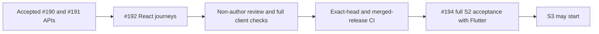

# React saved risk and manual portfolio validation

Story [#192](https://github.com/IgnAite-Showcase/Finex/issues/192) implements the full local application's saved-risk and manual-portfolio journeys. It maps to FR-04 through FR-08 and NFR-01, 04, 05 and 06 in [FinEx V9.1](https://github.com/IgnAite-Showcase/Finex/blob/docs/v9.1-master-handbook/docs/governance/FinEx_Master_Product_Design_Delivery_Handbook_v9.1.pdf), pages 62–64 and 92, template S2-WEB-01.

The accepted API baseline is W40 `949b54fffe5bb698a3d41e7d1c5a356ccb094bfc`, tree `99c08f21b9f00a8877449cca824da9a70f7cca2d`. #190 and #191 passed independent agent review, exact-head CI and their integrated release checks. The React implementation starts on `feature/192-s2-web-risk-portfolios-w40`; its own acceptance remains pending until the gates below pass.

## Required journeys

The [saved-risk contract](../features/local-application/S2-saved-risk-contract.md) and [manual-portfolio contract](../features/local-application/S2-manual-portfolio-contract.md) are the shared API authority. The full `/risk` screen uses all ten ordered server questions, resumable replacement drafts and immutable saved assessments. History requests use two results per page. A network-uncertain assessment retry retains a deep snapshot of the same input and its original generated UUID; a new assessment deliberately starts a new key. Equivalent reordered retries may return the original saved answer order.

The full `/portfolio` screen manages owned portfolios and holdings from the supported synthetic catalogue. Quantity and cost are decimal strings, normalized without floating-point arithmetic or rounding away invalid precision. Charts and numbers display the server's metrics rather than recalculating them. Missing prices retain null valuations and explicit unavailable metadata; invented quotes are never described as live market observations. An uncertain create refreshes the owned list before a deliberate retry, not an automatic repeated POST.

## Session and failure checks

| Situation | Required result |
|---|---|
| Logout starts while a request is in flight | Invalidate that request immediately, including any late success, error or 401. |
| Logout fails | Retain the same owner's mounted form and unsaved input; show a safe retry. |
| Logout succeeds, persona changes or current session expires | Remove previous-owner inputs, receipts and cached results. |
| Current onboarding is withdrawn or incomplete | Regate through onboarding; do not erase saved server records. |
| Save, provider or network failure | Show visible accessible feedback without claiming the operation succeeded; retain editable input where the session remains valid. |
| Narrow screen and keyboard navigation | Controls, errors and retry remain reachable at 320 pixels and 200% text scale. Hidden retained controls cannot receive focus. |

Authenticated adapters and the bearer remain private to the session. Pages receive named typed domain operations, never a token getter or callback that exposes the token. The old `/pilot/*` paths remain separately labelled and unchanged.

## Initial failing tests

On the accepted baseline, the first two behavioral tests in `src/App.s2.test.tsx` reached the full risk and portfolio routes and failed because both still displayed pending-delivery screens instead of the delivered headings and safe missing-capability feedback. The serial Node 24 Jest run exited 1 with two failed tests in 3.834 seconds. Earlier sandbox/runtime and test-login-helper errors are excluded from TDD evidence.

The exact npm arguments were `test -- --runInBand --watchAll=false --runTestsByPath src/App.s2.test.tsx --silent`, invoked through Node 24.19.0 and the installed npm CLI with that Node directory first in the child process PATH. The test-only checkpoint is `2bff4c82c081158f8737f3fe7fd7da62a098991a`, parent `949b54fffe5bb698a3d41e7d1c5a356ccb094bfc`; its original test SHA-256 is `B0563F6252ECDFB2FE007DBD3333183DFBE2C6CAAAAE8B40222BCB5B9313B5A7`. This normal commit preserves the failure before implementation. A later removal of an unsupported Testing Library option is a typing correction, not a weaker heading or error expectation.

Additional focused author runs use the same npm arguments, replacing only the `--runTestsByPath` paths below. The model, transport and capability stubs were importable typed implementations with deliberately missing behavior; module/import failures are not counted. Route tests reached importable skeletal screens.

| Focused paths | Initial behavior result | Corrected focused result |
|---|---|---|
| `src/services/localS2Models.test.ts` | 10 failed, 12 passed; 1.968 seconds | 22 passed; 1.643 seconds |
| `src/services/localS2Client.test.ts` | 13 failed; 1.649 seconds | With unchanged `src/services/localApplicationClient.test.ts`: 73 passed; 3.596 seconds |
| `src/context/LocalSessionContext.s2.test.tsx` | 6 failed; 2.554 seconds | With `src/context/LocalSessionContext.test.tsx`: 29 passed; 2.809 seconds |
| `src/App.s2.journey.test.tsx` | 5 failed because required risk and portfolio forms were absent; 7.616 seconds | Six implemented journey tests passed in the later four-suite checkpoint below. |

These are focused author checkpoints, not final integrated acceptance. The backend's `fieldErrors` array and nested `rules_snapshot.questionnaire` metadata were incorporated into the client rather than changing the accepted API. The four-suite selection of models, transport, journeys and initial route tests then passed 50 tests in 8.666 seconds.

Further genuine RED checks found eight allocation-group/cursor-cardinality failures with two passing controls, followed by 33 model tests passing after correction. Three streaming cleanup regressions then failed on the transport selection: an unresolved cancellation promise replaced prompt overflow with a timeout, a stalled reader was not cancelled and a current 401 left its fetch active. After correction, all 22 transport tests passed in 1.742 seconds. These checks preserve exact held asset/sector group sets and the two-item cursor contract without recalculating financial metrics or increasing response limits.

A real provider/guard test subsequently batched completed logout and re-login without an intermediate signed-out render. Three risk/portfolio cases passed on the existing gate in 3.162 seconds: previous-owner dirty input was removed and a late cancellation-ignoring 401 could not invalidate the new session. This is GREEN-only compatibility evidence, not a fabricated RED. An explicit child mount key was also added as defense in depth; failed logout retains the current owner's key.

## Non-author review corrections

The root reproduced the review findings before correcting their behavior. These checkpoints use the same serial Node 24 npm command and explicitly selected paths; tooling errors and fixture-name corrections are not counted as application RED.

| Regression selection | Genuine RED | Corrected behavior |
|---|---|---|
| `src/App.s2.http.test.tsx` plus the whitespace-name journey | Three failures, 26 passing controls; 14.782 seconds | Cold imports work in either order, the default App's real HTTP adapter passes both typed decoding layers, and invalid local input never sends a POST or freezes the form. |
| `src/services/localS2Client.test.ts`, catalogue error authority | Five failures, three passing operation controls; 1.590 seconds | Catalogue-specific 503 errors are valid only for catalogue-dependent operations, not independent portfolio CRUD. |
| `src/App.s2.journey.test.tsx`, independent portfolio records during catalogue failure | One failure; 2.573 seconds | Confirmed portfolio CRUD remains available. Unknown holdings and valuations are not invented or replaced with empty/zero values. |
| The same journey file, wrong-parent refresh and failed follow-up after confirmed DELETE | Two failures; 5.177 seconds | Only the original portfolio's confirmed holding read clears its creation warning. A confirmed deleted portfolio is removed even if a later full-list read fails. |
| The same journey file, confirmed create followed by failed detail read | One failure; 3.578 seconds | The validated created record remains saved; retrying a read never silently repeats its POST. |
| The same journey file, `--testNamePattern="failed catalogue reload"` | Two failures; 2.456 seconds | Holding edit/delete and an already-open holding confirmation are disabled after catalogue failure; independent portfolio actions stay enabled. |

The last control correction passed all 18 journey tests in 9.943 seconds. The earlier four-suite checkpoint (`App.s2.http`, `App.s2.journey`, `App.journey` and `localS2Client`) passed 64 tests in 14.085 seconds, and standalone `tsc --noEmit` passed in 7.600 seconds. The S1 journey's old pending-portfolio heading was updated to the implemented S2 heading without removing its prerequisite or retry assertions; this is expectation maintenance, not new product RED. The cursor transport assertion now explicitly tests both port 8000 and 8082 instead of depending on an inherited build origin.

The neutral `localApplicationBoundary.ts` has no runtime dependencies. S1 re-exports its unchanged boundary API, S2 models depend only on that neutral module and the S2 client's application-client imports are erased types. This removes the eager module cycle without weakening the existing S1 contract.

The first whole 25-path correction freeze (`68FE7D2C16D91DB9DFE773593CE1F252C76AB62943A8DBD25506F583709540DA`) passed non-author source inspection, all 453 tests in 24 suites (27.837 seconds, including explicit historical risk replay), standalone TypeScript and a production build. That compiled build's actual browser sign-in then exposed a separate host-transport failure; those results do not imply a working browser journey.

The actual API was healthy, the build contained its owned origin and exact CORS preflight succeeded, but the embedded browser still showed the safe unavailable error. A non-arrow global-fetch regression reproduced a receiver-sensitive host call failure: one genuine failure and two passing cold-import controls in 4.584 seconds (test source SHA-256 `DD75B51074028E6281A50429BE00FB3FD2CAEA442E06FD7AB7900CED1E16B73F`). Both clients had copied the native global fetch into a local variable and invoked it unbound. Binding only the global fallback passed all three tests in 2.382 seconds. Injected fetch functions remain unchanged; a further explicit control checks their undefined receiver, two calls and zero global-fallback use. Actual browser confirmation remains a separate gate, not inferred from this synthetic host test.

The receiver-corrected 25-path frontend freeze has ordinal path/SHA-256 manifest `8D9989BB81C75F65E80D600D02FB760326034D7A4283E1A5E7169DA9F5905A24`. It excludes this evidence note and generated builds. The non-author reviewer verified the same hashes before and after and found no remaining concrete blocker. Root's full suite passed **454 tests in 24 suites**, 25.176 seconds, including 25 compatible original historical risk responses and the configuration guard. Standalone `tsc --noEmit` passed in 6.232 seconds. The production build succeeded with CI enabled and its public API origin set to the isolated owned loopback server; generated main bundle SHA-256 is `0DC507571390A027A0198320400038C0E1CDB593E09ECEA431CAED8CAD751966`.

After explicitly reloading the compiled browser tab, sign-in succeeded, consent and profile drafts saved on the native backend, and Complete onboarding reached the server-confirmed dashboard. A three-answer risk draft survived reload and same-persona re-login; the completed ten-answer submission returned the server's Moderate 50/100 assessment, immutable original calculation time and stored rules digest. Explicit history reload returned that unchanged saved assessment. These are actual compiled-browser/API observations, separate from the test doubles; the remaining checks are recorded below.

## Compiled-browser portfolio and isolation checks

Against the unchanged accepted API and its disposable native database, the root created a synthetic portfolio, added a holding from decimal input `1.2300` / `10`, edited it to `2` / `12.5`, renamed its parent and confirmed deletion of a second unavailable-price holding. Saved quantities and costs were displayed as the server's exact canonical strings. A missing-price holding made overall valuation incomplete: overall values and allocation weights remained unavailable rather than treating its price as zero or renormalizing the priced subset. Removing that holding restored the backend's complete synthetic valuation. Original quote time, calculation time and source/version labels remained distinct.

Keyboard Enter activated the portfolio edit action and its cancel control. At a temporary 320-pixel browser override, the page and all main form controls fitted without horizontal overflow; the measured content width was 312 pixels after the scrollbar. The override was reset. The embedded browser did not apply the attempted zoom shortcut, so an actual 200% React browser-zoom or text-scale result is **not** claimed. Combined #194 acceptance must retain that remaining accessibility limit until verified.

After confirmed logout, the second synthetic learner had a blank independent onboarding profile. Completing that learner's synthetic onboarding exposed an empty owned portfolio list, no risk draft, no checked questionnaire answers and no saved assessments. The first learner's portfolio label and records were absent. The compiled Flutter client separately resumed the first learner's saved onboarding, three-answer draft and original immutable assessment from the same native API; it then saved the complete ten-answer draft and a second server-calculated Moderate assessment. This demonstrates cross-client server persistence, not human UAT or a native-device check.

After signing back into the original learner, React read Flutter's holding edit (`3.000000` units / `20.0000` average cost) and its saved unavailable-price holding. Once Flutter confirmed removal of that unavailable-price holding, React's explicit refresh showed the same complete backend valuation: cost `60.00`, value `600.00`, gain `540.00`, with the unchanged synthetic quote time. Neither client silently recalculated or relabelled the quote as live.

React then confirmed deletion of the validator-created parent portfolio and displayed the explicit saved-deletion confirmation and empty owned list. Flutter's second-learner check independently showed no draft, zero of ten answered and no saved assessments. Only disposable synthetic records were used. Both verification tabs and static servers were closed, the owned API child was reaped and its temporary database removed; a listener check found none of the three verification ports still listening. Existing user demo servers were untouched. The removed test database is disposable, not a recoverable user backup.

## Historical API bytes and actual risk observation

The final committed repeat used the supported public build origin on port 8082 and exposed a test-isolation defect: both historical replay adapters inherited that origin while their safety assertions required port 8000. The two injected mock adapters now explicitly select port 8000. Their original response bytes, request/body equivalence, credential omission, no-store, no-redirect, single-call and no-reflection assertions remain unchanged. This corrects the replay setup; it is not an API behavior change or product TDD RED. The earlier 25-path source manifest identifies the pre-correction checkpoint; publication must bind the updated two test hashes and rerun the complete checks.

The bounded historical portfolio fixture is derived from the accepted #191 native capture and is explicitly labelled as historical public-wire replay, not current-client TCP or browser acceptance. Its 31 original UTF-8 cases and six provenance/privacy guard controls passed 37 focused tests in 1.585 seconds. Two earlier raw-versus-trimmed request-matcher failures were test-fixture corrections, not application RED.

For saved risk, the root temporarily instrumented the unchanged accepted API's existing native driver. Its 33 validated original UTF-8 responses include exact two-item history pages and their one-item continuation, with owned-child and disposable-database cleanup confirmed. Review-only artifact SHA-256: `0f78d2e710d83255a72741f0d623ab0baaacbe317091afe4b97414da3a068a6d`; observer source SHA-256: `5665A7801CD7A4BBDFCB9BC3ACDB55E391F4725F5B2822F91781D368E3724ADE`.

The temporary risk artifact uses `finex.review.saved_risk_wire_observation.v1` and retains only synthetic public DTOs, not login responses, request headers, credentials or persona IDs. Earlier one-item/default-limit pages must not be reshaped into fixed two-item transport requests. Any curated replay remains historical decoding evidence only; #194 must generate formal current-client native corpora. Temporary driver reports and machine-specific artifact paths are not committed.

## Acceptance gates

Before #192 is Done, retain the exact RED/GREEN commands and tested commits, changed source hashes, non-author review findings, complete React suite, standalone TypeScript check and production build. A controlled compiled-client journey must use its own loopback API and temporary synthetic database, preserving the existing demo. Native wire decoding and browser interaction are distinct checks; neither proves a native Flutter device or human UAT.

Publishing must preserve the tested tree, read back the exact PR head and approved release base, and wait for every applicable workflow and nonempty job to complete successfully. After the safe merge, integrated release CI must pass before completing this new card. #194 remains responsible for combined S2 parity, setup, handoff and rollback evidence; S3 stays gated on that acceptance. External #129, #132 and #134 are unchanged.
