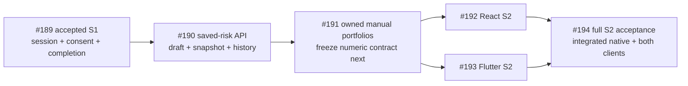

# S2 saved risk API acceptance

Story [#190](https://github.com/IgnAite-Showcase/Finex/issues/190), branch `feature/190-s2-saved-risk-w40`, target `release/2026-W40`. Accepted prerequisite: full S1 [PR #208](https://github.com/IgnAite-Showcase/Finex/pull/208), W40 `c912df3ffaa6a1dfc81a6d5a27d5eb4666c54221`. V9.1 S2 templates/pages 61–64 and 92 map this slice to FR-04 questionnaire, FR-05 deterministic scoring and FR-06 educational explanation. The master remains linked from the [delivery supplement](../features/local-application/S1-S4-delivery-contract.md); this record adds reproducible implementation evidence, not new financial policy.

The API slice is accepted through [PR #209](https://github.com/IgnAite-Showcase/Finex/pull/209), W40 `26f7261189cbf3aa6be61ce44b6fdcf0ee2489b9`; #190 is Done and closed completed. Failed and intermediate runs below retain their historical scope. Combined current S2 acceptance belongs to [#194](https://github.com/IgnAite-Showcase/Finex/issues/194), not this API-only certificate.

The [frozen API contract](../features/local-application/S2-saved-risk-contract.md) is authoritative for the six endpoint shapes, canonical UUIDs/hashes, validation precedence and error matrix. Its SHA-256 is `9961EE2B770085126C0A211262A35E49F9E2E0BBD0EF5D181C1A20FA41278EBA`. The approved ten-question engine, 16 golden cases and legacy stateless pilot stay separate and unchanged in meaning. No LLM determines the score.

## Delivery order and scope



#190 implements `/api/v1/local-risk/questionnaire`, `draft` GET/PUT, `assessments` POST and `history`/assessment-detail GET. Each protected request uses the existing S1 session and current consent/completion. Writes check authorization in the same locked transaction; reads see one consistent snapshot. Schema 2 preserves S1 data and adds an owned draft plus append-only saved assessments. A saved result includes its exact original input, ordered rules snapshot/hash, calculation time and educational explanation. Reordered equivalent retries return the original document; changed valid input with the same owner/key conflicts without another row. Corrupt data fails safely instead of inventing a successful result.

This API slice does not deliver portfolio metrics, client risk screens, market quotes, simulated execution, goals, deployed identity or cloud hosting. Those stories remain pending their own dependency gates.

## Test first and review corrections

| Check | Actual result | Scope and limitation |
|---|---|---|
| New 52-case saved-risk HTTP contract before runtime implementation | 51 failed / 1 passed, 213 warnings, 20.91 seconds; exit 1 | Tested accepted S1 source `c912df3ffaa6a1dfc81a6d5a27d5eb4666c54221` plus new test bytes. Failures were missing endpoint/OpenAPI assertions, not import/setup errors. The passed disabled-feature case is a negative control. |
| Test-first seed retained locally | Commit `8ea209b2714698e7c3a9591c03c55a843c1f9d25`; test SHA-256 `C518F1C504F5D5DDC795F019E7B7DD8A471D70F4818ED0806C3DEB3502E08CA2` | The RED run preceded this commit; identical test assertions were committed afterward. Do not label the earlier run as having executed this SHA. |
| Initial shared S1/S2 HTTP regression | 108 passed, 445 warnings, 41.77 seconds; exit 0 | 52 new contract + 17 additional transport + 39 existing S1 API/OpenAPI checks. This was an intermediate dirty source tree, not final commit acceptance. |
| New CI contract assertions before workflow updates | 2 failed, 0.37 seconds; exit 1 | Detected missing saved-risk native step and both-platform verifier type checks. |
| CI/harness tests after updates | 8 passed, 0.50 seconds; exit 0 | Includes wrong/dirty source rejection before process start, wire/cleanup failures, report no-overwrite and safe diagnostics. |
| Independent native/CI source review | Separate reviewer ran 8 passed, 0.96 seconds; exit 0 | Complete driver/test/workflow review. Source/unit design only; native TCP/restart/full API acceptance is below. |
| Stored rules snapshot review and correction | Reviewer reproduced acceptance of boolean score, non-text label and reversed options; expanded real RED: 109 failed / 58 passed, 14.49 seconds; corrected matrix: 167 passed, 3.95 seconds | Strict factory shape/type/order/formula checks now reject malformed saved rules. Default pilot constructor and arithmetic are unchanged. Independent re-probes and final source acceptance remain required. |
| Independent snapshot correction review | 320 passed, 4.27 seconds; exit 0; three valid baselines and six corrupted public detail/history probes behaved correctly | Boolean scores, non-text labels and reversed options now fail through the safe storage boundary. Seven reviewed source/test hashes remained unchanged. This is not native/CI acceptance. |
| Final focused service/scoring regression | 320 passed, 1.61 seconds; exit 0; owned Ruff/format and both type-platform targets passed | Includes shared authorization, complete/partial validation, default pilot, 16 golden cases and specification checks. Intermediate dirty-source evidence, not full candidate acceptance. |
| Concurrent schema bootstrap correction | Real creator race: 1 failed / 160 passed, 30.00 seconds. Journal classification/budget RED: 3 failed / 3 passed, 0.20 seconds. Final storage/S1 regression: 169 passed, 289 warnings, 34.90 seconds | Only BUSY/LOCKED journal initialization retries within one three-second budget, with schema reinspection. No DDL/domain transaction replay. Linux/Win32 strict typing and owned Ruff/format passed; independent review remains separate. |
| Both real native lock orders | Expanded atomicity file: 12 passed, 1.47 seconds; independent run: 12 passed, 4.44 seconds. Separate independent schema/journal run: 39 passed, 6.62 seconds | An earlier S1 withdrawal/logout blocks a waiting risk save. An earlier risk commit completes exactly once, then the waiting S1 change denies later access while preserving the snapshot. These additional inverse-order cases were already GREEN, not invented RED evidence. |
| Risk-only store injection | New two-case constructor-spy regression: 2 failed, 13 warnings, 0.74 seconds before the guard; 2 passed, 13 warnings, 1.35 seconds afterward | An explicit risk store without its S1 counterpart now fails safely with `503 LOCAL_STORE_UNAVAILABLE`, including a falsey injected store. It never silently constructs an unrelated default S1 database. Independent root re-review remains required. |
| Malformed bearer before unavailable injection | Follow-on RED: 1 failed, 9 warnings, 0.83 seconds (`503` instead of required `401`). Corrected shared bearer guard plus all S1 API/OpenAPI/transport cases: 59 passed, 241 warnings, 8.41 seconds | Strict token syntax now fails before service/store construction, preserving `401 SESSION_INVALID`. These are focused dirty-source checks; final clean candidate and independent review remain separate. |
| Clean historical candidate `7491a422f39203c8929ddded4527f986fa4ebd42` | Full backend: 1,056 passed, 1,243 warnings, 119.74 seconds, 84.83% coverage with the unchanged 70% floor. Ruff lint/format and both type-platform targets passed. Native S1: all 24 checks, two restarts and 60.078 seconds of real elapsed expiry. Native S2: all 17 checks and two restarts. | Tested clean tree `ef6bf89f7a89d473d9a10f421bc317c0410913bf` with Python 3.12.14 on Windows; all owned children were reaped and temporary databases removed. These are historical results, not acceptance for the subsequent documentation correction. |
| Historical secret snapshot gate | Failed on one `generic-api-key` finding: the authored `idempotency_key` example UUID at contract line 101. The synthetic detector probe was detected and redacted. | The retry identifier was not a credential. The example is now an unmistakably synthetic, valid UUIDv4 with an explicit new-key/retry instruction. No scanner rule, threshold or exclusion changed; the corrected committed candidate must pass a fresh scan. |
| Published PR #209 report-location correction | The first head `bcbe27263ebaa147fa8a6cb14d190b027dad9e3f` passed 80 focused Linux cases, then the native proof correctly failed `PROVENANCE_MISMATCH` before starting a server: earlier CI reports were untracked files inside the checkout. New CI assertions: 3 failed / 1 passed, 0.57 seconds. Corrected CI/harness matrix: 10 passed, 0.34 seconds. | All five reports now live in the runner's owned temporary evidence directory; summary and artifact paths use the same explicit allowlist. Source-cleanliness, runtime hashes, secret rules and application behavior are unchanged. Exact corrected-head CI is still required; the failed head is historical evidence, not accepted release evidence. |
| Follow-on workflow-context correction | Head `a973e1c115588d9ddb03e6f2758305a3d1cc2d79` produced a failed workflow-validation run with no jobs. Checksum-pinned actionlint 1.7.12 reproduced the forbidden job-level `runner` context at line 17. New regression: 1 failed / 4 deselected, 2.56 seconds; corrected CI/harness matrix: 11 passed, 0.15 seconds. All five repository workflows then passed syntax/context validation. | The mandatory setup step now creates the same directory using `RUNNER_TEMP` and exports it through `GITHUB_ENV` before any writer. The [official context availability rules](https://docs.github.com/en/actions/reference/workflows-and-actions/contexts#context-availability) permit runner information in steps, not job-level `env`. No clean-source exception or application change. Optional external shellcheck/pyflakes were not installed, and hosted exact-head execution remains required. |
| Clean historical correction candidate `a1482ee30fe8d57ffa559a4d983ec0268e1329bf` | 1,058 backend tests passed, 1,243 warnings, 139.14 seconds, 84.83% coverage with unchanged 70% floor; Ruff/format, both type-platform targets and synthetic-probe/secret snapshot passed. Native S1: 24 checks, two restarts and 60.140 seconds actual expiry. Native saved risk: 17 checks and two restarts; owned children reaped and temporary databases removed. | Clean tree `bfeda3ff70916f8367fa9841886822b3f2bb3943`, Python 3.12.14 on Windows. Application/runtime bytes are unchanged by the follow-on workflow correction, but these results are historical provenance, not a claim that its new committed candidate or hosted CI has passed. |

A shared authorization test initially used unsupported fixture versions `v1` instead of `profile.v1`/`consent.v1`. Correcting the fixture produced 21 independent passing tests. That fixture error and earlier sandbox temporary-directory failures are not credited as production TDD RED evidence.

## Reproduce the API and storage checks

From an existing bootstrapped backend, run commands serially with a new owned pytest directory:

```powershell
$s2RiskPytestTemp = Join-Path ([IO.Path]::GetTempPath()) ('finex-s2-risk-tests-' + [guid]::NewGuid().ToString('N'))
python -m pytest tests/contract/test_local_s2_risk_api.py tests/contract/test_local_s2_risk_transport.py tests/unit/test_local_authorization.py tests/unit/test_local_risk_service.py tests/unit/test_local_risk_validation.py tests/unit/test_local_risk_store.py tests/unit/test_local_risk_sql.py tests/unit/test_local_schema_migration.py tests/unit/test_local_journal_initialization.py tests/integration/test_local_risk_atomicity.py tests/unit/test_s2_saved_risk_harness.py tests/unit/test_s2_saved_risk_ci.py --no-cov --basetemp $s2RiskPytestTemp
```

Targeted GREEN is not full regression acceptance. Run the complete backend quality workflow commands, retaining the existing coverage floor, both Linux/Win32 mypy targets and all legacy golden/API tests. Then run the native S1 proof and the separate [S2 saved-risk proof command](../runbooks/native-local-application.md#owned-s2-saved-risk-api-proof) on the exact clean committed candidate. Do not point tests at a saved developer database or a running demo.

The saved-risk proof requires all 17 checks: disabled/missing-bearer pre-storage denial; current S1 prerequisites; ordered ten-question contract; owned partial draft; numeric/rules snapshot; original equivalent replay; conflict with unchanged history; owner-scoped history/detail; empty draft preserving history; first restart; stable bounded cursor; withdrawal/recompletion; durable logout; second restart; safe wire data; owned cleanup. Four owned process starts and two same-file restarts are actual TCP operations, not mocked claims. The S1 verifier separately proves real elapsed session expiry.

## Final acceptance gates

| Gate | Required evidence | Current state |
|---|---|---|
| Non-author source review | Authorization/router/DTO, dedicated risk service/AI snapshot factory, preserving SQLite migration and tests, native proof/workflows | Accepted, including exact 38-file binding and 114/118 runtime hash checks; no remaining findings. |
| Full candidate quality | Actual commands, runtime versions, tests/coverage, unchanged approved goldens and both type targets | Clean local `4341a74399bedbe6d75c1ca53a1c8920416719a9`: 1,059 backend tests, 84.83% coverage with unchanged 70% floor, full Ruff/format and 117-file Linux/Win32 type checks passed. Local Python was 3.12.14; hosted Linux used the specified Python 3.13. |
| Native S1 and saved-risk proof | Exact local commit/tree and runtime hashes, real TCP, restart/isolation/retry/withdrawal/logout and safe cleanup | S1 24 and original saved-risk 17 checks passed, two restarts each and 60.469-second real S1 expiry; owned cleanup passed. |
| Secret snapshot gate | Committed tracked-tree scan plus genuine redacted synthetic detection | Passed with zero current findings; not a Git-history credential audit. |
| Published head | Identical tested tree, accepted W40 parent, reviewed paths and read-back identity | Accepted corrected head `99cb4a31d42f3fd19b4433772381ebf7bf59a0ac`, tree `41a17ed6920cd0332635f35e220d2cae11f32f40`, identical to the clean tested tree. Earlier failed heads remain historical. |
| Release acceptance | All exact-head jobs, non-author technical review and SHA-locked W40 merge; post-merge jobs green | All 14 candidate and seven post-merge jobs passed. Merge `26f7261189cbf3aa6be61ce44b6fdcf0ee2489b9`; [backend](https://github.com/IgnAite-Showcase/Finex/actions/runs/38156216141), [release evidence](https://github.com/IgnAite-Showcase/Finex/actions/runs/38156216099), [integrated S1](https://github.com/IgnAite-Showcase/Finex/actions/runs/38156216133). No downstream promotion. |
| Project/card | Accepted release read-back; no assignment or legacy-card change | #190 Done and closed completed; [acceptance comment](https://github.com/IgnAite-Showcase/Finex/issues/190#issuecomment-6111332608). |

The final issue acceptance comment and linked PR/CI provide the tested local SHA, published head/tree and merged release SHA after those values exist. This avoids changing a committed evidence file merely to insert its own future hash. Failed or historical runs stay identified; a later GREEN does not rewrite their result.

## Developer handoff and limits

Use the [native runbook](../runbooks/native-local-application.md) and [data dictionary](../features/local-application/local-data-dictionary.md) for no-Docker setup on 8/16 GB machines, schema-1 preservation, immutable history, backup and safe feature-disable/forward-correction recovery. Bearers are memory-only and never exported with reports. Reports contain outcomes, provenance and source hashes, not login responses, credentials or SQLite files.

Acceptance is local educational API behavior. Native-device GUI, two fresh developer machines (#129), historical credential-owner rotation (#132), cloud/auth/privacy/cost deployment (#134) and human UAT are separate gates. No real PII, personal financial advice, real money, live provider, paid CI allowance or production deployment is claimed.
