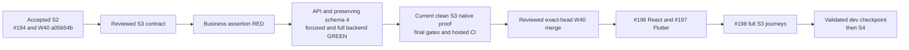

# S3 API implementation and validation

The S3 candidate implements supported synthetic market search and quotes, owned
watchlists and explicit simulated account opening. It follows
[#195](https://github.com/IgnAite-Showcase/Finex/issues/195), V9.1 pages 65–68/93,
FR-09–FR-12 and the [reviewed foundation contract](../features/local-application/S3-market-foundation-contract.md).
The API was accepted through [PR #215](https://github.com/IgnAite-Showcase/Finex/pull/215)
at W40 commit `e4aff0343e3aad6db7bbe7bdfdf5fae4328da8f7`, after final native
proof, independent technical review, full backend gates and successful candidate
and post-merge CI. #195 is Done and closed completed. React #196 and Flutter
#197 are in progress; full S3 #198 remains a separate acceptance gate. S4 orders
and goals are not implemented here.

## Test first evidence

| Step | Actual result | Meaning |
|---|---|---|
| Initial API/schema tests, local `a2806c7e90a49e3bbf5022052e2cec17372ff105` | 147 failed / 12 passed, independently reproduced; zero collection errors | Missing supported behavior and migration assertions, not absent modules or dependency setup |
| Strict wire/replay controls, local `d764706f25628960cec6625fbc80398e437a23a7` | Selected 9 failed / 8 passed, independently reproduced | Exact types, versions, parent bindings and original replay metadata |
| S3 OpenAPI controls before correction | 4 failed | Runtime five-key error envelope and optional empty mutation bodies were not documented accurately |
| Wrong-clock/stored-precision controls | 5 failed / 5 passed, then all 10 passed | Wrong shared clock types must return safe storage failure; S3 stored UTC precision must not be truncated |
| Corrupt store-confirmation controls | 4 failed, then the full fault file 14 passed | Reject invented opening receipts and inconsistent duplicate/reversed owned-list projections |
| Current S2 native schema observer at local `e9b6bc227fb1fd3d22cc9c1adb494bd20cc0eec3` | 2 failed / 9 passed, zero errors | The old verifier rejected current generation 4 and accepted unmigrated 3 |
| Minimal current-owner correction and all focused harness controls | 145 passed including two independent probes | Retain strict foreign/type/duplicate/no-write checks and the compatible historical S2 baseline label |
| S3 CI controls before wiring, preserved in local `cedc5e5cb660ae172c767b7c89f0f401cdb54c56` | 14 failed / 23 existing S1/S2 controls passed; zero errors | RED ran on the then-uncommitted test file; the subsequent local commit preserves the assertions, not a falsely labelled clean-commit run |
| S3 CI wiring and unchanged S1/S2 CI controls | 37 passed | Existing six-file S1/S2 artifact/parity gates remain intact; S3 API proof is a separate required job |
| Initial importable native-tool controls | 120 failed / 56 passing controls, zero collection errors | Strict wire/provenance/lifecycle requirements were not yet implemented; no native TCP claim |
| Windows reparse/junction controls before correction | 16 failed, zero errors | SQL and recursive-deletion spies proved redirected paths could reach mutation/cleanup |
| Corrected complete native-tool suite | 234 passed; 29 visible deprecation warnings | Metadata simulations and bounded in-process/mock controls only, not actual junction creation or native acceptance |

Eight original S3 snapshot failures were test-fixture maintenance: the validator
now permits only the independently declared, empty newly added tables while
requiring exact original objects, rows and sequences. Earlier generation
fixtures retain frozen definitions; current generation/future markers advance
to 4/5. These corrections are not invented product RED evidence. Runtime setup,
empty optional evidence flags, sandbox temp permissions and formatter invocation
errors are not counted as TDD defects.

The CI selector initially also matched the test filename containing the driver
name. It was corrected to select an actual `python <driver>` command; that
checker correction is not a new product RED claim. Independent native-tool
review also caught a Windows junction/reparse safety gap before installation.
The correction is independently approved: both root and reviewer reproduced all
16 new negative controls passing. The reviewed implementation is installed;
clean native execution subsequently passed as recorded below. Mock lifecycle
coverage alone does not certify real native cleanup. The installed harness plus new/existing CI controls
also passed all 271 tests; the 29 deprecation warnings remain visible.

The three installed tool/test raw SHA-256 values are:

| File | Installed SHA-256 |
|---|---|
| `verify_s3_foundation.py` | `4BA0B319B3189BAF50F319D011477E01CA08D008CF984B0015CA44319B31CE32` |
| `verify_s3_evidence.py` | `0E83985EECB950CD54EEDFC7576AB21105F7EF03E02CA97FCEF19EFBC9900BB0` |
| `test_verify_s3_foundation.py` | `B9713237A7FB58CB0688EA253356971A9A43BC6C819F41C30DDE34C77F77C68F` |

The ordinal repository-path/uppercase-SHA manifest is
`22BD0F3F1FD61266E1835708A5F6322515A3BC0B1B6308B3FBF994128695CC07`.
It records these three installed source files, not a native report or corpus.
The reviewed staging manifest was
`7AAA8000A7AC386A9B9F64DE674CC61A9BAB000779BC7E972F754538B2B5FFB7`;
repository-local Ruff required only four import-order/blank-line corrections
after installation. No guard, test assertion or native behavior was relaxed.
The full repository lint/format pass covers 256 files. Local import-root setup
mistakes are not counted as product RED or native evidence.

## Backend source review and initial full gates

The implementation author's 24-path source/test manifest is
`32C6A2F77498C338A30880E1F5B4BC87536A4C4CDBA1E09F77F79F844B3EA1A2`.
Before the separate current-schema observer correction, the full backend passed
2,367 tests, zero failures/errors/skips, 87.63% coverage against the unchanged
70% gate. Both complete Linux and Win32 mypy commands targeting Python 3.13
passed for 136 source files; Ruff lint/format checks passed. The actual local
interpreter is Python 3.12.14, not a claimed hosted Python 3.13 run.

Independent technical-agent source review approved committed implementation
`e9b6bc227fb1fd3d22cc9c1adb494bd20cc0eec3`, tree
`cc304b117311560fb576a06bb619c0992f8d093e`, with no remaining P1/P2 findings.
The preliminary clock finding was retracted after tracing the transaction's
ValueError-to-safe-storage-error boundary. That review covers the implementation
and test design, not the later native tool, browser execution or human UAT.
The separately reviewed observer correction preserves the strict v1 S2 corpus
label; subsequent combined full gates must validate the final source.

S3 v1 has no search-result cache. Each authorized search filters the validated
injected catalogue using its normalized query and exact requested limit; the
quote cache is separate. If a later search cache is introduced, its canonical
key must include normalized query, exact limit and catalogue version. The
generic story's cache-key criterion does not imply an unimplemented or omitted
key in this direct-search design.

## Current S1 and S2 native regression on the S3 candidate

Clean local `f707161892f56efa416c7a2c811c5d256771bb0c`, tree
`aa1457fa37a785616f1d7295b020ef7ac67b7bfe`, passed
`scripts/verify-owned-s2.ps1 -Component Backend` with the prepared interpreter.
Actual native TCP results: S1 24 checks, saved risk 18 and manual portfolio 26;
the complete passive S2 pair passed. Reports confirm clean source, zero failures,
owned children reaped and internally created temporary state removed. This
proves the earlier journeys still work with schema 4; it is not S3 wire/client
acceptance or a final-source claim after later commits.

| Artifact | SHA-256 |
|---|---|
| S1 corpus | `302A89520E5068C616D52D94BA4C98E945E5805FF7160EC9BA7514AAA07ECC2E` |
| S1 report | `2D636BEF5813E1293F5C9A89B172F98885648882EE9AC830F6FC23266801592E` |
| Saved risk corpus | `C6BBDB8BF73AC5C11CF50BFF19AAE9F0DE55D601F7A57780CD0BC32CA4ECB479` |
| Saved risk report | `9525025E2FA63424C3018CEB993A6CD4D5797F25E592F080695792204ABD3A98` |
| Manual portfolio corpus | `70D9CB2266CD0C6E6B85DF07EA338CD3AB493BE0092CFC80F5829F1B01C185E9` |
| Manual portfolio report | `A7958A20CD0C6B9CF1D8E6BCB7C515EE5E2F62BAC476FB677B21FBB68FB32EA9` |

## Final API acceptance

The clean local candidate `1852b3aac39a87e64468be5dfeb1203ac3b90e52`, published
head `33e4ab7c27834969663a829f11585eb78cd1af69` and accepted W40 commit
`e4aff0343e3aad6db7bbe7bdfdf5fae4328da8f7` have the same tree
`c57703cf2dbced976e2ba7f38e81a6945afa9d89`. Independent technical-agent review
covered the final 39-path composition, with no remaining P1/P2 findings.
The GitHub COMMENT review records that technical review, not a human-pair
approval or human UAT.

| Final gate | Actual result |
|---|---|
| Full backend suite | 2,616 passed; zero failures, errors or skips; 2,427 visible deprecation warnings; 305.59 seconds |
| Coverage and static checks | Rounded coverage 88% against the unchanged 70% gate; Ruff/format 256 files; complete Linux and Win32 mypy 138 source files |
| Local interpreter | Python 3.12.14; Python 3.13 is the static target and hosted CI runtime, not the local interpreter |
| Tracked-source secret snapshot | Redacted Gitleaks check passed with its detector probe; not a historical or ignored-file scan |
| Actual native S3 execution | 21 ordered checks; 48 original safe wire cases and 194 checked responses; six owned starts |
| Persistence, faults and expiry | Two durable restarts, two storage-fault restarts and 60.281-second real session expiry |
| Native cleanup and passive validation | Owned children reaped, internally created temporary database state removed; full current-source/report/corpus validation passed |
| Exact candidate CI | Ten workflow runs and twenty actual non-skipped jobs passed |
| Exact accepted-release CI | Five workflows and ten actual non-skipped jobs passed |

The native report SHA-256 is
`D192594A96FD179A4532E320834E5E5001794215F9628383D6694C000AD9035D`;
the original corpus is
`64EA582BB14FD98CEED0F6D22921AD6492507E2B64CB38935CB7B2C3F48CC735`.
Their current backend source manifest is
`03b82696b7e92afcdd234aa8d24b1f14f59f1682f8ca8bc707da4bd7addb19e1`.
The immutable [PR validation package](https://github.com/IgnAite-Showcase/Finex/pull/215)
and [issue acceptance](https://github.com/IgnAite-Showcase/Finex/issues/195)
contain the commands, actual source bindings and hosted run links. These results
belong to that accepted API tree; subsequent client changes require their own
current-source validation.

Default native execution uses four synthetic instruments. Injected stale quotes,
provider outages and expanded capacity are tested separately and are not
relabeled default native behavior. API acceptance does not complete either
client, full S3, S4, cloud deployment, a fresh-laptop check or a native-device GUI
check. The next accepted `dev` checkpoint follows full S3 #198, not API #195 alone.

## Acceptance and handoff gates

| Gate | Required evidence |
|---|---|
| API #195 | Accepted through PR #215 and the exact-source evidence above; Done and closed completed |
| React #196 and Flutter #197 | Strict typed consumption of this same API; original native response replay; loading/empty/error/retry/success states; ownership/session invalidation; accessible controls and honest synthetic/simulation wording |
| Full S3 #198 | Actual shared API/browser journeys on disposable synthetic state, cross-client durable watchlists/account, failure recovery and quote-state parity; all required integrated checks |
| Development checkpoint | Accepted complete S3, preserving reviewed normal W40-to-dev integration and every candidate/resulting-dev check |

Keep the default dataset's native proof separate from injected expanded-capacity,
provider-outage and clock controls. STALE and provider-failure UI/replay evidence
must identify the controlled source and cannot be relabelled default or live
market behavior. A mock test does not prove real TCP, elapsed expiry or restarts.

Use the [native runbook](../runbooks/native-local-application.md) for no-Docker
setup, and the [data dictionary](../features/local-application/local-data-dictionary.md)
for ownership, schema and recovery. A schema-3-only binary must reject generation
4; use a forward correction or feature disable, never a metadata downgrade or
history erasure. Preserve developer databases, user demos/tabs and old branches.
No cloud/provider/broker call, real money, paid service, assignment change,
legacy closure, fresh-laptop/native-device/human-UAT or production acceptance is
claimed by this API candidate.
