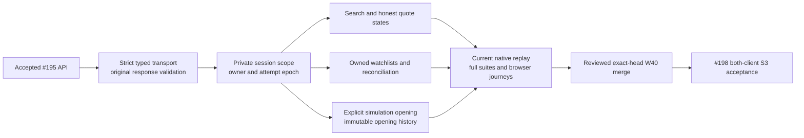

# S3 owned Flutter implementation and validation

This implementation follows [#197](https://github.com/IgnAite-Showcase/Finex/issues/197),
FR-09–FR-12 and V9.1 pages 67–68/93. Its base is the accepted S3 API W40 commit
`e4aff0343e3aad6db7bbe7bdfdf5fae4328da8f7`, tree
`c57703cf2dbced976e2ba7f38e81a6945afa9d89`. The
[foundation contract](../features/local-application/S3-market-foundation-contract.md)
defines the twelve operations, source metadata, watchlist ownership and explicit
simulated account opening.

The client implementation is under independent technical review. Focused tests
are passing; full regression, current native capture and replay, web build,
controlled browser journeys and exact candidate/post-merge CI are still required.
Their final commands and source bindings belong in the issue's PR and acceptance
package. A focused test run is not full S3 acceptance or native-device evidence.

## Delivered behavior

The `/market`, `/watchlist` and `/account` routes use the persistent local API,
not the historical market singleton. Prices remain canonical decimal strings;
synthetic origin, fixture time, retrieval time, expiry and status are visible.
STALE is a domain state even when the response envelope says CACHED. Unavailable
prices remain null, never zero or an invented price.

Session credentials stay behind named private scopes. A logout attempt, owner
change, replacement, disposal or changed prerequisite invalidates old work;
late success, error or 401 cannot replace current state. A failed logout keeps
dirty input hidden and inert until the current session is restored. Reads use
separate lanes; a synchronous mutation guard prevents duplicate intent.

Owned list state is independent of catalogue and quote failures. An uncertain
watchlist POST requires a successful owned-list read and deliberate
reconciliation before another create. Confirmed records survive a failed
refresh. Account GET never opens or funds an account; opening is an explicit,
idempotent simulated action. S4 execution and goals remain pending.

## Test first evidence

| Stage | Actual result and scope |
|---|---|
| Initial route baseline | Three missing-delivered-heading assertions failed before implementation; test-only checkpoint `45a631543c4a5d37a1718e3117a03edc415931c1` |
| Importable model factories | Eight valid-DTO assertions failed, fifteen rejection controls passed; all 23 subsequently passed |
| Importable twelve-operation transport | Ten assertions failed, two safe controls passed; all twelve subsequently passed |
| Search and rename fidelity | Two failures exposed Unicode casefold re-filtering and catalogue-503 mapping; corrections passed |
| Private session authority | Four isolation/current-authority assertions failed, one control passed; all five subsequently passed |
| Initial owned screens | Five journey assertions failed on missing screens; those five and the three route baselines subsequently passed |
| Failure, race and accessibility controls | Eighteen widget controls passed, including failed reads, coalesced owner changes, hidden retained input, 320px/200% text and exact-labelled 48px controls |
| Native-pair guard | Four semantic tampering assertions failed with eleven controls passing, then passed; extended original-byte/current-source controls subsequently passed |
| Additional read integrity | Three assertions failed for a collection error hidden by catalogue success and ignored captured GET inputs; all three subsequently passed |
| Independent contract corrections | Three assertions failed for ledger default 100 and two nonliteral fixture UTC aliases; all three passed after correction |
| Focused new suites after the first contract corrections | 123 passed and one explicit absent-current-native-evidence skip; this is not a final-source or native replay acceptance claim |
| Dashboard and default fixture corrections | Twelve assertions failed with two preservation controls passing; all fourteen passed after correction |
| Focused new suites after dashboard and fixture corrections | 137 passed and one explicit absent-current-native-evidence skip; seven targeted paths passed strict analysis |
| Missing watchlist fixture fidelity | Four missing/detail/update/repeat-delete assertions failed; typed `404 WATCHLIST_NOT_FOUND` corrections made all four pass |
| Concurrent peer deletion | After the fake-only correction, one genuine UI assertion failed because a vanished row remained selectable; one further owned collection read fixed it, and all five selected regressions passed |
| Focused final correction suites | All eight new suites passed: 142 tests and one explicit absent-current-native-evidence skip; four correction paths passed strict analysis |
| Local Git boundary for native evidence | Six actual argument/environment assertions failed across the S1/S2/S3 test readers with three preservation controls passing; all nine then passed after the flag and child-environment correction, without executing Git or networking in those tests |
| Extended correction regression | Ten targeted suites passed: 393 tests and one explicit missing-current-S3-native skip; all five changed Dart paths passed strict analysis. This includes inherited S1/S2 controls, not the full application suite |
| Canonical source manifest interoperability | Two actual assertions failed: the canonical uppercase-line aggregate was rejected and a noncanonical lowercase-line aggregate was accepted. Individual source SHA values remain strict lowercase; only manifest-line construction needs the producer's uppercase convention |
| Canonical manifest correction | Both regressions passed after the aggregate-line correction. All ten targeted suites then passed: 395 tests and one explicit optional missing-current-native skip; the two changed Dart paths passed strict analysis |
| Canonical request path replay | Three focused assertions failed after actual typed GET/PUT/DELETE calls returned valid DTOs. Their URI paths contained `SYN%3AAAPL`, while decoded final segments remained `SYN:AAPL`; only the replay request matcher rejected them |
| Request matcher correction | All 43 transport controls passed: the three canonical requests, 26 paired negative controls and fourteen existing controls. The two changed test files passed strict analysis. The negative strengthening is GREEN-only, not additional invented RED |
| Targeted static analysis | Eight core paths passed strict analysis after correction; full analysis remains a separate gate |
| Root CI wiring | Five missing-binding assertions failed with four preservation controls passing; all 46 combined S1/S2/S3 CI controls then passed |
| Evidence record workflow triggers | Eight assertions failed because the Flutter record did not trigger the four workflows on push and pull request; after correction all 46 selected CI controls passed with `--no-cov`, followed by Ruff check, format check and Actionlint |

Tool setup failures, a selector matching zero tests, fixture-inventory mistakes,
compilation/override corrections and a semantics-node selector correction are
not counted as product RED evidence. Official brace/null-aware formatting fixes
did not suppress assertions or analyzer rules. The immutable quote fixture fields
require their exact declared `2026-01-01T00:00:00Z` literal; ordinary retrieval,
expiry and creation fields retain valid UTC/microsecond support. Public ledger
defaults are 100; explicit UI or captured-native requests with limit 2 remain 2.

The first contract-correction run used the 26-path raw-source manifest
`C809C371B2789DFA9B583878D95F553500F29E5B363A627BD74B64E4009CCC91`.
The subsequent dashboard and fixture corrections were revalidated against the
28-path raw-source manifest
`A643F23CA5E1865CAD3144DD79DD60929B9422624B87E9DFBA17F3218EEB7099`.
The default test fake now reproduces all four declared instruments, their prices,
filtering and limits, unavailable quotes and unsupported-ID errors. The final
404/race correction run used the independently matched 28-path manifest
`84D566E31D24E3D550CF86FBEB4F12B64A1605F70199414F260DE25856BBBA1B`.
The additional collection read uses the same private owner/attempt lease, does
not replay a mutation, and preserves independent unsaved create input. The
earlier widget run blocked by the fake's TypeError is not product RED evidence.
Final review, full regression and current native/browser acceptance remain
publication gates.

All three Flutter native-evidence Git readers disable replacement objects, lazy
fetching and filesystem-monitor commands, use a noninteractive child with optional
locks disabled, and remove case-insensitive Git overrides and credential keys.
Normal PATH, PATHEXT and SystemRoot remain available. Spy controls verify this
process boundary; they do not replace actual native replay. The installed Git's
`--no-lazy-fetch` capability was checked rather than assuming a minimum version.
The six-file Git-boundary correction expands the complete Flutter source slice
to 31 paths, with raw ordinal manifest
`309852EA73C8E7A9DE71ED94D270272AF4AA1777085BF4D68E2D340C3D6DD106`.
The prior 28-path production, model, transport and session review remains valid;
current clean-commit/native replay and full application checks are still required.

The first complete required-native client attempt at clean commit
`729782335eb99a877b554503bdd8bd7cfd847247` passed analysis and 883 tests, with one
historical-input skip, but failed while loading S3 evidence before its 48 replay
cases registered. The web build did not run. Independent read-only diagnosis
confirmed that the original native pair, all individual source hashes and all
48 DTOs/relationships were valid; the client's aggregate checksum calculation
and handcrafted test fixture used lowercase manifest lines instead of the
producer's canonical uppercase lines. The two regression tests passed after the
minimal correction, followed by the ten targeted suites and strict analysis.
The corrected 31-path raw ordinal source manifest is
`74C90B03E828BF0F8407FE2FD22E4B71C4BB4CCD7B05243B3563C9FD268D3612`.
This earlier full-run failure remains recorded; fresh current-commit replay and
full checks must precede acceptance. Captures are not edited to fit a client,
and alternate checksum formats are not accepted.

The subsequent clean commit `146350ce2db20fc541dfdb497177c8ff9dd1e767`
passed all four fresh native producers, both passive pair checks, strict Flutter
analysis and the tracked-snapshot secret gate. Its complete required-native
suite registered all 48 S3 cases and passed 923 tests, with one historical-input
skip, but ten quote and watchlist-item replay cases failed. The replay matcher
compared encoded request paths with unencoded instrument targets; production
uses encoded URI path segments. The build did not run. This request-matcher
correction passed its three regression tests and the complete 43-control
transport file, including paired rejection of wrong instruments, parents,
methods, authorization, queries, redirects, raw and double-encoded paths. The
two changed test files passed strict analysis. The corrected 31-path ordinal
raw-source manifest is
`854075BE8176E67BFF79A8781CAC607833EDBA5F7A978452ECDB6A5EE3719A8A`.
Independent review and fresh full validation remain required; the original
response captures and production URL encoding are unchanged.

## Evidence and acceptance boundaries

The test-only S3 loader requires the complete original report/corpus pair,
strict UTF-8 and duplicate-member rejection, private-field checks, exact current
clean commit/tree, current raw source inventory and digests, all 48 ordered cases,
21 successful lifecycle checks, request/target relationships and cleanup proof.
Wire bodies are capped at 262,144 bytes and each artifact at 2 MiB. It does not
rewrite native captures or claim that legal typed requests emitted captured
illegal request inputs. Normalized requests are labeled semantic replay.

CI downloads only the successful same-run two-file S3 artifact, separately from
the existing six S1/S2 files. `FINEX_REQUIRE_LOCAL_S3_CORPUS=1` makes absent or
invalid evidence fail rather than skip. The S1/S2 required parity gates remain
intact. Handcrafted loader controls and the optional missing-evidence skip above
are not real TCP or current native-response proof.

Independent review and final full/native/browser/CI evidence must precede Done
or closure. Full S3 #198 requires both clients and their shared durable journeys;
the next `dev` promotion follows that completed sprint, not this client alone.
No cloud, real money, human UAT, fresh-laptop or native-device GUI acceptance is
claimed by this implementation record.
