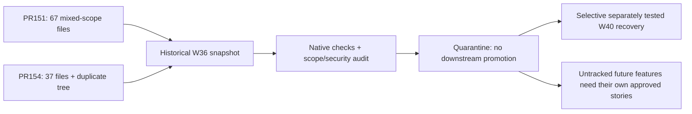

# W36 integrity audit — story #158

**Disposition: NO GO for W36 promotion.** Audit completed under Anand's delegated recovery authority. This is a technical no-go, not an invented independent human approval or permission to delete/rewrite an old branch.

## Exact snapshot and review evidence

Audited `release/2026-W36` at `2cb2f0e859d33105e37015cf9e36168babde8cb8` in an isolated detached native checkout. Main stayed at `fef387cd81f5753416a14fad89ead263c4ac5f6b` during recovery.

- [PR #151](https://github.com/IgnAite-Showcase/Finex/pull/151): head `02dfdd3ab74682caf9d15f36078d7a782abb2988`, merge `cd384b639982b4e6fe4b1997b8140ebb9b7a55de`; 67 files; no review recorded in the retrieved review list.
- [PR #154](https://github.com/IgnAite-Showcase/Finex/pull/154): head `4c5d1d7097d400ea43a912ffb97d22108b61c87e`, merge `57af07ccc9b41f376428378eeecf03edd345302`; 37 files; one COMMENT review, not an independent approval.
- Complete per-file inventory with disposition and recovery-story mapping: [JSON inventory](w36-pr151-pr154-inventory.json).

## Native verification

Python validation interpreter 3.12.14; CI targets 3.13. Local mock providers, no Docker/cloud credentials/deployment.

| Command from `backend` | Result |
| --- | --- |
| `python -m ruff check .` | PASS, zero lint findings. |
| `python -m ruff format --check .` | FAIL: seven files require formatting. |
| `python -m mypy app` | PASS, 96 source files. |
| `python -m pytest tests/test_r0_settings.py tests/test_r0_cors.py tests/test_health.py --no-cov` | 52 passed. |
| `python -m pytest` with `APP_ENV=local`, `LLM_PROVIDER=none`, `MARKET_DATA_PROVIDER=mock` | 354 passed, 79.39% app coverage. |

On the recovery machine, pytest additionally used `-p no:cacheprovider --basetemp <unique-task-temp-directory>` to avoid OneDrive locks. A first sandboxed full run was stopped without a result and is not counted as passed; the separately completed native run above provides the actual evidence.

Formatting failures are in `alembic/versions/778763e97790_merge_migration_heads.py`, `app/adapters/yfinance_adapter.py`, `app/config/settings.py`, `app/core/exceptions.py`, `app/main.py`, `tests/conftest.py`, and `tests/test_migration_lineage.py`. Neither source nor branch was modified to hide these failures. React/Flutter validation of this historical release is **not claimed**; a failing foundation gate plus the scope/security findings is sufficient for no-go.

## Material scope disposition

| Group | Safe disposition |
| --- | --- |
| Health/envelope/OpenAPI/config/CORS | Retain concepts only through scoped W40 recovery and its own tests (#132, #133, #135, #166). Do not promote the mixed W36 commits. |
| Standalone `R0-SEC-01/` application | Duplicated, separately executable source, not imported by the root native launcher (`--app-dir backend`). It is not accepted production code or trustworthy evidence of the root path. Leave quarantined; removal would require a new separately approved cleanup PR. |
| Market/watchlist/portfolio AI/migrations/notebooks/S3 handoffs | Untracked by this R0–S2 recovery. Create/approve dedicated later feature stories and contract/test evidence before reuse. No silent acceptance by association with a passing health check. |
| Legacy S1/S2 client/spec/analytics files | Evaluate against V9.1, not filenames or old Done status. Controlled W40 replacements have their own accepted stories and fixtures (#139/#140/#145/#146/#159/#166/#160/#143/#161/#162/#163/#144/#164). |
| Embedded Databricks value in old utility | Removed from the W40 current snapshot in PR #179. Historical exposure remains: issuer-side revocation/rotation must be confirmed. No token is reproduced in this record. |

W40 was rebuilt sequentially from the approved main foundation, not from W36. No W36 deletion, revert, force-push, history rewrite or downstream promotion was performed. The audit task can finish with a no-go finding; the old release does not become accepted merely because the audit is complete.
