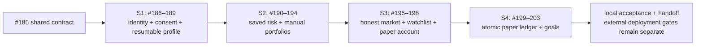
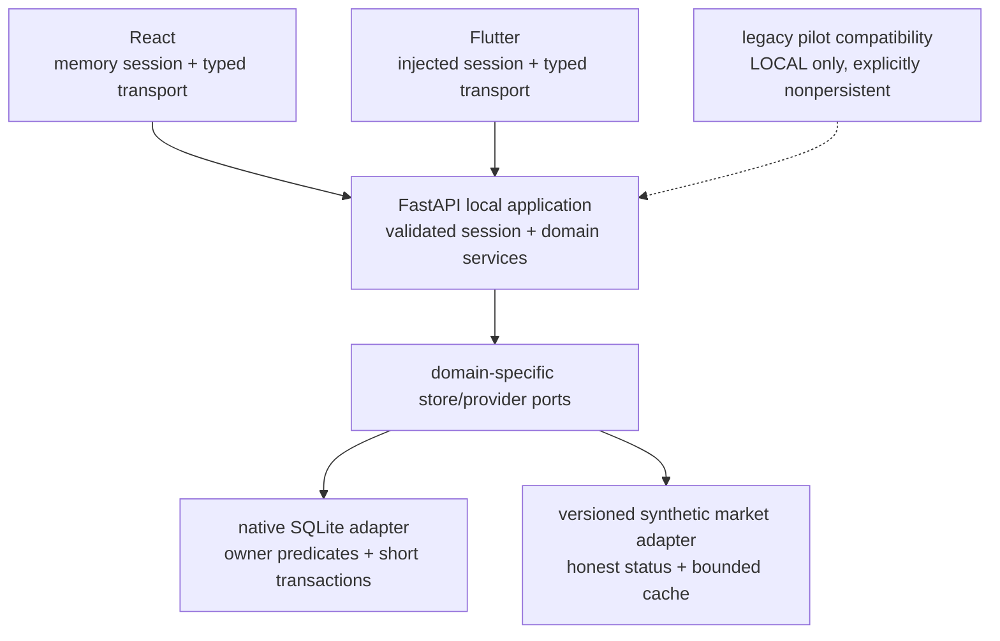
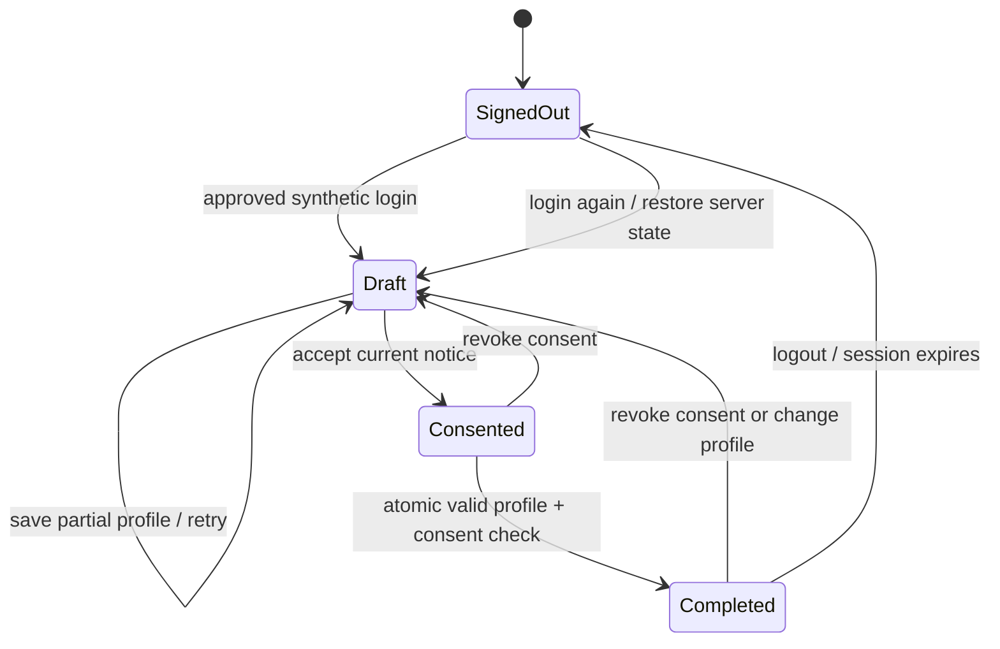
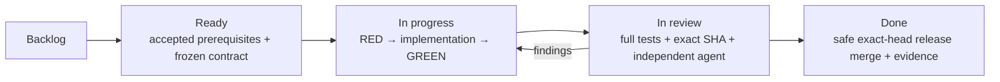

# FinEx S1–S4 local application delivery contract

Contract: `local.v1` · Decision date: 2026-10-11 · Integration target: `release/2026-W40` · Approved validated checkpoint promotion: `dev`

This is a versioned implementation supplement to the [V9.1 master handbook](https://github.com/IgnAite-Showcase/Finex/blob/docs/v9.1-master-handbook/docs/governance/FinEx_Master_Product_Design_Delivery_Handbook_v9.1.pdf), not a replacement or a claim of production readiness. Anand has delegated development, agent review, verification, safe release merges and the new delivery cards to Codex. Independent **agent** review is recorded honestly; no human pair approval is invented.

Tracker: [#184](https://github.com/IgnAite-Showcase/Finex/issues/184). Design: [#185](https://github.com/IgnAite-Showcase/Finex/issues/185).

## 1. Delivery order and traceability

The accepted W40 pilot at `06096af0f9171d2b50bfafe8c4224bcfd0f5e41a` proves stateless consent/profile and deterministic risk contracts. It does **not** prove durable identity, saved assessments, portfolios, market ownership, execution or goals. The new cards close those full-product gaps; they do not reopen or reassign legacy intern work.



| Master requirement | Delivery cards | V9.1 templates/pages | Acceptance focus |
|---|---|---|---|
| FR-01 sign-in/out and own profile | #186, #187, #188, #189 | S1-SPEC/DAT/API/WEB/MOB/CON/UAT; 57–60, 90–91 | Server-owned identity, expiry/revocation, no cross-user access |
| FR-02 versioned consent | #186–189 | Same | Notice/version/timestamp/history; revocation blocks completion |
| FR-03 onboarding draft/resume | #186–189 | Same | Partial draft persists; atomic validated completion |
| FR-04 questionnaire | #190, #192–194 | S2 templates; 61–64, 92 | Exact version/ordered question and option IDs, draft/history |
| FR-05 deterministic risk | #190, #192–194 | Same | Existing approved engine and golden vectors, reproducibility |
| FR-06 explanation | #190, #192–194 | Same | Matches metrics/assumptions; education only |
| FR-07 manual portfolio | #191–194 | Same | Owned CRUD, valid identifiers/quantities/currency |
| FR-08 metrics | #191–194 | Same | Decimal golden calculations, incomplete-price honesty |
| FR-09 supported search | #195–198 | S3 templates; 65–68, 93 | Canonical instruments, limits and deterministic empty state |
| FR-10 quote provenance/status | #195–198 | Same | Synthetic origin, true snapshot time, null unavailable price |
| FR-11 watchlist | #195–198 | Same | Durable ownership and idempotent add/remove |
| FR-12 paper account | #195–198 | Same | One controlled simulated opening and ledger entry |
| FR-13 simulated execution | #199, #201–203 | S4 templates; 69–72, 94 | Exact idempotent replay, conflict and no real money |
| FR-14 auditable ledger | #199, #201–203 | Same | Atomic cash/position effects, concurrency and reconciliation |
| FR-15 goals | #200–203 | Same | Owned validated inputs, durable CRUD |
| FR-16 projections | #200–203 | Same | Formula/version/assumptions, gap/contribution/scenarios, no guarantee |

NFR-01–10 apply throughout: authorization, safe configuration, minimal synthetic data, financial safety, failure/rollback, accessibility, redacted correlation diagnostics, bounded resource use, reproducible setup/migrations and ports/adapters. Each slice's acceptance package maps the applicable NFR to actual tests and limitations.

Each API implementation precedes its consumer implementation. Clients may use frozen typed examples in tests, but no sprint is accepted on mocks alone. S2 starts after #189, S3 after #194, and S4 after #198. This is deliberate sequencing, not a license to start later-sprint functionality prematurely.

| Card | Work | Exact feature branch (from accepted W40) |
|---|---|---|
| #184 | Overall tracker | Coordination only |
| #185 | Shared contract | `feature/185-s1-s4-delivery-contract-w40` |
| #186 | S1 owned API/state | `feature/186-s1-owned-state-w40` |
| #187 | S1 React | `feature/187-s1-web-owned-journey-w40` |
| #188 | S1 Flutter | `feature/188-s1-flutter-owned-journey-w40` |
| #189 | S1 full acceptance | `feature/189-s1-full-acceptance-w40` |
| #190 | S2 saved risk | `feature/190-s2-saved-risk-w40` |
| #191 | S2 manual portfolios | `feature/191-s2-manual-portfolios-w40` |
| #192 | S2 React | `feature/192-s2-web-risk-portfolios-w40` |
| #193 | S2 Flutter | `feature/193-s2-flutter-risk-portfolios-w40` |
| #194 | S2 full acceptance | `feature/194-s2-full-acceptance-w40` |
| #195 | S3 market/watchlist/account API | `feature/195-s3-market-watchlist-account-w40` |
| #196 | S3 React | `feature/196-s3-web-market-account-w40` |
| #197 | S3 Flutter | `feature/197-s3-flutter-market-account-w40` |
| #198 | S3 full acceptance | `feature/198-s3-full-acceptance-w40` |
| #199 | S4 atomic orders/ledger | `feature/199-s4-atomic-paper-ledger-w40` |
| #200 | S4 goals/projections | `feature/200-s4-goal-projections-w40` |
| #201 | S4 React | `feature/201-s4-web-orders-goals-w40` |
| #202 | S4 Flutter | `feature/202-s4-flutter-orders-goals-w40` |
| #203 | S4 full acceptance/handoff | `feature/203-s4-full-acceptance-w40` |

## 2. Boundaries and component ownership



- Native local development only; no Docker, Postgres server, Databricks, paid/free cloud resource creation, broker account or LLM call is required for these slices.
- Additive `/api/v1/local-*` namespaces distinguish the persistent application from the explicitly stateless `/onboarding-contract` and `/risk-contract` pilots. Shared response envelopes, correlation middleware and approved risk math are reused.
- The native store is an adapter, not a production architecture claim. Session ownership, domain rules and response DTOs do not depend on a cloud vendor. A deployed identity/storage adapter requires separately reviewed work and deployment authorization.
- Do not mount the old in-memory portfolio service or merge PR127/PR136 wholesale. Their branches include unrelated changes and unsafe persistence/price semantics. Reuse audited math and test intent only.
- Runtime databases, journal/WAL/SHM files and local backups are ignored and never published. Do not create databases at module import. An application-injected store uses isolated temporary test paths.
- Existing assignments, legacy issue states, protections/settings, credentials and user dirty files are preserved. Only new delivery issues may close after accepted work. Anand approved safe, tested W40-to-`dev` promotions at completed sprint checkpoints on 2026-10-11; this does not authorize changes to `main`, `uat` or `prod`.

## 3. Frozen S1 identity and authorization contract

S1 uses `APP_ENV=local` **and** `LOCAL_APP_ENABLED=true`. Otherwise all new routes return `403 LOCAL_APPLICATION_ONLY` before session/storage access. `LOCAL_DB_PATH` selects a native file database; its default is the ignored `backend/.local/finex.sqlite3`. `LOCAL_SESSION_TTL_MINUTES` is an integer from 1 through 60 (default 30). Tests inject a clock/path/store instead of waiting or writing the developer database.

Approved personas: `learner-a`, `learner-b`. These are explicitly synthetic test aliases, not verified OAuth identities. Login selects an approved server-owned persona; it never accepts arbitrary email, password, user ID, provider token or a legal name. Do not use the historical default Khyati user as proof of authentication.

Persona selection simulates identity; it does not authenticate a real person or prevent another trusted local operator selecting that persona. Ownership tests prove that a bearer cannot select a different owner through protected APIs. Run bound to loopback only, with explicit loopback client origins. Do not expose through LAN/public binding or tunnelling. With the local app enabled, reject a configured non-loopback host/client origin; the router also rejects non-loopback peer addresses (the in-process test transport is not a network exposure). This is not deployed identity acceptance.

The server generates a cryptographically random 32-byte opaque bearer, stores only its SHA-256 digest with owner/expiry/revocation and returns the token once. `Authorization: Bearer …` is the only credential input; it must never appear in URLs, logs, issue bodies, fixtures or committed evidence. Correlation IDs trace requests; they do not choose the owner.

React context and Flutter's injected session hold the bearer in memory. No localStorage, sessionStorage or SharedPreferences secret persistence. A cold launch signs out; selecting the same persona signs in again and resumes server data. All in-flight work is cancelled or ignored when session generation changes. A network failure is not evidence that logout succeeded; show retry instead of silently clearing a still-valid server session. A confirmed logout or `401` clears user-owned client state.

Both typed transports accept only an HTTP(S) loopback base origin (`localhost`, `127.0.0.1`, `[::1]`), without userinfo/query/fragment or an unexpected path. Reject a remote base URL before acquiring/sending the bearer. Requests have a bounded timeout and safe error decoding; credentials are never supplied through URL query or client diagnostics.

Full-app route intent is shared: `/` leads to `/login`; login is public, `/onboarding` requires a validated session but allows incomplete progress, and `/dashboard`, `/risk`, `/portfolio`, `/market`, `/watchlist`, `/paper-trading`, `/goals` require loaded server completion/current consent. Loading/failure is not completion. `/consent` aliases the authenticated onboarding consent section. Until a feature's sprint is accepted, its full-app route displays an honest pending-delivery state rather than disconnected hardcoded metrics or pretend success. The compatibility pilots use `/pilot/consent`, `/pilot/onboarding`, `/pilot/risk` (Flutter may route consent to its combined pilot screen), visibly marked nonpersistent and isolated from full-app state. Existing pilot clients remain separately tested. Chat/alerts/spending and later-sprint work are outside this delivery; do not imply they are implemented.

| Endpoint | Request | Success `data` | Authorization |
|---|---|---|---|
| `POST /api/v1/local-auth/mock-login` | `{ "alias": "learner-a" }` | Scope/version, `access_token`, `token_type: "Bearer"`, `expires_at`, `user: {id, alias}` | Explicit LOCAL opt-in only |
| `GET /api/v1/local-auth/me` | None | Scope/version, `user: {id, alias}` | Valid local bearer |
| `POST /api/v1/local-auth/logout` | No body or `{}`; extra fields rejected | Scope/version, `signed_out: true` | Valid local bearer; revoke durably |
| `GET /api/v1/local-onboarding/state` | None | `LocalOnboardingState` below | Valid local bearer |
| `PUT /api/v1/local-onboarding/draft` | Profile version + nullable display label/experience | Updated state | Valid local bearer |
| `POST /api/v1/local-onboarding/consent` | `{ "consent_version": "consent.v1", "consent_given": true/false }` | Updated state | Valid local bearer |
| `POST /api/v1/local-onboarding/complete` | Consent + profile versions | Updated state | Atomic prerequisite recheck |

All request DTOs forbid extra fields, including `owner_id`. Every protected query/update takes the owner from the session dependency and includes that owner predicate in the store. Return the same safe not-found outcome for nonexistent versus other-owner resource IDs in later slices.

All successes use existing `success/message/data/meta`, and errors use the existing `error_code/error.fieldErrors/error.correlationId` envelope. For persistent/synthetic local data use `meta.dataStatus=CACHED`; never claim real-time market `LIVE`. Include scope/version in domain DTOs so decoders reject pilot/full-application drift.

All three auth `data` DTOs also include `scope: "local_educational_application"` and `contract_version: "local.v1"`. The draft request is exactly `{ "profile_schema_version": "profile.v1", "display_name": "Test learner", "experience_level": "beginner" }`, with nullable draft field values allowed. The completion request is exactly `{ "consent_version": "consent.v1", "profile_schema_version": "profile.v1" }`; it does not accept a client-supplied completion flag.

Example state (illustrative contract example, not execution evidence):

```json
{
  "scope": "local_educational_application",
  "contract_version": "local.v1",
  "profile_schema_version": "profile.v1",
  "consent_version": "consent.v1",
  "consent": {"accepted": true, "version": "consent.v1", "recorded_at": "2026-10-11T12:00:00+00:00"},
  "draft": {"display_name": "Test learner", "experience_level": "beginner", "updated_at": "2026-10-11T12:01:00+00:00"},
  "onboarding_completed": false,
  "completed_at": null
}
```

### Minimal fields, versions and state rules

- Required at completion: a nonblank, trimmed display label of at most 80 characters, and experience `beginner | intermediate | advanced`. The label is not a legal name. Do not collect email, DOB, address, government ID or financial account details.
- Draft PUT is a full replacement: both `display_name: string | null` and `experience_level: enum | null` are required fields, though nullable. Omitted fields fail `422 VALIDATION_ERROR`; they do not silently retain or erase old fields. Trim a label before checking the 80-character limit. Null/blank label is a valid incomplete draft, never a complete profile. Invalid enum, overlength and extra/owner fields fail `422 VALIDATION_ERROR` with safe field errors.
- Profile version is `profile.v1`; consent is `consent.v1`, matching the approved pilot constants. Unknown client versions fail `409 PROFILE_VERSION_MISMATCH` / `CONSENT_VERSION_MISMATCH`; do not quietly upgrade an old acceptance.
- Initial state has `consent: null`, a `draft` object with `display_name: null`, `experience_level: null`, `updated_at: null`, and false/null completion. Profile/consent version and scope remain explicit even before saving.
- Consent events are append-only with a monotonic event ID, owner/version/decision/UTC time. Latest means greatest event ID, not timestamp (multiple actions may share a clock tick). A false decision withdraws consent, clears completion and gates later features. Reacceptance alone does not restore completed state. Repeating an accepted current version preserves an already valid completion; repeating a false decision remains safely incomplete.
- Draft edits clear completion only when profile content changes. Repeating the same saved draft is safe. Completion rechecks required fields and latest current accepted consent inside one transaction; failure does not write a completed record.
- Missing consent returns `409 CONSENT_REQUIRED`; incomplete profile returns `409 PROFILE_INCOMPLETE`. Repeated successful completion preserves the original completion timestamp until a consent/profile change invalidates it.
- Invalid/malformed/expired/revoked bearer returns `401 SESSION_INVALID`; unknown alias returns `422 UNKNOWN_LOCAL_ALIAS`. Storage unavailability yields safe `503 LOCAL_STORE_UNAVAILABLE`, no database path/token leakage and no claimed save.



The diagram's Draft node means authenticated onboarding; re-login loads actual server completion, not necessarily an incomplete draft. Client guards render the correct state after loading it. Editing a complete profile shows why completion must be reconfirmed.

### Persistence and failure safety

Schema version 1 contains users (stable synthetic alias/UUID), sessions (digest, owner, expiry/revocation), onboarding (owner PK, nullable draft, profile version, draft/completion times), and immutable consent events (owner/version/decision/time). All IDs are server created; timestamps are UTC ISO-8601. No bearer plaintext column exists.

The frozen [#190 saved-risk contract](S2-saved-risk-contract.md) adds schema version 2 through one shared, preserving bootstrap transaction. It retains the version-1 S1 records and adds an owned questionnaire draft and immutable assessment history. The [data dictionary](local-data-dictionary.md) defines these additions and safe rollback limits; their delivery is accepted only after the separate #190 evidence and merged CI gates.

Use parameterized SQL, foreign keys, bounded busy timeout and per-operation connections. File databases may use WAL where supported and tested. Atomic writes use a short transaction, with no network/await inside it. The injected clock returns a UTC-aware datetime; reject a naive clock rather than using host timezone. Schema metadata rejects unsupported future versions without destroying data. Migration/reset commands must name an exact synthetic local database and require deliberate action; normal server startup never resets user data. Back up with SQLite's backup API, or close all connections and checkpoint WAL before copying; never copy only the active main file. Forward-fix or use a prior compatible binary/feature disable, never erase history as rollback.

Tests must include a new app/store instance opening the same file, expired/revoked sessions, two-persona ownership, owner injection, trace-header nonidentity, wrong versions, consent withdrawal, partial draft and repeat completion. Inject failure before commit to prove rollback. New local sessions must not authorize legacy JWT routes.

Every S2–S4 protected endpoint requires a valid session, current accepted consent **and** completed onboarding. Absent/withdrawn consent, incomplete/changed profile or reacceptance without completion returns `409 ONBOARDING_REQUIRED` without exposing or mutating domain data. Preserve saved domain data; it is accessible again only after valid recompletion. For mutations, recheck session validity and onboarding/consent prerequisites **inside the same transaction** as the write so a concurrent withdrawal cannot permit a later unauthorized commit. Reads observe one consistent snapshot. Tests cover direct calls before completion, withdrawal/reacceptance, profile invalidation and withdrawal/write races. S1 state/draft/consent routes stay accessible with a valid session so the user can repair prerequisites.

The legacy mock OAuth/JWT routes remain only LOCAL compatibility, not real Google verification. Gate all historical register/login/me/refresh/logout/google authentication routes outside LOCAL; list only the caller's own legacy profile and reject other-user ID lookup with safe not-found. Preserve valid LOCAL regression contracts; never expose arbitrary user emails merely because a caller is authenticated.

## 4. Later-sprint design constraints (freeze details at each gate)

These constraints prevent an intern or agent from filling a gap with an unsafe assumption. The respective API story publishes numeric DTO examples, error/status matrix and golden calculations **before** its implementation; later refinements increment the local contract when incompatible.

| Slice | Authoritative behavior | Must not do |
|---|---|---|
| S2 risk | Wrap existing approved `ai.risk` versioned ten-question engine; save exact input/rules/results and immutable history; owned draft/resume | New five-question/client/LLM score or weakening the pilot `persisted=false` decoder |
| S2 portfolio | Owned durable manual CRUD; Decimal money/quantity precision, initially USD only; golden allocation/concentration/diversification/value/gain-loss definitions | Float authority, invented quote/default 100, zero unavailable price or cost-basis fallback pretending valuation |
| S3 market | One supported synthetic catalogue/quote port; immutable fixture version/as-of, separate fetched-at, bounded cache and explicit unavailable null price | `yfinance-prototype` label on constants, `LIVE` claim, refreshed source timestamp, unsupported instruments silently accepted |
| S3 account | One controlled paper opening cash/ledger per owner; own durable watchlist and idempotent add/remove | Real money/broker/billing/provider dependency or duplicate opening funds |
| S4 orders | Unique account/key + canonical request fingerprint + exact stored replay; one cash/position/order/trade/ledger transaction; concurrent and rollback tests | Checking before await then separate dict mutations, key/payload conflict silently replayed, negative cash/position or real execution |
| S4 ledger | Append-only correction entries, cash/position reconciliation with mismatch detection | Deleting/rewriting audit history or calling a balance reconciled without comparison |
| S4 goals | Owned validated explicit inputs, versioned deterministic contribution/compounding formulas, zero/negative boundaries and scenarios | Guaranteed return, hidden taxes/fees/inflation assumption or client financial authority |

Paper execution must explicitly permit or reject fixture quotes based on source/version/status. No silent stale quote, unavailable price or portfolio cost-basis execution. A synthetic simulator may accept a fixed synthetic fixture **as a simulation**, never as a current market fill. UI confirmation states this distinction.

## 5. Work and acceptance policy



- Feature branches are exact in the issue bodies, e.g. `feature/186-s1-owned-state-w40`; create from latest accepted W40 after prerequisites, not an unreviewed feature. For later parallel client work, use the same accepted API base and independent, non-overlapping files/branches.
- Red evidence records real failing test assertions, not syntax errors or missing tool dependencies. Green evidence identifies tests changed, commands, results, local commit, published head and tree equivalence. Do not claim a new token-auth flow passes merely because older pilot tests do.
- Separate implementation and review agents. Review actual changed code and tests; record limitations. Self-account GitHub COMMENT review is technical evidence, not a fabricated independent APPROVE.
- Run relevant full backend lint/format/mypy/pytest+coverage, React serial tests/build, Flutter strict analysis/tests/build and native API smoke. Exact-head CI must be green before safe squash merge; post-merge integrated release checks must remain green. No bypassing protection or merging known failed checks.
- Add browser/API parity checks with synthetic personas; preserve the user's current local browser state. Native device/emulator testing is only claimed if actually run. Flutter web build is not Android/iOS device evidence.
- Close only the new delivery cards after actual acceptance. Card status is verified evidence, not a forecast. Existing assignments/legacy issue states stay unchanged; unresolved external gates are not marked Done.

### Validated development checkpoints

Feature PRs integrate into `release/2026-W40`. After a sprint's full acceptance and integrated release checks pass, promote that accepted checkpoint to `dev` through a separately reviewed PR. The first planned promotion follows accepted #194, not just accepted individual S2 features. Inspect divergent `dev` history, preserve existing work, and test the actual combined merge result; never reset `dev` to a release snapshot or force-push it. Record the exact promoted release, tested merge tree, PR and resulting `dev` commit. A merge is not a deployment, and approval does not waive protection, failed checks or unresolved destructive conflict resolution.

The latest accepted W40 remains the S1–S4 feature-branch base while development continues. The accepted `dev` checkpoint provides a validated shared baseline for the team; do not automatically copy unfinished release work into it. Promotion to `uat`, `prod` or `main`, cloud deployment and billing/settings changes remain outside this approval.

## 6. Acceptance ledger and known external gates

| Gate | Current evidence | Status |
|---|---|---|
| Contract #185 | Independently reviewed design [PR #204](https://github.com/IgnAite-Showcase/Finex/pull/204), published head `c7d32a765ad7446cdfe40f91608ec34af0a034f0`; accepted W40 merge `c864cdb361aab3b3caa6038e129e25b23f3928e6`, green post-merge CI | Design accepted; implementation gates below remain separate |
| S1 API #186 | Independently reviewed [PR #205](https://github.com/IgnAite-Showcase/Finex/pull/205), published head `4284f6eadf405a20f9a95807441bb7872371c7d2`; W40 merge `deef08e3424c62348e1fd571709a08ea53f05053`, identical tested tree `ada4b3297ec208363b6834e06d52c88cb08c88de`; 525 backend tests, secret snapshot/native HTTP and all exact-head/post-merge CI passed | API/native persistence accepted; both clients and full S1 are separate gates |
| S1 React #187 | Independently reviewed [PR #206](https://github.com/IgnAite-Showcase/Finex/pull/206), published head `a3df6849d11ae1e83d557c7f867cafff64a2e8e5`; accepted W40 merge `765535270eb6d11f098ea86154d0dcdef758aba7`, identical tested tree `0b13230a47724758f3c08d5e06dd6040b652b43b`; 170 tests, strict types/build, controlled browser journeys and all exact-head/post-merge CI passed | React slice accepted; full S1 remains separate |
| S1 Flutter #188 | Independently reviewed [PR #207](https://github.com/IgnAite-Showcase/Finex/pull/207), published head `dae3d6bc1f7c406c590455964be25ae3b22aede4`; accepted W40 merge `28631a0a70a0d77e4c5c011713044f7494ccef3d`, identical tested tree `ec80974ed25ea3e73a93cf83650735d34b5971a4`; 232 tests, strict analysis/web build, controlled browser journeys, six exact-head runs and all three post-merge checks passed ([release](https://github.com/IgnAite-Showcase/Finex/actions/runs/38142551773), [S1](https://github.com/IgnAite-Showcase/Finex/actions/runs/38142551775), [Flutter](https://github.com/IgnAite-Showcase/Finex/actions/runs/38142551637)) | Flutter slice accepted; desktop CI compilation is not native-device GUI evidence |
| S1 full #189 | Independently reviewed [PR #208](https://github.com/IgnAite-Showcase/Finex/pull/208), exact head `f9ad262e51f542e0fcb05f98709ff8ce8fe1ba4f`, accepted W40 merge `c912df3ffaa6a1dfc81a6d5a27d5eb4666c54221`; identical tested local tree `9b4a75350e6d0759b7c3e4761ea8f53f3c43f2f6` at `4de5a78fadf83e2639e6557f33352dd192dd441c`. Fresh proof: 603 backend tests, 83.39% coverage, both type targets, 24 native checks, two same-file restarts, 60.391-second real expiry and required React/Flutter parity with actual captured responses. All eight exact-head runs and all five post-merge workflows passed: [backend](https://github.com/IgnAite-Showcase/Finex/actions/runs/38147875315), [React](https://github.com/IgnAite-Showcase/Finex/actions/runs/38147875396), [Flutter](https://github.com/IgnAite-Showcase/Finex/actions/runs/38147875389), [integrated S1](https://github.com/IgnAite-Showcase/Finex/actions/runs/38147875422), [release](https://github.com/IgnAite-Showcase/Finex/actions/runs/38147875378). Historical and corrected test details remain in the [S1 record](../../evidence/s1-full-acceptance.md) and issue acceptance comment | S1 local synthetic slice accepted; #189 Done and closed. S2 can proceed through its contract/test gates. Native-device, fresh-laptop, credential-owner, cloud and human-UAT gates remain separate |
| S2 saved-risk API #190 | [PR #209](https://github.com/IgnAite-Showcase/Finex/pull/209), accepted W40 `26f7261189cbf3aa6be61ce44b6fdcf0ee2489b9`, tree `41a17ed6920cd0332635f35e220d2cae11f32f40`; 1,059 tests, 84.83% coverage, original 17 native risk checks, S1 restart/real expiry, non-author review, all 14 candidate/seven post-merge jobs. [Accepted API record](../../evidence/s2-saved-risk-api-acceptance.md) | Done and closed; saved-risk API accepted, not combined S2 |
| S2 manual portfolio API #191 | [PR #210](https://github.com/IgnAite-Showcase/Finex/pull/210), W40 `949b54fffe5bb698a3d41e7d1c5a356ccb094bfc`, tree `99c08f21b9f00a8877449cca824da9a70f7cca2d`; 1,753 tests, 86.82% coverage, 26 native checks, 31 original-wire cases, six independent Decimal goldens, real restart/expiry, all 14 candidate/seven post-merge jobs. [API record](../../evidence/s2-manual-portfolio-api-validation.md) | Done and closed; preserving schema 3, owned manual CRUD and metrics accepted |
| S2 React #192 | [PR #211](https://github.com/IgnAite-Showcase/Finex/pull/211), W40 `493e856e273f296ce095622a341e2e0d2548a178`, tree `10e48fcfa7af23663898f294fdcd12520f62dff2`; 454 tests, strict types/build, controlled shared native journeys/isolation and current S1 parity; all 14 candidate/seven post-merge jobs. [Client record](../../evidence/s2-owned-react-validation.md) | Done and closed; React slice accepted, current S2 artifact parity remains #194 |
| S2 Flutter #193 | [PR #212](https://github.com/IgnAite-Showcase/Finex/pull/212), W40 `a018951f1aecca062c31b18a22619f7940e175fc`, tree `a8fe249843593a5c89c6f83f1e59bb27d8d3db0d`; 451 tests, strict analysis/web build, real S1 TCP/restarts/60.438-second expiry and current parity; all 14 candidate/seven post-merge jobs, including hosted Windows desktop compilation. [Client record](../../evidence/s2-owned-flutter-validation.md) | Done and closed; desktop compilation is not native-device GUI evidence |
| S2 full #194 | [PR #213](https://github.com/IgnAite-Showcase/Finex/pull/213), accepted W40 merge `a05b54b1aabe776f23e3935d7e4d4f5255c5901e`, tree `78a079ecf0d7704e0b01e7f0b45ed014781b829f`. [Combined acceptance](../../evidence/s2-full-acceptance.md) binds current native risk/portfolio artifacts to both clients, full regressions, controlled journeys and handoff. Ten exact-head runs/18 actual jobs and five post-merge runs/nine actual jobs passed | Done and closed completed; S3 may proceed in order. Full S3 is still separate |
| S2 development checkpoint | [PR #214](https://github.com/IgnAite-Showcase/Finex/pull/214), published head `fd1997e9548835d4ce90f1e57833d06d065332a1`, reviewed/tested tree `42e49c37f30254f5727d4fca78c921c086569740`, normal dev merge `87553a10d028cff09723a57bb048262d5d044c22`. Both accepted W40 and 32 divergent dev commits are preserved; ten candidate runs/18 actual jobs and all five resulting-dev workflows/nine actual non-skipped jobs passed | Validated shared S2 checkpoint accepted on dev. W40 remains the feature-integration target for S3; no deployment or downstream promotion |
| S3 API #195 | [PR #215](https://github.com/IgnAite-Showcase/Finex/pull/215), accepted W40 `e4aff0343e3aad6db7bbe7bdfdf5fae4328da8f7`, tree `c57703cf2dbced976e2ba7f38e81a6945afa9d89`; 2,616 backend tests, rounded 88% coverage, both full type targets, 21 actual native checks/48 original wire cases, durable/fault restarts and real expiry. Independent technical review and all ten candidate runs/twenty jobs plus five post-merge runs/ten actual non-skipped jobs passed. [API acceptance record](../../evidence/s3-api-validation.md) | Done and closed completed; preserving schema 4, owned watchlists, truthful synthetic market and one explicit simulated opening accepted |
| S3 React #196 and Flutter #197 | Separate exact-base branches from accepted API W40 `e4aff0343e3aad6db7bbe7bdfdf5fae4328da8f7`; typed transports, private session scopes, owned screens and behavioral tests in development | In progress; neither client is accepted yet |
| S3 full #198 | Requires both accepted clients and actual shared API/browser journeys, durable cross-client state, failure recovery and current quote-state evidence | Not accepted; next dev checkpoint follows this gate |
| S4 full #203 | Unsafe legacy PR math/test intentions audited; atomic execution/goals pending | Not accepted |
| #129 fresh laptops | Two genuinely fresh Windows developer transcripts still required | External gate, unchanged |
| #132 historic credential | Credential revocation/rotation requires authorized owner evidence | External gate, unchanged |
| #134 cloud/platform | Hosting/auth/provider/cost/quota/deployment approval required | External gate, unchanged |
| Native Flutter device | Actual target/device runtime not yet validated for these new journeys | Evidence limit, not silently waived |
| Free-only CI guard | On 2026-10-11, Anand answered “Yes. Keep CI free only.” to the explicit question asking for a $0 Actions paid-usage budget with “Stop usage when budget limit is reached” enabled. The current member/token still cannot independently read organization billing | User-attested guard; free-only CI may resume. Stop hosted runs if the free quota is exhausted; do not enable paid usage. No allowance, charges, billing settings change or independent billing verification is claimed |

Acceptance packages go in `docs/evidence/`, with setup/handoff/rollback notes in established `docs/runbooks/` and `docs/handoffs/`. Append actual accepted SHA and results to this ledger through the corresponding reviewed PR, not by inventing success in advance. Only safe, tested W40-to-`dev` checkpoint promotion is additionally approved; no `main`/`uat`/`prod` promotion or cloud launch is authorized.
