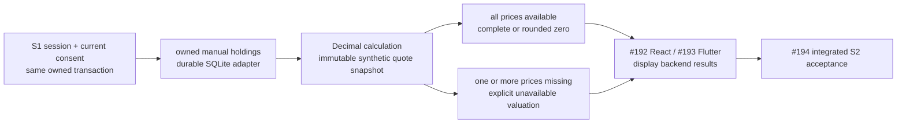

# S2 owned manual portfolio contract

Draft for #191. Implementation remains gated on accepted #190 and green integrated W40 CI. This is a focused delivery supplement, not a replacement for V9.1 or a claim of acceptance.

Branch: `feature/191-s2-manual-portfolios-w40`, from the latest accepted `release/2026-W40`. Master: FR-07/FR-08, NFR-01/03/04/05/09/10, V9.1 PDF pages 61–64 and 92; S2-SPEC-01, S2-DAT-01 and the portfolio portion of S2-API-01. #192/#193 add clients after this API; #194 supplies integrated S2 acceptance. No broker, paper position, real money, external provider or paid service is included.

## Boundary and delivery

All routes below require enabled local mode, an allowed loopback/peer boundary, a syntactically valid memory-only bearer, an active unexpired S1 session, current accepted consent and completed onboarding. These checks use the same read snapshot or locked write transaction as the owned operation. The browser/client never supplies an owner ID. Nested holding lookups include owner, portfolio and holding together. Cross-owner and absent resources are indistinguishable 404s.

Use the existing success/error envelope and correlation ID. Every top-level success `data` object includes `scope: local_educational_application` and `contract_version: local.v1`. Request bodies contain only the fields listed in the HTTP table; they do not contain scope or contract version. The outer success and error envelopes remain unchanged. Resource versions are `portfolio.v1`, `holding.v1`, `portfolio_metrics.v1` and `synthetic_catalog.v1`. Extra input fields are rejected. The listed request version fields are required, not silently defaulted. Nullable response fields are always present. Portfolio and holding list items reuse the complete scoped record DTOs; catalogue items, metric holdings, quotes and allocations use the exact unscoped nested shapes below.

## Canonical inputs and bounded records

| Field | Exact rule |
|---|---|
| `portfolio_id`, `holding_id` | Server-generated canonical lowercase UUIDv4; no client creation ID. Path IDs use the same syntax. |
| `name` | Strict string; trim before storage, then 1–100 characters. Not a legal name or account number. |
| `description` | Required key, null or trimmed strict string at most 500 characters; empty trimmed string remains empty. |
| `currency` | Required literal `USD`; no conversion or multi-currency arithmetic. |
| `instrument_id` | Strict string matching `^SYN:[A-Z][A-Z0-9_]{0,31}$` and an exact supported catalogue ID; never a guessed ticker, user-supplied sector or asset class. Immutable on a holding. A syntactically valid unsupported ID, such as `SYN:OTHER`, is distinguishable from a malformed ID. |
| `quantity` | Strict canonical decimal string, exactly six fractional places, from `0.000001` to `1000000.000000`. |
| `average_cost` | Strict canonical decimal string, exactly four fractional places, from `0.0000` to `1000000.0000` USD per unit. |
| Available `unit_price` | Canonical string, exactly four fractional places, greater than zero and at most `1000000.0000`. Not supplied by a CRUD request. |
| Collections | At most 20 portfolios per owner and 100 holdings per portfolio. Unique `(owner, portfolio, instrument_id)`; stable ordering by creation time then ID, bounded queries. |
| Time | Stored UTC-aware creation/update times; no invented quote freshness from a CRUD timestamp. |

Reject JSON numbers, booleans, exponent notation, signs, leading zeroes except the single integer `0`, whitespace in numeric fields, NaN/infinity and additional fractional digits. There is no float conversion. Money outputs have exactly two fractional places; signed gains may be negative. Percentages have exactly two places and HHI exactly six. Normalize signed zero to positive zero. Counts are strict integers.

Full PUT replaces only its documented mutable fields. The last successfully committed transaction wins; this contract makes no optimistic-locking claim. An identical normalized PUT is a no-op and preserves the previous timestamp. A holding update cannot change its instrument or portfolio. Holding creation, update and deletion never change the parent portfolio's `updated_at`; that timestamp describes changes to the portfolio's own documented mutable fields. Create is not idempotent: after an uncertain response, refresh the owned list instead of automatically repeating POST. A confirmed duplicate holding is a conflict.

## Supported synthetic instruments

| ID | Display name | `asset_class` | `sector` | Default USD quote |
|---|---|---|---|---|
| `SYN:AAPL` | Synthetic Apple example | `EQUITY` | `TECHNOLOGY` | `200.0000` |
| `SYN:MSFT` | Synthetic Microsoft example | `EQUITY` | `TECHNOLOGY` | `400.0000` |
| `SYN:BND` | Synthetic bond-fund example | `BOND` | `FIXED_INCOME` | `80.0000` |
| `SYN:UNAVAILABLE` | Synthetic unavailable-price example | `EQUITY` | `GENERAL` | null, reason `SYNTHETIC_QUOTE_UNAVAILABLE` |

These are invented training quotes, not observations of those securities or investment recommendations. Source type `SYNTHETIC`; source `finex.synthetic.portfolio`; snapshot version `synthetic_quotes.v1`; fixed `fixture_as_of: 2026-01-01T00:00:00Z`. An available quote has that fixed quote-as-of and status `CACHED`; a missing quote has null unit price and null quote-as-of, status `UNAVAILABLE` and the explicit reason. `calculated_at` is the request calculation time, not a claim of updated market data. No network request, provider credential, clock-based price refresh or LIVE status is permitted here.

The catalogue is a typed immutable injected port, as is the quote snapshot. Its default is the four rows above. A catalogue contains 1–128 unique canonical IDs, version `synthetic_catalog.v1`, currency `USD`, trimmed display names of 1–100 characters and class/sector labels matching `^[A-Z][A-Z0-9_]{0,31}$`. Enumeration sorts by instrument ID. Invalid versions, duplicates, malformed fields or out-of-bound cardinality are catalogue configuration faults. Holding display name, asset class and sector are readonly values derived from this current versioned catalogue, not user-editable or creation-time stored metadata. If a persisted holding's instrument is no longer supported, fail safely as a catalogue configuration fault rather than silently relabelling or dropping it.

A future adapter can supply more approved instruments without changing client DTOs. The 100-holding guard is tested with an explicitly expanded 101-instrument synthetic test catalogue within the 128-instrument bound; the default API cannot create 100 unique valid holdings from four instruments. Do not claim that it did. `/instruments` enumerates this bounded catalogue for manual entry; it is not S3 market search.

A metrics quote snapshot must contain exactly one record for every requested supported holding instrument: either an available price or an explicit unavailable record. Missing records, duplicates, unexpected IDs, malformed fields, invalid versions/source/time, or an available quote with an unavailable reason are configuration faults, not ordinary missing prices. An available record requires a bounded canonical price, `CACHED`, the fixed quote-as-of and null reason; an unavailable record requires null price/as-of, `UNAVAILABLE` and reason `SYNTHETIC_QUOTE_UNAVAILABLE`. No quote is requested for an empty portfolio. CRUD never queries the quote port and therefore remains usable when prices are unavailable or that port is faulty.

## HTTP contract

All operations use `/api/v1/local-portfolios`. Place the static `/instruments` route before the portfolio-ID route.

| Method and suffix | Input | Success data |
|---|---|---|
| GET `/instruments` | None | Versioned catalogue shape below, not a fabricated live price. |
| POST root | `portfolio_version`, `name`, `description`, `currency` | 201 owned portfolio record. |
| GET root | None | `portfolio_version`, ordered `items`, `count`; at most 20. |
| GET `/{portfolio_id}` | Path ID | Owned portfolio record. |
| PUT `/{portfolio_id}` | Same fields as POST | Updated or unchanged owned portfolio record. |
| DELETE `/{portfolio_id}` | Path ID | 200 scoped `{portfolio_version: portfolio.v1, portfolio_id, entity_type: portfolio, deleted: true}`; atomically removes only its manual holdings and portfolio. |
| POST `/{portfolio_id}/holdings` | `holding_version`, `instrument_id`, `quantity`, `average_cost`, `currency` | 201 owned holding record. |
| GET `/{portfolio_id}/holdings` | Parent ID | `holding_version`, `portfolio_id`, ordered `items`, `count`; at most 100. |
| GET `/{portfolio_id}/holdings/{holding_id}` | Both path IDs | Owned holding record. |
| PUT `/{portfolio_id}/holdings/{holding_id}` | `holding_version`, `quantity`, `average_cost`, `currency` | Updated or unchanged owned holding record. |
| DELETE `/{portfolio_id}/holdings/{holding_id}` | Both path IDs | 200 scoped `{holding_version: holding.v1, portfolio_id, holding_id, entity_type: holding, deleted: true}`. |
| GET `/{portfolio_id}/metrics` | Parent ID | Versioned deterministic metrics snapshot below. |

The following field lists are exhaustive; nested keys are not aliases. Every scoped object also has exactly the two scope/contract keys defined above. Response fields are required, including nullable fields.

| Success DTO | Exact fields beyond scope/contract |
|---|---|
| Catalogue | `catalog_version: synthetic_catalog.v1`, `currency: USD`, `items`, `count`; at most 128 items. |
| Catalogue item, unscoped | `instrument_id`, `display_name`, `asset_class`, `sector`, `currency: USD`. |
| Portfolio record | `portfolio_version: portfolio.v1`, `portfolio_id`, `name`, `description`, `currency: USD`, `created_at`, `updated_at`. |
| Portfolio list | `portfolio_version: portfolio.v1`, `items` (complete portfolio records), `count`; at most 20. |
| Holding record | `holding_version: holding.v1`, `catalog_version: synthetic_catalog.v1`, `portfolio_id`, `holding_id`, `instrument_id`, `display_name`, `asset_class`, `sector`, `quantity`, `average_cost`, `currency: USD`, `created_at`, `updated_at`. |
| Holding list | `holding_version: holding.v1`, `catalog_version: synthetic_catalog.v1`, `portfolio_id`, `items` (complete holding records), `count`; at most 100. |
| Portfolio deletion | `portfolio_version: portfolio.v1`, `portfolio_id`, `entity_type: portfolio`, `deleted: true`. |
| Holding deletion | `holding_version: holding.v1`, `portfolio_id`, `holding_id`, `entity_type: holding`, `deleted: true`. |

No internal owner/session/digest/database information is exposed. Catalogue, CRUD and list envelope status is `CACHED`. Record reads/creates/updates use the persisted record `updated_at` as `dataAsOf`, not a quote timestamp. Catalogue enumeration, both lists and both deletion responses use null `dataAsOf`; deleting a record does not invent a new persisted record timestamp. Creation/update times are UTC-aware ISO 8601 strings. An identical normalized PUT preserves both timestamps.

## Metric outputs and exact formulas

Metrics use one holdings array containing the normalized inputs, quote data and calculated results. This is a reproducible calculation snapshot, not an additional durable history endpoint. These field lists freeze the exact JSON shape:

| Metric DTO | Exact fields |
|---|---|
| Top-level scoped metrics | `metrics_version: portfolio_metrics.v1`, `formula_version: manual_portfolio_math.v1`, `catalog_version: synthetic_catalog.v1`, `quote_snapshot_version: synthetic_quotes.v1`, `portfolio_id`, `currency: USD`, `valuation_status`, `source: finex.synthetic.portfolio`, `source_type: SYNTHETIC`, `fixture_as_of: 2026-01-01T00:00:00Z`, `calculated_at`, `missing_instrument_ids`, `limitations`, `holdings`, `totals`. |
| Metric holding, unscoped | `holding_version: holding.v1`, `portfolio_id`, `holding_id`, `instrument_id`, `display_name`, `asset_class`, `sector`, `currency: USD`, `quantity`, `average_cost`, `cost_basis`, `quote`, `market_value`, `gain_loss`, `gain_loss_percent`, `weight_percent`. |
| Nested `quote`, unscoped | `unit_price`, `data_status`, `quote_as_of`, `reason`; all four keys required. |
| Nested `totals`, unscoped | `cost_basis`, `market_value`, `gain_loss`, `gain_loss_percent`, `allocation_by_asset_class`, `allocation_by_sector`, `concentration_percent`, `hhi`, `educational_spread_percent`. |
| Allocation item, unscoped | `group` (the exact class or sector label), `market_value`, `weight_percent`; sort groups lexicographically. |

Holdings retain creation-time/ID list ordering. Missing instrument IDs are sorted lexicographically. `limitations` is the ordered list `SYNTHETIC_QUOTES_NOT_MARKET_DATA`, `MANUAL_HOLDINGS_NOT_BROKER_POSITIONS`, `SPREAD_IS_ALLOCATION_ONLY`, `NO_FUND_LOOKTHROUGH_OR_SUITABILITY`. These codes mean the quotes are invented, manual holdings are not a broker account, spread is the allocation formula below, and neither fund look-through nor suitability is measured. Catalogue metadata and the captured quote records make the calculation reproducible. Missing valuation yields null allocations, not empty arrays that imply no allocation.

Use a local Decimal context with precision 50 and ROUND_HALF_UP. Never modify global Decimal settings or use floats.

| Calculation | Rule |
|---|---|
| Holding cost | Quantity × average cost, rounded HALF_UP to cents. |
| Holding value | Quantity × available unit price, rounded HALF_UP to cents. |
| Portfolio cost/value | Sum the displayed rounded holding amounts; do not round a raw aggregate instead. |
| Gain/loss | Rounded value minus rounded cost; percentage = gain/cost × 100, null when cost is zero. |
| Weight | Rounded holding value / total rounded portfolio value × 100; null when total value is zero. |
| Group allocation | Sum rounded holding values by catalogue asset class/sector; divide by total value for percentage. |
| Concentration | Largest instrument weight; not largest asset-class weight. |
| HHI | Sum of squared unrounded ratios of rounded holding value / total rounded value; display six places. |
| Educational spread | 100 × (1 − unrounded HHI); display two places. Do not compute from displayed weights or displayed HHI. |

Displayed percentage sums may be 99.99 or 100.01. Do not force a residual into a holding to invent 100.00. Spread describes only this allocation formula: not correlation, look-through fund holdings, financial risk or suitability. The clients display backend results and never recalculate them.

| Valuation state | Body amounts and ratios | Envelope status / `dataAsOf` |
|---|---|---|
| `COMPLETE` | All prices available. Known value/gain; ratios except zero-denominator cases. | `CACHED` / fixed available quote-as-of |
| `EMPTY` | No holdings; cost/value/gain `0.00`; null gain percentage/concentration/HHI/spread, empty allocations. | `CACHED` / null |
| `INCOMPLETE` | Some prices missing; cost known, overall value/gain/gain percentage/all weights/concentration/HHI/spread and allocations null. Priced holdings retain their value/gain/gain percentage; unpriced holdings have those three fields null. Every holding weight is null. Missing IDs explicit. | `UNAVAILABLE` / null |
| `UNAVAILABLE` | Every held instrument price missing; same unavailable calculation rule. | `UNAVAILABLE` / null |

COMPLETE with total rounded value `0.00` is not EMPTY: retain known cost/value/gain and gain percentage whenever cost is positive; only value-denominator ratios are null. Keep group values with null percentages. For both incomplete states, every holding still has known cost; priced holdings retain value/gain/gain percentage, unpriced holdings have them null, and every weight is null. No missing price is replaced with average cost, zero, a default 100 or a renormalized priced subset. Invalid catalogue/quote configuration is a safe 503, not a normal unavailable quote.

## Golden examples and counterexamples

| Example | Expected portfolio result |
|---|---|
| 10 AAPL at average cost 150; 25 BND at cost 80, default prices | Cost `3500.00`, value `4000.00`, gain `500.00`, gain percentage `14.29`, weights `50.00` each, HHI `0.500000`, spread `50.00`. |
| 5 MSFT at average cost 500, default price 400 | Cost `2500.00`, value `2000.00`, gain `-500.00`, percentage `-20.00`, concentration `100.00`, HHI `1.000000`, spread `0.00`. |
| AAPL quantity 1, MSFT quantity 0.5, BND quantity 2.5, costs equal their default quotes | Three values `200.00`, displayed weights `33.33`, total `600.00`, HHI `0.333333`, spread `66.67`; no fabricated rounding residual. |
| AAPL quantity `0.005025` at cost `100.0000`; BND quantity `0.012563` at cost `40.0000` | Each cost `0.50`, value `1.01`; sums cost `1.00`, value `2.02`, gain `1.02`, percentage `102.00`. Raw-aggregate value `2.01` is wrong. This is reachable with the default catalogue. |
| Cost zero, positive known value | Known monetary gain; gain percentage null, not infinity. |
| Nonempty quantities whose individual values round to zero | COMPLETE, known zero value; null value-based ratios, not EMPTY or unavailable. |
| AAPL quantity `0.000001`, average cost `1000000.0000`, default price 200 | COMPLETE, cost `1.00`, value `0.00`, gain `-1.00`, gain percentage `-100.00`; all value-based ratios null. A positive cost denominator must not be treated as a zero value denominator. |
| Available AAPL and unavailable instrument | INCOMPLETE, total cost known, overall valuation and weights null; never AAPL weight `100.00`. |
| Only unavailable instrument | UNAVAILABLE, missing quote/as-of null; no cost-as-price fallback. |

Also exercise maximum accepted numeric bounds, rejected adjacent bounds/precision, catalogue ordering/version/corruption, zero and negative-zero presentation, stable times/no-op PUT, repeated/missing DELETE, nested cross-owner IDs, all supported IDs, full migration rollback, restart persistence, concurrency of duplicate/quota operations and both authorization race orders. A separate pure-math injected quote `2.0050` may test HALF_UP ties; do not present it as a default quote.

## Safe errors and persistence

Keep existing disabled/boundary/bearer/session/consent/completion error codes and precedence. Transport/type/version/bounds failures: 422 `VALIDATION_ERROR`. Unsupported otherwise well-formed instrument: 422 `UNSUPPORTED_INSTRUMENT`. Absent/cross-owner parent: 404 `LOCAL_PORTFOLIO_NOT_FOUND`; absent/cross-owner/wrong-parent holding: 404 `LOCAL_HOLDING_NOT_FOUND`. Duplicate: 409 `HOLDING_ALREADY_EXISTS`. Capacity conflicts: 409 `PORTFOLIO_LIMIT_REACHED` or `HOLDING_LIMIT_REACHED`. Store faults: 503 `LOCAL_STORE_UNAVAILABLE`; catalogue/quote configuration faults: 503 `LOCAL_CATALOG_UNAVAILABLE` / `LOCAL_QUOTE_UNAVAILABLE`. Missing prices are the normal 200 metrics states, not configuration errors. Error text never exposes SQL, paths, owner IDs, exception text or credentials.

After transport validation and shared authorization, a nested operation checks parent ownership before child lookup or semantic instrument, duplicate and capacity checks. Thus an absent/cross-owner parent is always `LOCAL_PORTFOLIO_NOT_FOUND` even if a valid-looking instrument is unsupported or a holding belongs elsewhere. An existing parent with an absent/cross-owner/wrong-parent child is `LOCAL_HOLDING_NOT_FOUND`. Holding creation checks supported instrument, then existing duplicate, then capacity: a duplicate at the holding limit remains `HOLDING_ALREADY_EXISTS`. Portfolio creation checks owner capacity before insertion. Repeat deletion is the corresponding 404, not a successful no-op. Read/write ownership and these checks remain inside the same authorization transaction.

The narrow portfolio transaction extends only the three shared authorization reads plus owned portfolio/holding reads and mutations. The quote snapshot is synchronous, immutable and local; no network wait occurs inside a database transaction. Parameterized queries must include ownership. Persist quantity as bounded integer micro-units (maximum `1000000000000`) and average cost as bounded integer 1/10000-USD units (maximum `10000000000`), converting exactly to/from canonical domain text; enforce SQLite integer type and bounds. Their product can exceed SQLite's integer range, so multiplication occurs only in Python Decimal, never SQL. Composite owner/portfolio foreign keys and a unique owner/portfolio/instrument constraint enforce isolation and duplicates.

One schema owner advances to 3 and recognizes exact schema 1, 2 and 3 shapes. Atomic 1→3 adds risk and portfolio objects; 2→3 adds portfolio objects. Preserve existing S1 identities/sessions/onboarding/consent and risk documents, hashes and append-only triggers. Reject foreign, future or malformed files before WAL changes. Bootstrap failure rolls back all added DDL/metadata. Retain existing bounded journal-lock handling; never retry a domain write transaction blindly.

Extend fail-closed injected-store handling across S1, risk and portfolio: a missing counterpart must never cause lazy construction of an unrelated default database, including falsey injected objects. A malformed bearer is rejected before construction. This is a forward migration, not a downgrade: old schema-2 code must safely reject schema 3; use a reviewed forward fix or bounded feature disable and validated backup. Never delete a developer database or immutable history.

## Delivery evidence

Before implementation, freeze this reviewed contract and add HTTP/golden failing tests against the accepted #190 source. Record genuine RED separately from fixture/import/sandbox errors and already-green controls. Then implement domain/ports/Decimal/service/SQL/DTO/router with non-overlapping agents and non-author reviews; run migration/rollback/ownership/concurrency, actual native TCP/restart, full backend quality/unchanged coverage, both platform typing and secret snapshot. Publish identical tested tree, read back exact head/base/parent, require every applicable CI job and integrated post-merge workflow, then update only new #191 to Done and close completed. Both client implementation and #194 remain separate; external #129/#132/#134, human UAT, native-device GUI and production hosting are not claimed here.
