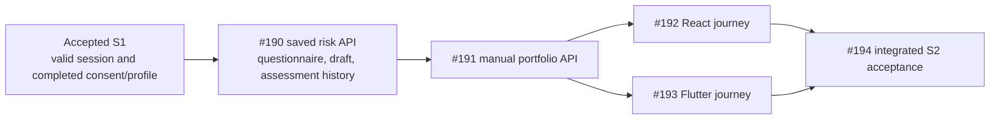
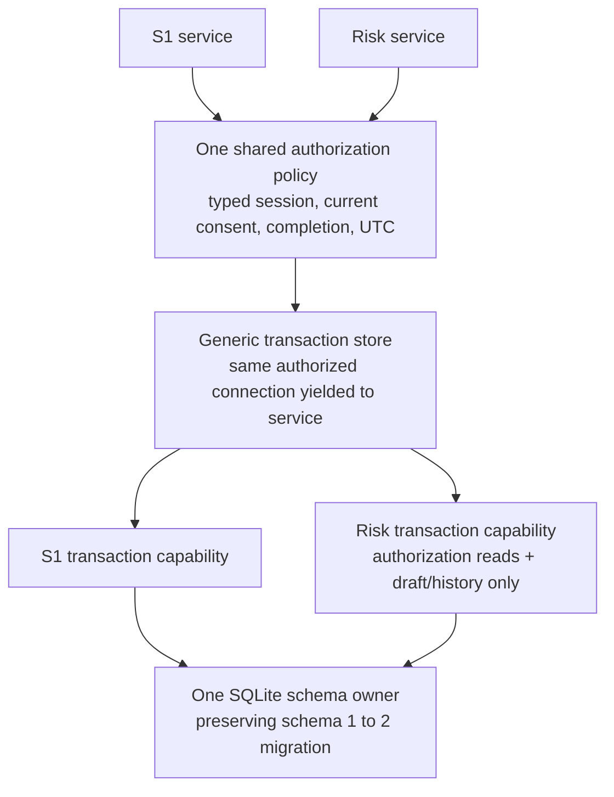

# FinEx saved risk assessment contract

Frozen implementation contract · `local.v1` · 2026-10-11

Story [#190](https://github.com/IgnAite-Showcase/Finex/issues/190) delivers the saved questionnaire, resumable answers and immutable risk history used by both clients. It implements FR-04, FR-05 and FR-06 from [V9.1](https://github.com/IgnAite-Showcase/Finex/blob/docs/v9.1-master-handbook/docs/governance/FinEx_Master_Product_Design_Delivery_Handbook_v9.1.pdf), pages 61–64 and 92, S2-SPEC-01, S2-DAT-01 and S2-API-01. The [shared application contract](S1-S4-delivery-contract.md) remains authoritative for identity, consent, safety and delivery order.

The starting release is accepted S1 `c912df3ffaa6a1dfc81a6d5a27d5eb4666c54221`. Its five post-merge workflows passed. Create `feature/190-s2-saved-risk-w40` from this accepted release. This contract defines the next implementation; it does not claim that S2 has passed acceptance.

## Delivery and user journey



The learner loads the approved ten-question questionnaire and their own draft. Saving replaces the draft without calculating a score. Submitting complete answers creates an immutable assessment, or returns the original assessment when a retry uses the same key and answers. Reading history never recalculates an old result with today's rules. Consent withdrawal preserves the records but blocks access until S1 completion is valid again.

```mermaid
sequenceDiagram
  participant C as React or Flutter
  participant API as Local risk API
  participant DB as Owned SQLite unit
  C->>API: GET questionnaire and draft with bearer
  API->>DB: One read snapshot and S1 prerequisite check
  DB-->>C: Ordered questions and own partial answers
  C->>API: PUT full replacement draft
  API->>DB: BEGIN IMMEDIATE, authorize, validate, save
  DB-->>C: Confirmed draft and server time
  C->>API: POST complete answers with retry key
  API->>DB: BEGIN IMMEDIATE, authorize, find owner/key
  alt Same key and same canonical input
    DB-->>C: Original saved assessment and original time
  else New key and valid complete input
    API->>API: Approved deterministic engine and explanation
    API->>DB: Insert immutable input, rules and result; commit
    DB-->>C: Confirmed saved assessment
  end
```

## API operations and envelopes

All six operations are under `/api/v1/local-risk`, require the existing documented `LocalApplicationBearer`, and require current accepted consent and completed onboarding. They use `APP_ENV=local`, `LOCAL_APP_ENABLED=true`, loopback binding/origins, memory-only credentials and the same durable database as S1. Disabled or non-loopback exposure fails before body parsing or database access.

| Method and suffix | Request | Success `data` |
|---|---|---|
| `GET /questionnaire` | None | `LocalRiskQuestionnaire` |
| `GET /draft` | None | `LocalRiskDraft` |
| `PUT /draft` | `LocalRiskInput` with partial answers | Confirmed `LocalRiskDraft` |
| `POST /assessments` | `LocalRiskInput` plus required `idempotency_key` | `LocalSavedRiskAssessment` |
| `GET /assessments` | `limit` and optional `before` query parameters | `LocalRiskHistory` |
| `GET /assessments/{assessment_id}` | Canonical lowercase UUIDv4 resource ID | Own `LocalSavedRiskAssessment` |

All successes return HTTP 200 and the existing `success/message/data/meta` envelope. `meta.dataStatus` is `CACHED`; this is durable synthetic local data, not live market data. Assessment creation/replay/read sets `meta.dataAsOf` to the stored calculation time; draft GET/PUT uses its nullable `updated_at`; questionnaire and history use null. Correlation IDs may change across retries; assessment `data` does not.

Every top-level local-risk success `data` DTO includes `scope: "local_educational_application"` and `contract_version: "local.v1"`. Nested input, `QuestionDefinition`, `RiskContractResult` and `EducationalExplanation` retain the explicitly specified logical shapes. The saved assessment includes `persisted: true`. The compatibility `/api/v1/risk-contract` API and its `persisted: false`, `local_educational_pilot` DTO remain unchanged and separately tested. Clients must not accept a pilot response as a saved application result. A local saved-result subclass makes nullable `informational_tension` required without changing the pilot schema or serialization.

## Input and draft fields

`LocalRiskInput` has exactly `questionnaire_id`, `questionnaire_version` and `answers`. IDs are strict strings, not converted from numbers or normalized to uppercase. The approved ID is `risk_questionnaire_v1`; the version is `v1`. An answer has exactly `question_id` and `answer_code`, using the approved identifiers `W1`–`W5`, `C1`–`C5` and corresponding `_A`–`_E` options. Extra fields, including owner, client score, result, rule override and timestamp, are forbidden.

Answers preserve the supplied array order. The questionnaire preserves its canonical question and option order. Transport bounds match the pilot's strict DTO: questionnaire ID 1–80 characters, version 1–32, answer identifiers 1–32, and no more than 64 supplied answers. Semantic validation allows at most one approved answer per question; the wider transport bound preserves deterministic duplicate/unknown/missing error precedence rather than hiding it behind an arbitrary list-length error.

The draft accepts zero through ten valid unique answers; missing questions are allowed only here. PUT is a full replacement, not a merge. An empty array explicitly clears only the draft. The draft never modifies assessment history or claims a score. Unsupported versions are rejected without replacing the previous draft.

`LocalRiskDraft` contains the scope/version, questionnaire ID/version, `answers` and required nullable `updated_at`. Before the first save, answers are empty and time is null. After each confirmed PUT, time is server-generated UTC. Saving identical answers is permitted and records the new explicit save time. A failed commit returns no confirmed save and preserves the prior draft.

```json
{
  "questionnaire_id": "risk_questionnaire_v1",
  "questionnaire_version": "v1",
  "answers": [{"question_id": "W1", "answer_code": "W1_C"}]
}
```

An initial draft is exactly this domain shape:

```json
{
  "scope": "local_educational_application",
  "contract_version": "local.v1",
  "questionnaire_id": "risk_questionnaire_v1",
  "questionnaire_version": "v1",
  "answers": [],
  "updated_at": null
}
```

## Submission and safe retries

Submission requires all ten answers plus a client-generated canonical lowercase UUIDv4 `idempotency_key`. This is a retry identifier, not a credential or an owner selector. Invalid/missing keys are HTTP 422. The request otherwise has exactly the three input fields above. The scorer receives only those input fields, never the retry key.

```json
{
  "questionnaire_id": "risk_questionnaire_v1",
  "questionnaire_version": "v1",
  "idempotency_key": "00000000-0000-4000-8000-000000000190",
  "answers": [
    {"question_id": "W1", "answer_code": "W1_C"},
    {"question_id": "W2", "answer_code": "W2_C"},
    {"question_id": "W3", "answer_code": "W3_C"},
    {"question_id": "W4", "answer_code": "W4_C"},
    {"question_id": "W5", "answer_code": "W5_C"},
    {"question_id": "C1", "answer_code": "C1_C"},
    {"question_id": "C2", "answer_code": "C2_C"},
    {"question_id": "C3", "answer_code": "C3_C"},
    {"question_id": "C4", "answer_code": "C4_C"},
    {"question_id": "C5", "answer_code": "C5_C"}
  ]
}
```

The owner comes only from the session. A unique database constraint on `(user_id, idempotency_key)` prevents duplicate history. The request fingerprint is SHA-256 of UTF-8 JSON with sorted object keys, compact separators and `ensure_ascii=False`, containing questionnaire ID/version and answers sorted by question ID. Thus a reordered equivalent retry returns the original saved input order, result, explanation and time. A different otherwise valid complete input under the same key returns `409 IDEMPOTENCY_CONFLICT`; no new row or draft change occurs. Unsupported versions and invalid answers still produce their semantic 400 before key comparison. Different owners may independently use the same key.

The all-zero-based UUID above is an illustration, not a reusable client constant. Generate a new UUIDv4 once for each deliberate new assessment; an uncertain retry must keep that assessment's original key and input.

Validate the complete semantic input before key comparison. There is no automatic server retry on a database failure. A client retry after an uncertain network outcome must retain its original key and input until confirmation. A deliberate new assessment uses a new key. Submission leaves the saved draft unchanged; clearing it requires an explicit draft PUT.

## Saved assessment and versioned rules

`LocalSavedRiskAssessment` has exactly these fields:

| Field | Meaning |
|---|---|
| `scope`, `contract_version`, `persisted` | Application literals above; saved is true |
| `assessment_id` | Server-generated canonical lowercase UUIDv4 |
| `created_at` | Server UTC time; equals `assessment.calculated_at` |
| `input` | Exact accepted three-field input and answer order; no bearer/key/owner |
| `assessment` | Existing `RiskContractResult`, including required nullable `informational_tension` |
| `explanation` | Existing deterministic `EducationalExplanation` |
| `explanation_version` | `educational_v1.0.0` |
| `rules_sha256` | Lowercase SHA-256 of the canonical JSON rules snapshot |
| `rules_snapshot` | Entire approved questionnaire/scoring configuration as a bounded JSON object |

The snapshot includes the questionnaire metadata, ordered questions/option scores and scoring rules from `backend/data/questionnaire/risk_questionnaire_v1.json`. Digest serialization is exactly `json.dumps(snapshot, sort_keys=True, separators=(",", ":"), ensure_ascii=False, allow_nan=False).encode("utf-8")`, with no BOM, final newline or Unicode normalization. It preserves JSON number types and array order and is stable across Windows/Linux line endings. Unsupported or non-finite snapshots fail safely; no fallback serialization is allowed. No disk path or repository credential belongs in a response. Measure the 64 KiB limit on these exact bytes. The existing scorer remains the sole numeric authority; a shared validation seam may support partial drafts and a single loaded engine without changing scoring arithmetic or pilot validation precedence.

The result versions are `s2-risk-contract/v1.0`, questionnaire `v1`, scoring `deterministic_v1.0.0`. Five willingness and five capacity scores each sum from 5 to 25. Normalize each as `(sum - 5) / 20 * 100`, round to four decimal places, combine equally and round to four places. Composite `<34` is Conservative, `34 <= score <67` is Moderate, and `>=67` is Aggressive. All `_C` answers produce willingness/capacity/composite 50 and Moderate; all `_A` produce 0/Conservative; all `_E` produce 100/Aggressive. Existing sixteen approved golden vectors remain the authority for boundary and tension cases.

The explanation describes these exact stored scores, versions, time and self-reported limitations. It supplies no recommendation, verified suitability, guaranteed outcome or LLM-generated numeric result. A history read returns the stored document, not a fresh score, explanation or timestamp. Tests reproduce the original calculation from the saved rules/input/time and compare every result field. Corrupt stored JSON, rules hashes, identity/time binding or unsupported document shapes fail safely; never substitute today's result.

`LocalRiskQuestionnaire` has exactly `scope`, `contract_version`, `questionnaire_id`, `questionnaire_version`, `scoring_version`, `explanation_version`, `rules_sha256`, `questions` and `limitation`. `questions` is the existing ordered `QuestionDefinition` array and `limitation` is `RiskLimitation`. It contains no assessment or owner information. Both clients render its actual content rather than a different five-question form.

## Owned history and pagination

`LocalRiskHistory` contains scope/version, `items: LocalSavedRiskAssessment[]` and required nullable `next_cursor`. An empty history is `items: []`, `next_cursor: null`. Default limit is 20; only canonical decimal integers 1–50 are accepted. `before` is an optional canonical positive decimal internal sequence, at most signed 64-bit maximum. Invalid query values fail 422 without exposing data.

Order is descending immutable insertion sequence, not calculation time; two assessments may share one clock tick. Fetch `limit + 1` owned rows to determine whether another page exists. If more remain, `next_cursor` is the last returned sequence as a string; otherwise it is null. A following page includes only this owner's rows with lower sequence. New inserts do not duplicate earlier-page results. There is no unbounded list endpoint. A valid missing resource ID and another owner's ID return the same `404 RISK_ASSESSMENT_NOT_FOUND` message/envelope.

## Authorization and durable storage



Use a small `AuthorizationTransaction` protocol for `get_session`, `get_onboarding` and `latest_consent`, and generic `TransactionStore[T]`. A shared authorization context validates and yields the same `(LocalSession, T)` inside one transaction. Keep the public S1 service and its existing store injection backward compatible. Domain-specific risk ports do not inherit unused S1 mutation or future portfolio/order methods. Do not introduce `Any`, casts or runtime capability guessing into these ports.

The risk service receives an explicitly typed risk-capable store. `create_app(local_store=..., local_clock=...)` must continue working for existing S1 tests. Add separate `local_risk_store` injection. With a supplied S1-only store and no risk store, risk requests fail safe 503; they must never silently use the developer database. With neither supplied, both lazy services use the same configured native path. Use `is None` checks, preserve lazy effective clock injection and do not create a database at app construction.

One schema owner supports version 2. Fresh creation and preserving migration from version 1 happen in a separate short adapter bootstrap transaction on first guarded use, before the domain unit of work. A compatible version-1 file is upgraded additively; no data reset is allowed. Both S1 and risk adapters recognize the upgraded schema. Domain reads then set `query_only` and use one consistent snapshot; mutations use `BEGIN IMMEDIATE` and recheck session/consent/completion in that same write transaction. No provider, network or await occurs inside a database transaction.

Reject unknown future versions, foreign databases and missing required schema before changing their schema/journal. Migration failure before metadata commit rolls back DDL and leaves all version-1 records and version metadata intact. Concurrent migrators recheck after acquiring the write lock. Preserve existing `_connect` and `_before_commit` failure/race seams and bounded three-second busy timeout. Never reset an old file because it cannot migrate; return a safe failure and use a separately scoped forward fix.

The draft table has owner PK/FK, questionnaire ID/version, ordered answer JSON and UTC update time. The assessment table has a monotonic internal sequence, unique assessment UUID, owner FK, retry key, 64-character request fingerprint, immutable response document and UTC creation time, with unique owner/key and an owner/sequence index. Parameterized owner predicates apply to every read/write. Update/delete triggers protect assessment history, like S1 consent history. Native SQLite backup or closed/checkpointed files are required for backup; copying only an active main file is unsafe.

### Typed persistence seams

The domain records are frozen dataclasses with no Pydantic, FastAPI or SQLite imports. `LocalRiskDraftRecord` has `user_id: str`, `questionnaire_id: str`, `questionnaire_version: str`, `answers_json: str`, `updated_at: datetime`. `LocalRiskAssessmentRecord` has `assessment_id: str`, `user_id: str`, `idempotency_key: str`, `request_fingerprint: str`, `document_json: str`, `created_at: datetime`, `sequence: int = 0`. Sequence zero is only the uninserted record; an inserted/read record has a positive database-assigned sequence.

`LocalRiskTransaction` extends only `AuthorizationTransaction` and these methods:

| Method | Return |
|---|---|
| `get_risk_draft(user_id: str)` | `LocalRiskDraftRecord \| None` |
| `save_risk_draft(record: LocalRiskDraftRecord)` | `None` |
| `get_risk_assessment(user_id: str, assessment_id: str)` | `LocalRiskAssessmentRecord \| None` |
| `get_risk_assessment_by_key(user_id: str, idempotency_key: str)` | `LocalRiskAssessmentRecord \| None` |
| `insert_risk_assessment(record: LocalRiskAssessmentRecord)` | `LocalRiskAssessmentRecord` with assigned sequence |
| `list_risk_assessments(user_id: str, *, before: int \| None, limit: int)` | `list[LocalRiskAssessmentRecord]`, descending sequence, at most limit |

`LocalRiskStore` is `TransactionStore[LocalRiskTransaction]`; the SQLite implementation is `SQLiteLocalRiskStore`. The service owns validation, rules/response construction, canonical fingerprints and stored-document binding checks. The adapter owns parameterized persistence, connection lifecycle, migration and commit/rollback. A common generic SQLite transaction factory creates the appropriate typed transaction on its single owned connection; existing S1 transaction/store class names and hooks remain available.

## Error precedence and safe failures

| HTTP | Stable code | Condition |
|---|---|---|
| 401 | `SESSION_INVALID` | Missing, malformed, expired or revoked bearer |
| 403 | `LOCAL_APPLICATION_ONLY` | Disabled or invalid local exposure boundary |
| 409 | `ONBOARDING_REQUIRED` | Consent/profile/completion is not current |
| 400 | Existing seven risk semantic codes | Invalid answer/version input, below |
| 409 | `IDEMPOTENCY_CONFLICT` | Owner/key already has different complete input |
| 404 | `RISK_ASSESSMENT_NOT_FOUND` | Missing or other-owner valid assessment ID |
| 422 | `VALIDATION_ERROR` | Strict transport DTO, key, resource ID or pagination failure |
| 503 | `LOCAL_STORE_UNAVAILABLE` | Native store/injection/migration/commit or stored-document failure |
| 503 | `RISK_ASSESSMENT_UNAVAILABLE` | Approved rules/scorer/explanation cannot be safely supplied |

Transport validation does not expose a submitted bearer/body/path in field errors. For valid transport, authorization precedes semantic risk validation inside the transaction. Semantic order is unchanged: `MALFORMED_ANSWER`, `UNSUPPORTED_QUESTIONNAIRE_VERSION`, `DUPLICATE_QUESTION_ANSWER`, `UNKNOWN_QUESTION_ID`, `MISSING_REQUIRED_QUESTION`, `INVALID_ANSWER_CODE`, `ANSWER_NOT_PERMITTED_FOR_QUESTION`. Partial draft validation omits only the missing-required check. No numeric result is returned on these failures.

Responses confirm save only after a successful commit. A failed draft/assessment commit preserves the previous draft, S1 prerequisites and all existing history. If logout or consent withdrawal commits first, a competing risk writer must observe it after acquiring its lock and fail 401/409 without inserting. If an authorized risk write commits first, history remains immutable and subsequent access is gated by the later withdrawal.

## Acceptance tests and handoff

Write actual failing assertions for missing behavior before implementation; import/tool failures are not application RED evidence. The story's evidence must include:

- Existing pilot contracts and all sixteen approved golden vectors unchanged; saved results match them at an injected UTC time.
- Ordered partial/empty replacement, invalid/version precedence, duplicate/unknown/wrong-question answers, strict transport fields and restart resume.
- Complete submit, exact original replay after restart, reordered equivalent retry, conflicting key, different-owner same key, concurrent duplicate submission and rollback.
- Owned history/detail, identical missing/other-owner 404, pagination limit/cursor validation, stable ordering at equal times and inserts between pages.
- Real S1-to-S2 preserving migration, migration failure/concurrency, future/foreign rejection, read snapshot/query-only, immutable history triggers, generic type checks and one-connection authorization/write proof.
- Session expiry/logout, consent withdrawal/reacceptance, profile invalidation and real lock-ordered races in both directions; injected S1-only stores never falling back to the developer database.
- OpenAPI for six bearer-protected operations and full DTO/error/nullability shapes; real native HTTP smoke using a disposable owned database and sanitized evidence.
- Full backend lint/format, Linux/Windows-targeted mypy, pytest/coverage, secret snapshot, independent non-author review and exact-head/post-merge CI before Done.

Publish only committed reviewed paths from the clean feature branch into `release/2026-W40`. Record tested local SHA, published SHA/tree, exact commands/results and review findings in `docs/evidence/`. Consumer work waits for accepted #190 and #191. Cloud deployment, real identity/money, human UAT, native-device checks and external #129/#132/#134 gates remain outside this local acceptance.
