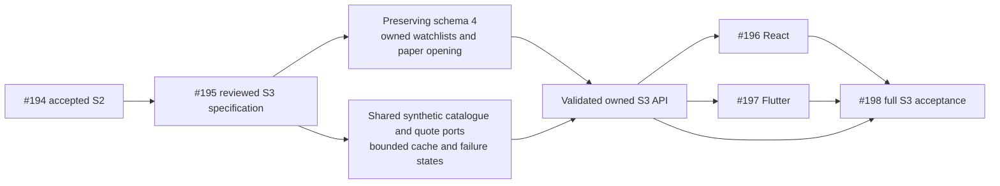
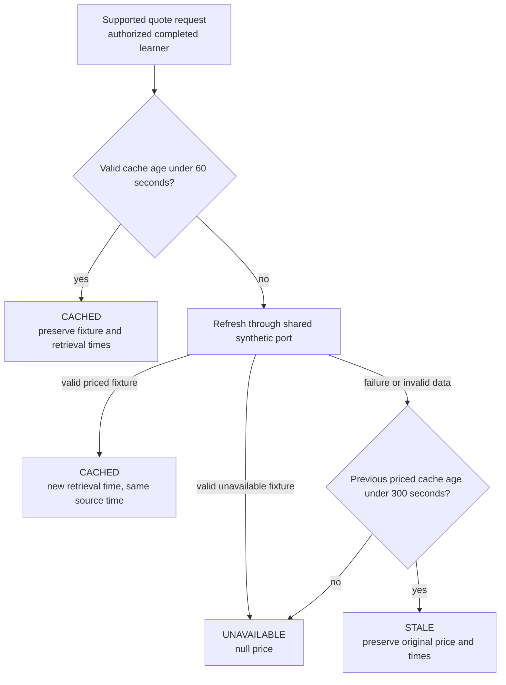
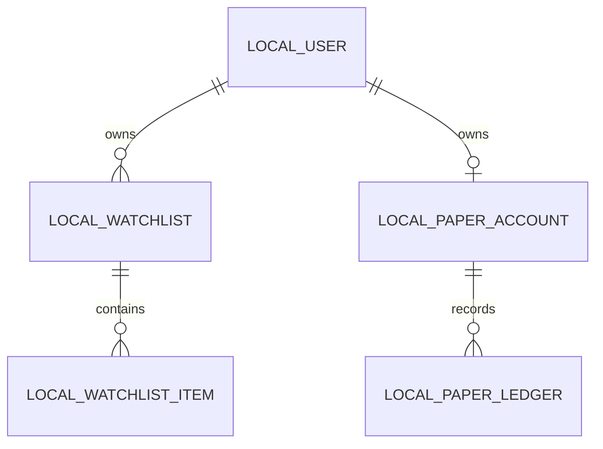

# S3 market watchlist and simulated account contract

Contract version: `market_foundation.v1`. Overall local application contract:
`local.v1`. This specification covers supported instrument search, truthful
synthetic quote states, owned watchlists and an explicitly opened simulated
paper account. It does not implement orders, real market access or real money.

Implementation follows [#195](https://github.com/IgnAite-Showcase/Finex/issues/195)
on `feature/195-s3-market-watchlist-account-w40`, based on accepted S2 W40
`a05b54b1aabe776f23e3935d7e4d4f5255c5901e`. React #196 and Flutter #197 consume
this contract only after the API is accepted; #198 supplies full S3 acceptance.
Independent technical review must accept this specification before behavior
implementation. Anand's standing delegated authority is not a fabricated human
UAT record.

The master requirements are FR-09 through FR-12 and NFR-01,03,04,05,07,08,09,10.
[V9.1](https://github.com/IgnAite-Showcase/Finex/blob/docs/v9.1-master-handbook/docs/governance/FinEx_Master_Product_Design_Delivery_Handbook_v9.1.pdf)
pages 65–68 and 93 map to S3-SPEC-01, S3-DAT-01 and S3-API-01. The
[shared delivery contract](S1-S4-delivery-contract.md) remains authoritative for
identity, current consent, profile completion, failure envelopes and local-only
access. Compatible additions keep `local.v1`; an incompatible refinement needs
a new domain version and updated consumer stories.



## Supported instruments and search

Reuse the S2 catalogue and quote ports, not the historical market service. The
default application catalogue is `synthetic_catalog.v1`, currency USD, with the
exact four teaching examples below. These identifiers never represent a live
exchange listing or a qualified current market quote.

| Instrument ID | Display name | Asset class | Sector | Fixed fixture price |
|---|---|---|---|---|
| `SYN:AAPL` | Synthetic Apple example | EQUITY | TECHNOLOGY | `200.0000` |
| `SYN:BND` | Synthetic bond-fund example | BOND | FIXED_INCOME | `80.0000` |
| `SYN:MSFT` | Synthetic Microsoft example | EQUITY | TECHNOLOGY | `400.0000` |
| `SYN:UNAVAILABLE` | Synthetic unavailable-price example | EQUITY | GENERAL | null |

Source: `finex.synthetic.portfolio`; source type: `SYNTHETIC`; quote snapshot:
`synthetic_quotes.v1`; immutable fixture time: `2026-01-01T00:00:00Z`. Fetching or
refreshing a fixture must not change its source, snapshot version or source
timestamp. An invalid injected catalogue or snapshot is a provider fault, not
permission to invent a price or change the default application's supported IDs.

### Controlled capacity fixtures

As with S2's capacity tests, a trusted test may inject the catalogue port with
up to 128 valid synthetic entries, including `SYN:TEST001` through
`SYN:TEST101`. This is an isolated boundary fixture, not the default application
dataset or a production catalogue extension. It preserves the v1 record shape,
catalogue/quote versions, SYNTHETIC source, USD and immutable fixture timestamp;
matching injected quote records must satisfy the same strict validators. There
is no HTTP body, query or environment selector for this fixture. Default factory
and native-default tests must prove all TEST IDs remain unsupported.

The expanded fixture proves 100 successful distinct item additions and an
atomic 101st-item capacity failure through the owned API. It also proves list
and cache bounds without inventing an unsupported default identifier. The cache
still holds only four entries; a fifth distinct injected request evicts the
least recently used entry. A cache hit changes recency only, never retrieval or
source time. Changing the real default dataset requires an approved versioned
provider/consumer update, not enabling this test fixture for users.

Search trims the query and matches instrument ID or display name
case-insensitively. Empty query returns supported entries, sorted by instrument
ID. Unknown text returns an empty list, not an unsupported synthetic instrument.
The query is at most 80 characters, without control characters; `limit` is an
integer from 1 to 20, default 20. Unknown query fields, duplicate controls and
invalid bounds fail with safe validation errors before provider work. Currency,
owner and source are not search request inputs.

## Quote cache and provider failures

Prices are fixed-point decimal strings with exactly four fractional places,
positive and within the accepted S2 price bounds. Unavailable prices are null,
never zero, a cost basis or a guessed default. The teaching fixture may be old:
its immutable source time and the cache's retrieval time describe different
facts and must both be visible.

The cache has at most four entries, one per supported identifier. A successful
validated retrieval records `fetched_at` and `cache_expires_at` in UTC. Freshness
TTL is 60 seconds. During a failed refresh, a previously priced entry may remain
visible as STALE only while its age is less than 300 seconds. At age 300 seconds
or later, no price may be supplied. A failed or invalid retrieval never refreshes
the entry's original retrieval or source timestamp. A backward or invalid clock
fails closed; it must not make an entry appear younger. Cache creation is lazy,
in memory, bounded and thread-safe; no provider or database is contacted at
module import.

| Situation | Quote status | Price and source time | Retrieval metadata | Reason |
|---|---|---|---|---|
| Valid priced fixture; cache age less than 60 seconds | CACHED | Exact fixture values | Last successful fetch and its 60-second expiry | null |
| Cache expired; refresh succeeds with a valid priced fixture | CACHED | Same immutable fixture values | New successful fetch and expiry | null |
| Refresh fails; priced cache age at least 60 and less than 300 seconds | STALE | Last validated fixture values | Unchanged original fetch and expiry | `SYNTHETIC_PROVIDER_STALE` |
| No priced cache, or failed refresh at age at least 300 seconds | UNAVAILABLE | Price and quote time null | Previous successful metadata if it exists, otherwise null | `SYNTHETIC_PROVIDER_UNAVAILABLE` |
| Valid `SYN:UNAVAILABLE` fixture | UNAVAILABLE | Price and quote time null | Successful snapshot retrieval and expiry | `SYNTHETIC_QUOTE_UNAVAILABLE` |
| Unsupported ID | No quote response | No fallback | No provider call | `INSTRUMENT_NOT_FOUND` |



Quote status is a domain field. The unchanged shared envelope uses
`meta.dataStatus=CACHED` for CACHED or STALE synthetic values and UNAVAILABLE when
the quote has no price. `meta.dataAsOf` is the immutable quote time only when a
price is present. Do not map STALE to LIVE or DELAYED. Clients display the domain
status as text, the source/time, and "Synthetic teaching data — not a live market
price". Unknown status/version/source, malformed decimal/time or a contradictory
price/status combination is a decoding failure, not usable market data.

### Exact quote field and state rules

Every quote response always contains the declared `catalog_version`,
`quote_snapshot_version`, `source`, `source_type`, `fixture_as_of`, canonical
`instrument_id` and USD currency specified above. On a provider fault, these
identify the configured teaching dataset, not a newly observed provider result.
Unvalidated provider metadata is never copied into the response.

| Status and reason | `fixture_as_of` | `unit_price` / `quote_as_of` | `fetched_at` / `cache_expires_at` | Envelope `dataStatus` / `dataAsOf` |
|---|---|---|---|---|
| CACHED, reason null | Exact declared fixture time | Valid fixed-point price / exact fixture time | Successful UTC retrieval / that time plus exactly 60 seconds | CACHED / exact fixture time |
| STALE, `SYNTHETIC_PROVIDER_STALE` | Exact declared fixture time | Last validated price / exact fixture time | Unchanged successful retrieval / its original expiry | CACHED / exact fixture time |
| UNAVAILABLE, `SYNTHETIC_QUOTE_UNAVAILABLE` | Exact declared fixture time | null / null | Successful unavailable-snapshot retrieval / that time plus exactly 60 seconds | UNAVAILABLE / null |
| UNAVAILABLE, `SYNTHETIC_PROVIDER_UNAVAILABLE`, previous validated retrieval exists | Exact declared fixture time | null / null | Previous successful retrieval / its original expiry, unchanged | UNAVAILABLE / null |
| UNAVAILABLE, `SYNTHETIC_PROVIDER_UNAVAILABLE`, no validated retrieval exists | Exact declared fixture time | null / null | null / null | UNAVAILABLE / null |

Retrieval fields are a pair: both UTC strings or both null. A nonnull expiry is
exactly 60 seconds after its paired retrieval. CACHED requires a positive priced
result and null reason. STALE requires a previous priced result and the exact
stale reason. UNAVAILABLE always requires null price and quote time and one of
the two unavailable reasons above. Missing fields, extra fields, LIVE/DELAYED,
negative/nonfinite/zero prices, wrong versions/source or mixed nullability fail
strict decoding. After shared authorization has confirmed a valid UTC instant,
an invalid or backward quote-cache clock yields safe `503 LOCAL_QUOTE_UNAVAILABLE`,
without changing a cache entry or inventing times. If the shared clock is already
invalid during authorization, the existing S1 boundary returns safe
`503 LOCAL_STORE_UNAVAILABLE` before provider/cache work. Do not bypass that
authorization check, substitute a guessed time or disclose internal diagnostics
to classify an unauthorizable request as a quote-only failure.

S4 may explicitly execute a supported CACHED synthetic fixture as a simulation.
STALE and UNAVAILABLE quotes may not execute orders. S3 exposes no order endpoint;
the later execution contract must recheck its quote inside the defined intent
and atomicity boundary, without treating this market screen as financial
authority.

## Owned watchlists

A learner may create up to 10 watchlists, with up to 100 distinct supported
instruments in each. Names are trimmed, nonblank strings of at most 100
characters; they are nonsensitive labels, not legal names. IDs are server-created
canonical UUID4 strings. Lists sort by creation time and ID; items sort by
addition time and instrument ID. Empty states are actual empty collections.

The owner comes only from the opaque local session. List CRUD and item reads
include owner predicates. A nonexistent list and another learner's list return
the same `404 WATCHLIST_NOT_FOUND`. All writes recheck session expiry/revocation,
current consent and completed onboarding in the same short SQLite transaction.
Withdrawal races cannot permit a later unauthorized write.

Adding an existing instrument is idempotent: return the existing item with its
original `added_at`, do not duplicate it or advance the list's modification time.
Removal is idempotent for an existing owned list: return the same confirmation
if the supported item is already absent. Unknown instruments never become list
items. Repeating an unchanged name preserves its modification time. Deleting a
list deletes its owned items atomically, but does not touch paper ledger, risk
history, other watchlists or manual portfolios. Watchlist deletion is not a
ledger deletion. Capacity failures cannot leave partial writes.

## Controlled simulated account opening

The initial simulated cash policy is exactly USD `10000.00`, represented by
1,000,000 integer cents. The learner must explicitly choose to open the account.
An account GET does not open, fund, reset or top up it. Each owner has at most one
paper account and one immutable OPENING ledger entry. There is no funding amount,
real account identifier, owner ID, broker credential or payment input.

`POST` opening rechecks authorization and prerequisites in one transaction,
inserts the account and its opening ledger together, and commits once. Repeated
or concurrent opening returns the same account, opening amount, opening entry ID
and original creation time; it never adds money again. A later S4 balance change
does not authorize a top-up when opening is retried. Failures and injected
rollback leave neither half of the opening behind.

```mermaid
sequenceDiagram
  participant C as React or Flutter
  participant A as Owned paper service
  participant T as SQLite transaction
  C->>A: Explicit open with version and USD
  A->>T: Begin immediate; recheck session and completion
  T->>T: Read owner account
  alt Already opened
    T-->>A: Existing account and opening entry
  else First opening
    T->>T: Insert unique owner account and OPENING entry
    T->>T: Commit both or roll back both
    T-->>A: Original account and opening entry
  end
  A-->>C: Simulated account, never real funds
```

The account response always identifies the amount as simulated. An unopened
account is null, not a fabricated zero balance. Ledger reads are owned and
bounded; `limit` is 1 to 100, default 100, and `after_sequence` is a nonnegative
integer cursor, default 0 when omitted. A missing owned account returns
`404 PAPER_ACCOUNT_NOT_OPEN` for ledger reads. S3 accepts only opening behavior.
Later BUY, SELL and linked
CORRECTION entries require S4's separate accepted execution contract.

## Versioned HTTP contract

Every success uses the existing `success/message/data/meta` envelope. Every
top-level domain `data` object carries `scope=local_educational_application`,
`contract_version=local.v1` and `foundation_version=market_foundation.v1`.
Request bodies forbid extra fields and binary-float money. Mutation responses
are sent only after their transaction is confirmed committed.

All routes require LOCAL opt-in, a valid bearer and current completed onboarding.
No owner selector, correlation header, legacy JWT or client-stored completion
can replace those prerequisites. The shared error envelope and correlation ID
remain unchanged.

| Method and route | Request | Success data |
|---|---|---|
| GET `/api/v1/local-market/instruments` | Query `query`, `limit` | Catalogue version, query and ordered supported items |
| GET `/api/v1/local-market/quotes/{instrument_id}` | Supported canonical ID | Quote metadata and CACHED, STALE or UNAVAILABLE result |
| GET `/api/v1/local-watchlists` | No body | Ordered owned lists; no other owner's IDs |
| POST `/api/v1/local-watchlists` | `{ "name": "Teaching examples" }` | New list; 201 |
| GET `/api/v1/local-watchlists/{watchlist_id}` | UUID4 | Owned list and ordered items |
| PUT `/api/v1/local-watchlists/{watchlist_id}` | `{ "name": "Renamed examples" }` | Saved list; unchanged replacement is safe |
| DELETE `/api/v1/local-watchlists/{watchlist_id}` | No body or empty object | `{ "watchlist_id": "UUID4", "deleted": true }` plus scope/version |
| PUT `/api/v1/local-watchlists/{watchlist_id}/items/{instrument_id}` | No body or empty object | Stable existing or newly added item |
| DELETE `/api/v1/local-watchlists/{watchlist_id}/items/{instrument_id}` | No body or empty object | `{ "watchlist_id": "UUID4", "instrument_id": "SYN:AAPL", "removed": true }` plus scope/version |
| GET `/api/v1/local-paper/account` | No body | `simulation: true`, account null or owned account |
| POST `/api/v1/local-paper/account/open` | `{ "foundation_version": "market_foundation.v1", "currency": "USD" }` | Existing or newly opened simulated account; 200 |
| GET `/api/v1/local-paper/account/ledger` | Query `limit`, `after_sequence` | Owned ordered ledger entries and next cursor |

### Exact typed success data

All keys listed here are required, including nullable keys. All objects forbid
extra fields. `Scope` means the three literal top-level fields `scope`,
`contract_version` and `foundation_version` above. Nested records contain only
their listed fields; they do not repeat Scope. `UTC` is an ISO-8601 string with
Z or +00:00, at most six fractional-second digits; timestamps must be timezone
aware. `ID` is a lower-case canonical UUID4 string. Counts/sequences are JSON
integers, never booleans or numeric strings. Public integers are bounded by
9,007,199,254,740,991 so JavaScript does not round them.

| Type | Exact required fields and constraints |
|---|---|
| `Instrument` | `instrument_id`: canonical supported SYN ID; `display_name`: trimmed string 1–100; `asset_class`, `sector`: uppercase identifier strings 1–32; `currency`: literal USD. Names/classes/sectors match the validated catalogue. |
| `MarketSearchData` | Scope; `catalog_version`: synthetic_catalog.v1; `query`: normalized string 0–80; `limit`: integer 1–20; `count`: integer equal to items length; `items`: ordered Instrument array of at most limit entries. Empty search is count 0/items []. |
| `MarketQuoteData` | Scope; all 13 remaining keys in the concrete quote example below, with exact literals and the quote-state/nullability matrix above. Status is CACHED, STALE or UNAVAILABLE only; price is a bounded positive four-place decimal string or null. |
| `WatchlistSummary` | `watchlist_id`: ID; `name`: trimmed nonblank string ≤100; `created_at`, `updated_at`: UTC, updated_at ≥ created_at; `item_count`: integer 0–100. |
| `WatchlistItem` | The five Instrument fields plus `added_at`: UTC. Instrument metadata is derived from the validated catalogue, not a client-provided name/price. |
| `WatchlistCollectionData` | Scope; `watchlist_version`: watchlist.v1; `limit`: literal integer 10; `count`: integer equal to items length; `items`: WatchlistSummary array, at most 10, unique IDs, sorted by created_at/ID. |
| `WatchlistData` | Scope; `watchlist_version`: watchlist.v1; all five WatchlistSummary fields; `items`: WatchlistItem array of at most 100, unique instrument IDs, item_count equals array length, sorted by added_at/instrument ID. POST returns empty items; GET/PUT return the current full list. |
| `WatchlistItemData` | Scope; `watchlist_version`: watchlist.v1; `watchlist_item_version`: watchlist_item.v1; `watchlist_id`: ID; `item`: WatchlistItem. A repeated PUT returns the original item. |
| `WatchlistDeletedData` | Scope; `watchlist_version`: watchlist.v1; `watchlist_id`: ID; `deleted`: literal true. |
| `WatchlistItemRemovedData` | Scope; `watchlist_version`: watchlist.v1; `watchlist_item_version`: watchlist_item.v1; `watchlist_id`: ID; `instrument_id`: supported canonical ID; `removed`: literal true. Already-absent owned items have the same data. |
| `PaperAccount` | `account_id`, `opening_ledger_id`: ID; `currency`: USD; `opening_cash`: literal string 10000.00; `cash_balance`: nonnegative two-place decimal string bounded by 100,000,000,000,000.00; `created_at`: UTC. In accepted S3 cash_balance is exactly 10000.00. |
| `PaperAccountData` | Scope; `paper_account_version`: paper_account.v1; `simulation`: literal true; `account`: PaperAccount or null. GET may return null; successful opening never returns null. No fake unopened zero balance. |
| `PaperOpeningEntry` | `ledger_id`, `account_id`: ID; `sequence`: integer 1–public bound; `entry_type`: OPENING; `cash_delta`, `cash_after`: literal strings 10000.00; `instrument_id`, `quantity_delta`, `position_after`, `order_id`, `trade_id`, `corrects_ledger_id`: all required null; `created_at`: UTC. |
| `PaperLedgerData` | Scope; `paper_ledger_version`: paper_ledger.v1; `simulation`: true; `account_id`: ID; `limit`: integer 1–100; `after_sequence`: nonnegative public integer; `count`: integer equal to items length; `items`: ascending sequence PaperOpeningEntry array of at most limit; `next_cursor`: last returned sequence if another row exists, otherwise null. Accepted S3 has one opening row; a cursor after it returns count 0/items []/next_cursor null. |

Watchlist creation is an ordinary POST, not an exact-replay order intent.
After an ambiguous create timeout, clients preserve the label and require an
owned-list refresh before retry; they must not automatically repeat the POST or
announce success. Repeated item PUT/DELETE and account opening are the specified
idempotent operations. Repeating whole-list deletion may return the same safe
not-found response after its first success; it never recreates the list.

Search and quote responses use catalogue/fixture times as specified; watchlist
and account responses use CACHED metadata, with dataAsOf equal to the resource's
confirmed UTC update/creation time when a single resource is returned and null
for collections or an unopened account. Ledger dataAsOf is the newest returned
entry time, or null for an empty page. The envelope correlation ID is always
the current request's ID, not part of domain idempotency replay.

S4 adds versioned execution/ledger records separately. A different ledger entry
shape increments `paper_ledger_version` and updates its consumer stories; it
must not silently send BUY/SELL/correction fields to a strict S3 v1 decoder.

An illustrative CACHED quote's `data` is:

```json
{
  "scope": "local_educational_application",
  "contract_version": "local.v1",
  "foundation_version": "market_foundation.v1",
  "catalog_version": "synthetic_catalog.v1",
  "quote_snapshot_version": "synthetic_quotes.v1",
  "source": "finex.synthetic.portfolio",
  "source_type": "SYNTHETIC",
  "fixture_as_of": "2026-01-01T00:00:00Z",
  "instrument_id": "SYN:AAPL",
  "currency": "USD",
  "status": "CACHED",
  "unit_price": "200.0000",
  "quote_as_of": "2026-01-01T00:00:00Z",
  "fetched_at": "2026-10-12T01:00:00+00:00",
  "cache_expires_at": "2026-10-12T01:01:00+00:00",
  "reason": null
}
```

These timestamps are contract examples, not runtime evidence. A STALE response
retains those timestamps and price but changes status/reason. A provider failure
after 300 seconds retains only truthful prior retrieval metadata and sets price
and quote time to null. An unavailable fixture also has null price/quote time.

An opened account contains `account_id`, currency USD, `opening_cash: "10000.00"`,
`cash_balance: "10000.00"`, `opening_ledger_id` and UTC `created_at`, with
`simulation: true`. Its initial ledger entry contains a server UUID4 `ledger_id`,
monotonic integer `sequence`, `account_id`, `entry_type: "OPENING"`,
`cash_delta: "10000.00"`, `cash_after: "10000.00"`, null instrument/quantity/order/
trade/correction fields, and UTC `created_at`. Sequence numbers order history;
equal timestamps do not erase or reorder entries.

## Errors and client states

| HTTP and code | Meaning | Client response |
|---|---|---|
| 401 `SESSION_INVALID` | Missing, malformed, expired or revoked local bearer | Clear confirmed-invalid session state and return to sign-in |
| 403 `LOCAL_APPLICATION_ONLY` | Wrong environment, missing opt-in or unsafe peer | Show local-only boundary; do not retry as a real platform login |
| 409 `ONBOARDING_REQUIRED` | Current consent/profile prerequisites missing | Preserve domain data; guide the learner through recompletion |
| 409 `MARKET_FOUNDATION_VERSION_MISMATCH` | Opening request has another domain version | Visible contract mismatch; no opening or automatic upgrade |
| 404 `INSTRUMENT_NOT_FOUND` | Well-formed but unsupported ID | Visible unsupported state; never invent a quote/item |
| 404 `WATCHLIST_NOT_FOUND` | Missing or other-owner list | Same safe not-found response |
| 404 `PAPER_ACCOUNT_NOT_OPEN` | Ledger requested before explicit opening | Offer the controlled account-opening action |
| 409 `WATCHLIST_LIMIT` or `WATCHLIST_ITEM_LIMIT` | Owned bounded collection is full | Keep saved state; explain the exact limit |
| 422 `VALIDATION_ERROR` | Invalid name, ID, body, controls or bounds | Safe field errors; do not claim a save |
| 503 `LOCAL_STORE_UNAVAILABLE` | Storage or schema cannot be confirmed | Preserve the form; retry explicitly; no fabricated success |
| 503 `LOCAL_CATALOG_UNAVAILABLE` | Supported catalogue cannot be validated | Show catalogue failure, not an empty successful search |
| 503 `LOCAL_QUOTE_UNAVAILABLE` | Quote cache timing cannot be validated after authorization | Leave the cache unchanged; show a timing failure, not a priced fallback |
| 200 with quote UNAVAILABLE | Supported instrument has no usable priced result | Visible null/unavailable state and safe refresh, not a transport error |

Both clients show loading, empty, permission, validation, failed transport,
retry, confirmed success and quote status as text. Refresh is a read, not an
automatic repeat of an ambiguous mutation. Pending opening/add/remove actions
are disabled against duplicate clicks; a timeout is not confirmation. A session
generation change aborts or ignores old work and clears the prior owner's state.
Confirmed withdrawal or invalidation returns to onboarding without erasing the
server's watchlists or account. S4 trading/goals remain pending.

## Native data model and forward migration

Schema version 4 adds `local_watchlists`, `local_watchlist_items`,
`local_paper_accounts` and append-only `local_paper_ledger`. Use parameterized SQL,
owner-scoped uniqueness, composite foreign keys and strict integer money/quantity
units. Ledger UPDATE/DELETE are blocked by triggers; opening uniqueness and its
10000.00 policy have database constraints as well as service validation.



The shared schema owner preserves the exact existing versions 1, 2 and 3 when
inspecting old files, then upgrades atomically to 4. Old S1 identities, consent,
profiles, sessions, risk drafts/history and manual portfolios remain unchanged.
Version 3 is the S2 native schema generation, not accepted Sprint 3. Foreign,
malformed, partial and future databases fail closed without reset or destructive
repair. Competing creation/migration/opening cannot duplicate state. Bootstrap
failure leaves the original file unchanged and blocks promotion.

The rollback route is a forward-fix or bounded feature disable. A version-3-only
binary cannot safely open a version-4 database; do not downgrade metadata or
delete new tables/history. Use SQLite's backup API for a named local database,
not a main-file copy while WAL is active. None of this authorizes legacy cloud
Alembic DDL, a real database reset or cloud deployment.

## Required proof before acceptance

| Requirement | Unit and contract proof | Integration and native proof |
|---|---|---|
| Supported catalogue and bounded search | Exact v1 IDs/metadata, normalization/order/empty result, controls and unsupported input | Current-consent authorization before provider access; real HTTP envelopes |
| Truthful quotes | Exact price/source/time, 60/300-second boundaries, invalid provider, missing price, clock reversal and no LIVE fallback | Controlled cache/outage/recovery; current response-byte replay on both clients |
| Owned watchlist lifecycle | CRUD, limits, exact duplicate-add behavior, repeat remove, safe errors | Same-file restart, two-persona non-disclosure, withdrawal/write race and rollback |
| Controlled opening | No GET funding, exact cents, immutable opening, version rejection | Concurrent repeated open, rollback, one account/entry, restart and ownership |
| Preserving schema | Frozen v1/v2/v3 definitions, constraints/triggers and future/foreign rejection | Concurrent preserving migration and failure injection without losing prior records |
| Safe handoff | OpenAPI examples/errors, no credentials or provider calls, requirement mapping | Full backend gates, independent review, exact-head/merged CI and consumer handoff |

RED evidence must be failing business assertions, not missing modules, parse
errors or dependency setup. Pin actual tested commit/tree, synthetic fixture
versions, commands/results and source/response artifacts. The native harness must
prove real TCP and process restarts, not only TestClient or fake client mocks.
No human UAT, native-device run, fresh laptop, cloud deployment or paid service is
claimed by a passing local/API slice. These remain explicit separate gates.
