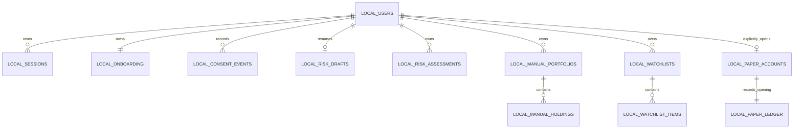
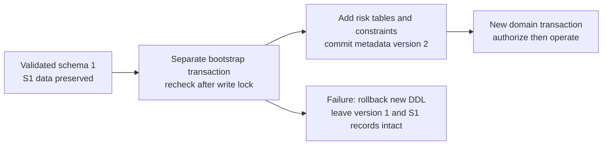
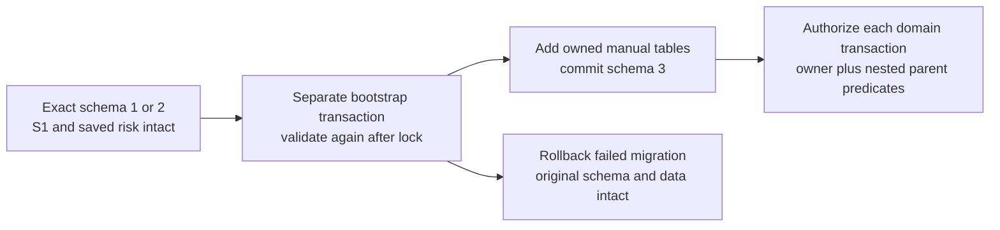
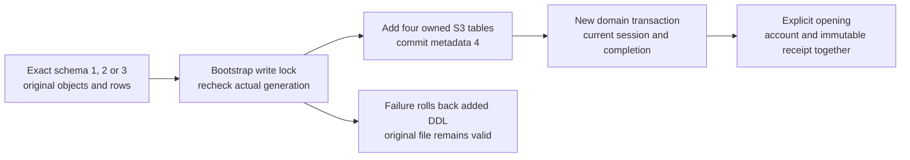
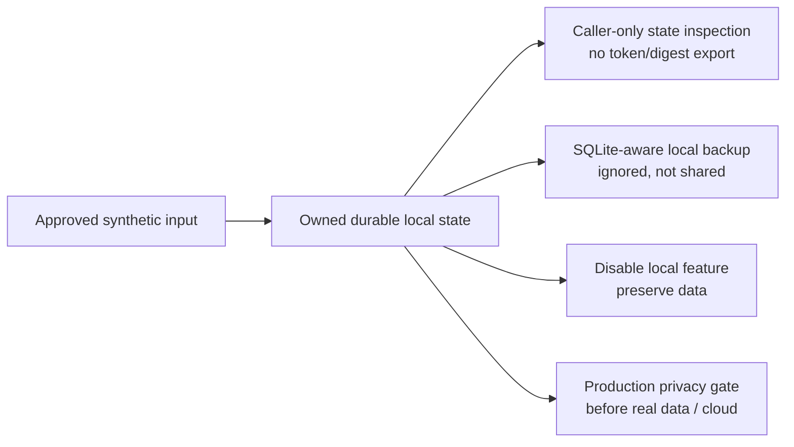

# Local application data dictionary and lifecycle

Contract `local.v1`, S1 FR-01–FR-03, S2 FR-04–FR-08 and the S3 candidate FR-09–FR-12 / NFR-03. Accepted S2 uses schema **3**: identity/onboarding, immutable saved risk and owned manual portfolios/holdings. [PR #209](https://github.com/IgnAite-Showcase/Finex/pull/209) accepted the preserving schema-2 risk addition; [PR #210](https://github.com/IgnAite-Showcase/Finex/pull/210) accepted schema 3. The S3 candidate adds schema **4**, preserving exact generations 1–3; [#195](https://github.com/IgnAite-Showcase/Finex/issues/195) remains its API acceptance gate. The [delivery ledger](S1-S4-delivery-contract.md#6-acceptance-ledger-and-known-external-gates) records accepted release identities. This is synthetic workstation state, not a production retention policy. Orders and goals remain S4 work.

| Record / field | Type and meaning | Ownership, handling and classification |
|---|---|---|
| `schema_metadata.version` | Exactly one positive integer row; accepted S2 3, S3 candidate 4 | One shared schema owner checks exact generations 1–3 and adds only the S3 tables in a bootstrap transaction. Unsupported, foreign or incomplete schemas stop safely; no startup reset. Schema-generation numbers are not sprint numbers. |
| `local_users.user_id` | Server-created stable UUID string, primary key | Internal synthetic identifier; never accepted from a client as an owner selector. |
| `local_users.alias` | Unique approved `learner-a` / `learner-b` | Public synthetic persona choice, explicitly not a real person's authentication. |
| `local_users.active` | SQL integer 0 or 1 | Authorization prerequisite; session lookup joins an active owner. |
| `local_users.created_at` | Required UTC ISO-8601 text | Synthetic record provenance. |
| `local_sessions.digest` | 64-character SHA-256 hex, primary key | Credential-derived local security metadata. The raw bearer is **not** a database column. Never export/print the digest or token as diagnostics. |
| `local_sessions.user_id` | Owner foreign key | Every protected call derives this owner from the session; no caller-supplied replacement. |
| `local_sessions.expires_at` | Required UTC timestamp | Validity checked at the exact time boundary in the transaction; configured TTL is 1–60 minutes. Expiry is denial, not automatic physical deletion. |
| `local_sessions.revoked_at` | Nullable UTC timestamp | Confirmed logout revokes that session durably; another valid session remains independent. |
| `local_sessions.created_at` | Required UTC timestamp | Local security provenance, not a usage/marketing identifier. |
| `local_onboarding.user_id` | Owner foreign key and primary key | Exactly one current profile draft per synthetic persona. |
| `local_onboarding.profile_schema_version` | `profile.v1` | Versioned field meaning; unknown client versions fail rather than silently migrate consent/profile semantics. |
| `local_onboarding.display_name` | Nullable, trimmed non-sensitive label, maximum 80 characters | Use invented test labels only. Do not enter a legal name or customer information. Null/blank may remain a draft. |
| `local_onboarding.experience_level` | Nullable `beginner` / `intermediate` / `advanced` | Synthetic self-description, not a financial suitability decision. |
| `local_onboarding.updated_at` | Nullable UTC timestamp | Null for initial untouched state; saving even a nullable draft records a time. |
| `local_onboarding.completed_at` | Nullable UTC timestamp | Set only after atomic current-consent/mandatory-field checks. Withdrawal or changed saved profile clears it; a repeated valid completion preserves it. |
| `local_consent_events.event_id` | Monotonic integer primary key | Latest event means greatest ID, not greatest timestamp. Shared clock ticks do not change ordering. |
| `local_consent_events.user_id` | Owner foreign key | No cross-persona history access. |
| `local_consent_events.version` | Current accepted request version `consent.v1` | Stored with each explicit decision; accepting an unknown notice version fails. |
| `local_consent_events.accepted` | SQL integer 0 or 1 | Explicit acceptance or withdrawal. Events are append-only; SQL triggers reject update/delete. |
| `local_consent_events.recorded_at` | Required UTC timestamp | Records the actual decision, separate from draft/completion time. |

The API's `onboarding_completed` boolean is derived from current consent, valid profile and completion state; it is not a client-written SQL field. Correlation IDs are diagnostic request metadata, not an owner or retained credential. Consent records must not contain the display label, bearer or hidden provider information.

## Saved risk records

The [frozen saved-risk contract](S2-saved-risk-contract.md) specifies HTTP shapes, canonical hashing, validation precedence and error codes. The risk adapter has only the three authorization reads and six risk persistence operations; it cannot mutate profiles, consent or sessions. Authorization and each risk operation use the same database transaction, so a write waiting for a lock must check current session, consent and completion after it obtains that lock.

| Record / field | Type and meaning | Ownership, handling and classification |
|---|---|---|
| `local_risk_drafts.user_id` | Owner foreign key and primary key | At most one current questionnaire draft per persona; owner comes only from the bearer session. |
| `local_risk_drafts.questionnaire_id` | `risk_questionnaire_v1` | A supported explicit questionnaire identity, not a client-defined scoring policy. |
| `local_risk_drafts.questionnaire_version` | `v1` | Validated against the approved question/option IDs. |
| `local_risk_drafts.answers_json` | JSON array of 0–10 distinct, ordered valid question/option answers | A PUT replaces the entire draft; `[]` clears its answers without deleting saved assessments. Missing answers are allowed only in a draft. |
| `local_risk_drafts.updated_at` | Server-generated UTC timestamp | A save is confirmed only after the transaction commits. An untouched draft is represented by the API with a null timestamp, not a fabricated saved row. |
| `local_risk_assessments.sequence` | Positive signed-64-bit autoincrement integer primary key | Stable descending owner-scoped history cursor; insertion order, not timestamp order. The database may have gaps. |
| `local_risk_assessments.assessment_id` | Unique server-created canonical UUID v4 | Detail lookup always includes the authenticated owner. Missing and another owner's IDs return the same not-found response. |
| `local_risk_assessments.user_id` | Required owner foreign key | Internal only; never accepted as a request owner or exposed in the saved DTO. |
| `local_risk_assessments.idempotency_key` | Client-created canonical lower-case UUID v4 | Unique with the owner. It identifies one submission, is not an authentication credential and is not returned in saved detail/history. Reuse with changed valid input conflicts. |
| `local_risk_assessments.request_fingerprint` | 64-character lower-case SHA-256 hex | Canonical supported input with answers sorted by question ID. Reordering equivalent answers returns the original stored input order/result/time. |
| `local_risk_assessments.document_json` | Bounded JSON document containing the exact 11 saved DTO fields | Stores input, result, explanation, version, calculation time, complete approved rules snapshot and its canonical hash. No paths, tokens, owner selectors or provider secrets. Reads validate the snapshot and reproduce its result without replacing it with today's rules. |
| `local_risk_assessments.created_at` | Server-generated UTC timestamp matching the stored document | Saved calculation provenance; retries preserve it. A mismatched/corrupt record fails safely instead of returning a partial history. |

Assessment rows are append-only: SQL triggers reject update and delete, and `(user_id, idempotency_key)` is unique. Submission does not silently change the draft. History queries fetch at most the requested 1–50 records plus one look-ahead row. A new assessment inserted between pages cannot move an earlier page's continuation boundary.

The shared bootstrap checks exact table/index/trigger definitions, not just names. A failed domain request cannot undo a successfully committed schema migration; a failed migration cannot partially publish version 2. A schema-1-only older binary must refuse version 2. Disabling the local feature or delivering a forward correction preserves history; migration is not permission to erase or reset the file.

## Manual portfolios and holdings

The [frozen portfolio contract](S2-manual-portfolio-contract.md) defines exact inputs, source labels, Decimal formulas and error precedence. Schema 3 adds the following mutable manual records without changing S1 or risk history. Every operation derives its owner from the current session and rechecks consent/completion inside the same transaction.

| Record / field | Type and meaning | Ownership and lifecycle |
|---|---|---|
| `local_manual_portfolios.portfolio_id` | Server-created canonical UUIDv4, primary key | Detail, update and delete include the current owner; another owner's ID is indistinguishable from absent. |
| `local_manual_portfolios.user_id` | Required owner foreign key | Internal only, never a caller-selected owner or public portfolio field. Maximum 20 portfolios per owner. |
| `local_manual_portfolios.name` | Trimmed text, 1–100 characters | Synthetic label only; normalized unchanged PUT preserves the existing timestamp. |
| `local_manual_portfolios.description` | Null or trimmed text, at most 500 characters | Required nullable API key; no account identifiers or real customer information. |
| `local_manual_portfolios.currency` | `USD` | No implicit conversion or mixed-currency arithmetic. |
| `local_manual_portfolios.created_at`, `updated_at` | UTC timestamps | Describe the portfolio record, not quote freshness. Holding changes do not update the parent time. |
| `local_manual_holdings.holding_id` | Server-created canonical UUIDv4, primary key | Every nested lookup includes owner, portfolio and holding together. |
| `local_manual_holdings.user_id`, `portfolio_id` | Composite foreign key to the owned portfolio | Deleting a portfolio atomically cascades only its manual holdings. Maximum 100 holdings per portfolio. |
| `local_manual_holdings.instrument_id` | Exact supported `SYN:` catalogue ID | Unique per owner/portfolio/instrument; immutable on update. Display metadata comes from the validated catalogue. |
| `local_manual_holdings.quantity_micro_units` | Integer 1–1,000,000,000,000; one unit is 0.000001 | API quantity is a canonical six-place decimal string. No binary float storage or SQL product. |
| `local_manual_holdings.average_cost_units` | Integer 0–10,000,000,000; one unit is USD 0.0001 | API average cost is a canonical four-place decimal string. Zero cost is valid and does not mean zero market value. |
| `local_manual_holdings.currency`, `created_at`, `updated_at` | `USD` and UTC record times | A normalized unchanged update preserves time; mutable fields cannot move a holding to another portfolio. |

Metric values are calculated responses, not extra durable history rows. The immutable synthetic quote snapshot keeps its original `fixture_as_of`, source/version and `CACHED`/`UNAVAILABLE` state. Missing prices retain null value-dependent outputs; cost is never substituted for price. Clients display the server calculation and do not independently recalculate money or allocation.

An explicit manual delete removes the selected owned mutable record and, for a portfolio, its manual holdings. It does not erase consent or saved-risk history. There is no paper cash, broker position, trade, ledger or goal row in these S2 tables. A schema-2-only binary must refuse schema 3; use a reviewed forward correction or feature disable with a validated backup, not a metadata downgrade.

## Watchlists and simulated opening

The [S3 foundation contract](S3-market-foundation-contract.md) defines the exact
wire shapes, quote states and all twelve routes. Schema 4 adds four tables;
their owner, authorization and domain write use the same short transaction.
The S3 candidate contains no order, position, trade, funding or goal endpoint.

| Record and field | Type and meaning | Ownership and lifecycle |
|---|---|---|
| `local_watchlists.watchlist_id`, `user_id` | Server UUID4 and internal owner FK; unique owned pair | At most 10 lists per owner. A missing or other-owner ID has the same safe not-found response. |
| `local_watchlists.name` | Trimmed text, 1–100 characters | Synthetic label; an unchanged normalized replacement preserves `updated_at`. |
| `local_watchlists.created_at`, `updated_at` | Required UTC text, at most six fractional digits; update not before creation | Corrupt or overprecise stored times fail safely rather than being truncated. |
| `local_watchlist_items.user_id`, `watchlist_id`, `instrument_id` | Owned composite primary key and parent FK; supported canonical SYN ID | At most 100 unique items per list. Metadata comes from the catalogue, never client-supplied prices/names. Default app supports only its four declared IDs; expanded capacity fixtures are trusted test injection only. |
| `local_watchlist_items.added_at` | Required UTC time | Duplicate PUT returns this original time without changing the list. Removal is idempotent for an existing owned list. |
| `local_paper_accounts.account_id`, `opening_ledger_id`, `user_id` | Server UUID4 IDs and unique internal owner FK | One explicitly opened simulated account per owner. Composite deferred FK binds its opening ID to the same owner/account ledger row. No GET or repeated open adds funds. |
| `local_paper_accounts.currency`, `opening_cash_cents` | Literal USD and integer 1,000,000 cents | Exactly simulated `10000.00`; no client funding amount or real account input. |
| `local_paper_accounts.cash_balance_cents` | Integer 0–10,000,000,000,000,000; wire uses a two-place decimal string | S3 opening balance is 1,000,000 cents and matches its opening receipt. Later S4 execution requires a separate accepted versioned contract; direct SQL edits are not a trading feature. |
| `local_paper_accounts.created_at` | Required UTC time | Repeated/concurrent opening returns the original account and time, not a top-up. |
| `local_paper_ledger.sequence`, `ledger_id`, `user_id`, `account_id` | Positive integer at most 9,007,199,254,740,991, UUID4 and owned account binding | Unique owner/account opening; sequence orders history even when timestamps tie. Public integers remain exactly representable in JavaScript. |
| `local_paper_ledger.entry_type`, `cash_delta_cents`, `cash_after_cents` | Literal OPENING and integer 1,000,000 cents for both amounts | Append-only opening receipt. Constraints and triggers reject invalid opening policy, updates and deletes. Account and receipt insert commit together or both roll back. |
| `local_paper_ledger.instrument_id`, `quantity_delta_micro_units`, `position_after_micro_units`, `order_id`, `trade_id`, `corrects_ledger_id` | All null for OPENING | No fabricated position, trade or correction is implied. S4 needs a new ledger record version, not silently changed S3 v1 DTOs. |
| `local_paper_ledger.created_at` | Required UTC time matching the account | Replay preserves original provenance; the envelope correlation ID belongs to the new request. |

Deleting an owned watchlist atomically removes only its items. It never deletes
the paper account, opening receipt, saved risk or manual holdings. Withdrawal,
logout and expiry block access without erasing those records. Ledger reads are
bounded to 1–100 rows plus a look-ahead row; empty pages are actual empty arrays.

## Synthetic quote cache

The market cache is lazy, in memory and bounded to four entries. It stores no
owner, profile, watchlist or bearer. The common validated catalogue/quote ports
supply SYN:AAPL, SYN:BND, SYN:MSFT and SYN:UNAVAILABLE; source/version/fixture time
remain immutable teaching metadata, not a live price claim.

| Cache fact | Rule |
|---|---|
| Fresh successful priced retrieval | CACHED until age 60 seconds; original source time remains `2026-01-01T00:00:00Z`. |
| Failed refresh with prior priced entry | STALE only while age is under 300 seconds; original price, source and retrieval/expiry times remain unchanged. |
| No priced entry or age at least 300 seconds | UNAVAILABLE with null price/quote time; retain only validated prior retrieval metadata when it exists. |
| Valid unavailable fixture | Null price, explicit `SYNTHETIC_QUOTE_UNAVAILABLE`, successful fetch/expiry times. |
| Invalid/backward quote clock | Safe quote failure after authorization; do not renew or modify cached entries. An already invalid shared authorization clock fails at the storage boundary first. |

An expired cache entry is not an execution price. S3 supplies no execution API;
S4 must explicitly reject STALE and UNAVAILABLE for simulated orders.

## Lifecycle and recovery

- Bearer: returned once, held only in client memory, sent only in the Authorization header. Reload/cold start discards client memory; the same synthetic persona can sign in again and resume owned server state. Logout revokes the session; consent withdrawal is a separate data-use decision.
- Retention: the local prototype has **no automatic purge**. Synthetic profiles, revoked/expired session digests, immutable consent and saved-risk history remain in the exact developer database. Withdrawal invalidates access/completion but preserves drafts, assessments, manual records, watchlists and the simulated account for valid recompletion. Explicit owned manual/watchlist CRUD deletion is separate from privacy erasure; it does not erase consent, risk or ledger history. Do not mistake expiry for erasure or promise an undelivered bulk/deletion API.
- Inspection/export: use the authenticated own-state API as shown in the [native runbook](../../runbooks/native-local-application.md). A redacted saved state can serve local test evidence. There is no accepted public bulk export, provider-token export or administrative all-user browser view.
- Deletion/reset: normal startup, login, logout and feature disable never delete history. For a fresh scenario choose a new exact temporary file; preserve the prior file. No destructive reset or data-deletion operation is authorized by this guide. Any deliberate disposal must identify its exact local files/backups and obtain the owner's authorization.
- Storage: prefer unsynced `LOCALAPPDATA` over an active OneDrive/Dropbox directory. Database, WAL/SHM/journal and backups are ignored and never published. SQLite-aware backup is required; copying only an active main file is not safe recovery evidence.
- Real-data/cloud gate: purpose, real identity, retention period, export/erasure rules, audit exceptions, backup deletion and permissions require an approved deployment/privacy design before real PII or a public deployment. That gate is external #134, not waived by passing local S1 tests.

See [S1 API evidence](../../evidence/s1-owned-api-acceptance.md) for actual isolation, revocation, immutable consent, rollback, restart, timestamp-corruption and digest-only tests. This dictionary documents behavior; it does not invent additional privacy APIs.

A schema-3-only binary must refuse a schema-4 database, not downgrade metadata or
delete new tables. Back up through SQLite's backup API and retain the named local
backup; recovery is a forward correction or feature disable with preserved data.
The stable S2 native check ID `schema3_preserves_s1_and_risk` names its S2 baseline:
the current verifier reads the exact shared schema owner and separately proves
retained S1/risk state, rather than claiming every future runtime is generation 3.
