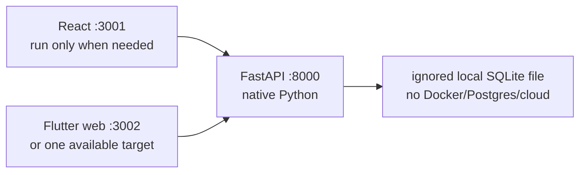
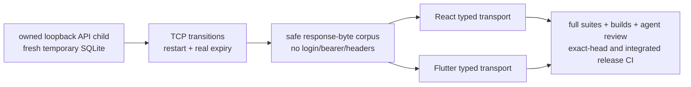
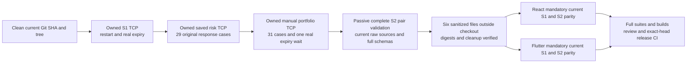
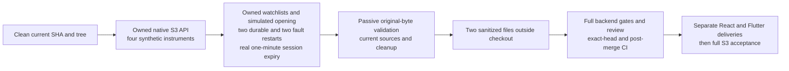

# Native local application: setup, persistence and recovery

Scope: accepted S1 identity/consent/profile and full S2 saved risk/manual portfolios on both clients, contract `local.v1`; S3 API candidate setup and proof instructions are added below. Full S2 #194 is accepted on W40 and its completed checkpoint is validated on `dev`. S3 API #195 must pass its separate gates before client stories #196/#197 proceed; full S3 remains #198.
Read [the frozen delivery contract](../features/local-application/S1-S4-delivery-contract.md) first. This is synthetic local development, not deployed authentication or production hosting. Later-sprint features are enabled only after their accepted delivery gates.

The [local data dictionary](../features/local-application/local-data-dictionary.md) names retained identity, risk/manual records and the additive S3 schema-4 candidate. It separates session expiry/logout, consent withdrawal, explicit owned record deletion, backup and data disposal. No automatic purge, public bulk export or real-data erasure API is claimed.

## Components and memory



On an 8 GB machine, run the API and only the client being developed. Close unneeded browser tabs; run tests serially. Do not start a mobile emulator, all clients and parallel builds together. On 16 GB machines, both clients may run if memory remains available. CI proves the combined regressions; a developer does not need all components open to edit a component.

## Bootstrap

Use the repository toolchain contract (Python 3.13, Node 24.20.0, Flutter 3.47.2). From PowerShell at the checked-out repository root:

```powershell
.\scripts\bootstrap.ps1 -Component Backend
# Choose just the relevant client:
.\scripts\bootstrap.ps1 -Component React
.\scripts\bootstrap.ps1 -Component Flutter
```

The existing [native setup guide](../local-development.md) contains installation/troubleshooting and Flutter's Windows symlink prerequisite. A test on this machine is not evidence of two fresh developer machines; #129 remains an external onboarding gate.

## Start the owned application API

```powershell
$env:APP_ENV = 'local'
$env:LOCAL_APP_ENABLED = 'true'
$env:LOCAL_SESSION_TTL_MINUTES = '30'
$env:LOCAL_DB_PATH = Join-Path $env:LOCALAPPDATA 'FinEx\development\finex.sqlite3'
$env:ALLOWED_ORIGINS = 'http://127.0.0.1:3001,http://127.0.0.1:3002'
$env:ALLOW_CREDENTIALS = 'false'
$env:LLM_PROVIDER = 'none'
$env:MARKET_DATA_PROVIDER = 'mock'
.\scripts\run-backend.ps1 -BindAddress '127.0.0.1' -Port 8000
```

Optional `-Reload` watches only backend and shared AI source. `-WhatIf` prints a safe dry-run command without launching Python. The launcher rejects public/LAN hosts before Python starts, passes the actual binding into typed settings, disables forwarded-peer trust and disables raw access logs (legacy query-based refresh could otherwise leak a token). Redacted correlation diagnostics remain available. Do not tunnel this app or manually override uvicorn with `--host 0.0.0.0`; if running uvicorn directly, include `--no-proxy-headers --no-access-log`. Synthetic persona selection is intentionally not proof of a real person's identity.

Default database when not configured: `backend/.local/finex.sqlite3`. The command above instead selects an unsynced Windows local-data folder: a checkout under OneDrive/Dropbox should not keep long-lived SQLite/WAL state inside its live sync tree. Do not sync/share an active database or treat file synchronization as a transactional backup. Choose a different exact path for a test/demo if needed; never point tests at your saved developer database. `LOCAL_APP_ENABLED=false` (or non-LOCAL environment) fails closed. This switch disables the new local routes but does not delete saved state.

The DB is created lazily when an allowed local operation first needs persistent storage, not by importing the API or running unrelated legacy tests. Disabled/nonlocal/remote requests are denied before storage; a syntactically valid but unknown bearer may require a storage lookup and still receives `401`. A new server instance at the same path resumes saved identities, consent, profiles, risk and manual records. Accepted S2 schema 3 preserves generations 1/2; the S3 candidate adds generation 4 while preserving all three. A foreign, incomplete or future schema stops safely before journal/schema changes. No startup reset is performed.

## Client configuration and journey

React, in a separate terminal:

```powershell
Set-Location frontend-react
$env:HOST = '127.0.0.1'
$env:PORT = '3001'
$env:BROWSER = 'none'
$env:REACT_APP_FINEX_API_BASE_URL = 'http://127.0.0.1:8000'
$env:NODE_OPTIONS = '--max-old-space-size=1536'
npm start
```

Flutter, as the alternative client in a separate terminal:

These instructions use the accepted #188/#189 owned Flutter implementation on W40. An older React-only #187 checkout still has the separately labelled historical Flutter pilot; use the accepted release base rather than assuming that older checkout delivers the same journey.

```powershell
Set-Location frontend_flutter
flutter pub get
flutter run -d chrome --web-hostname=127.0.0.1 --web-port=3002 `
  --dart-define=FINEX_API_BASE_URL=http://127.0.0.1:8000
```

`FINEX_API_BASE_URL` is the public compile-time loopback API origin, not an `/api` path or a place for secrets. A changed value requires a restart/rebuild. The full application is API-only; the compatibility pilot switches do not select its mode. If ports are occupied, use unused loopback ports and update the API's allowed client origins too; leave other processes alone. Run one target and record which target was actually tested. A web build/browser smoke is not native Android/iOS device validation. See [the Flutter client handoff](../../frontend_flutter/README.md) for strict gates and Windows prerequisite handling.

1. Open `/login`; select `learner-a` or `learner-b`. The disclosure says these are approved synthetic personas, not Google-verified people.
2. Read the education/consent notice and its `consent.v1` version before accepting. Decline/withdrawal must remain possible.
3. Save a partial profile (non-sensitive label and experience only); it is a draft, not completion.
4. Close/reopen the client, sign into the same persona and resume the saved server draft. Session tokens are deliberately not persisted in the browser/device preferences.
5. Supply a valid label and experience; explicitly complete. The server atomically checks `profile.v1` and current accepted consent. Missing input has visible, focusable feedback.
6. Sign out; the server durably revokes that session. Network-failed logout shows retry rather than pretending revocation succeeded.
7. Sign into the other persona; its data is distinct. Anyone trusted to operate this local simulator can deliberately choose either persona, so this is a bearer ownership test, not deployed person authentication.

No forced sign-in via legacy localStorage, fabricated JWT, global completion flag or correlation ID is accepted as identity. Full S2–S4 features require current accepted consent **and** completed onboarding; withdrawn consent or a changed profile invalidates that gate immediately. Saved downstream data is preserved until valid recompletion.

Compatibility pilots live under `/pilot/*` and clearly say nonpersistent. Do not confuse the older stateless `/risk-contract` result with saved assessment/history.

## Safe HTTP inspection

API successes use the existing FinEx envelope. Inspect `data`/safe state, not raw login bodies or Authorization headers. Do not paste bearer tokens into issues, chat, screenshots, URLs or committed logs.

```powershell
$localOrigin = 'http://127.0.0.1:8000'
$localLogin = Invoke-RestMethod -Method Post -Uri "$localOrigin/api/v1/local-auth/mock-login" -ContentType 'application/json' -Body '{"alias":"learner-a"}'
$localHeaders = @{Authorization = "Bearer $($localLogin.data.access_token)"}
$localState = Invoke-RestMethod -Uri "$localOrigin/api/v1/local-onboarding/state" -Headers $localHeaders
$localState.data | ConvertTo-Json -Depth 5
# Revoke when finished; output does not contain the token:
Invoke-RestMethod -Method Post -Uri "$localOrigin/api/v1/local-auth/logout" -Headers $localHeaders -ContentType 'application/json' -Body '{}'
```

Use only synthetic labels. `consent`, `draft` and `complete` request/response examples and stable error codes are in the supplement. Unknown aliases/extra owner fields/versions fail; `401` means sign in again, `409` means repair prerequisites/version, `503` means safe retry after storage recovery—not a completed save.

## Quality and evidence

From `backend`, run full Ruff lint/format, mypy and pytest coverage exactly as in the backend quality workflow; run each client's strict test/build gates. Targeted tests are useful during TDD but do not replace full regressions. Use isolated temp DB paths and a unique pytest base directory; do not delete or reset another running test's directory.

Check both type-platform targets from the same existing local interpreter. A default Windows mypy run does not prove Linux hosted CI: platform-specific standard-library constants have different type declarations. These are static checks, not a claim that a native Linux process ran on Windows; actual platform runtime evidence remains separate.

```powershell
python -m mypy app verify_s1_application.py verify_s2_saved_risk.py verify_s2_manual_portfolio.py verify_s2_evidence_pair.py local_s2_evidence.py verify_s3_foundation.py verify_s3_evidence.py verify_r0_thin_slice.py verify_s2_risk.py verify_secret_snapshot.py --platform linux --python-version 3.13
python -m mypy app verify_s1_application.py verify_s2_saved_risk.py verify_s2_manual_portfolio.py verify_s2_evidence_pair.py local_s2_evidence.py verify_s3_foundation.py verify_s3_evidence.py verify_r0_thin_slice.py verify_s2_risk.py verify_secret_snapshot.py --platform win32 --python-version 3.13
```

The acceptance record must identify actual commands, changed tests, RED/GREEN results, tested local SHA, published head/tree, independent agent review and exact-head/merged release CI. Local Python version, client target, device/browser dimensions and any not-run native target are explicit. No screenshots or test counts are invented. Record current evidence in #186/#189 and `docs/evidence/` after actual validation.

### Owned S1 acceptance command

The #189 verifier and typed-parity tests are accepted on W40 at `c912df3ffaa6a1dfc81a6d5a27d5eb4666c54221`. Re-run them on every later candidate that changes the shared authorization, storage or client paths. Earlier proof is not a certificate for new code.



From the root of a bootstrapped checkout:

```powershell
# 8 GB: native proof, or just your client; runs sequentially.
.\scripts\verify-s1.ps1 -Component Backend
.\scripts\verify-s1.ps1 -Component React
.\scripts\verify-s1.ps1 -Component Flutter
# Combined technical proof, still serial:
.\scripts\verify-s1.ps1 -Component All
```

Supply `-Python` only to select an existing virtual-environment interpreter. Optional `-Node` **together with** `-NpmCli`, or `-Flutter`, selects existing client tools; these options do not install or change the system toolchain. Relative tool paths resolve in your current directory before the verifier changes directories. The selected Node directory is prefixed to this process's PATH so npm's lifecycle child uses the same interpreter; the prior PATH is restored even on failure. Flutter dependencies must already be resolved. No Docker, emulator, cloud credential, live provider or developer database is used. The native harness always starts its own bound loopback child with an internally created temporary database and a real one-minute session lifetime. Allow roughly two minutes for the native proof; it is not an injected-clock unit test. It restarts only its own process and preserves its synthetic database across those restarts, then removes that internally owned database after its processes exit. It never resets an existing app's database or kills an unrelated listener.

The verifier restores both the values and the presence of its process-only PYTHONPATH, corpus options, CI flag and PATH, even on failure. An originally absent option remains absent, rather than becoming an empty option that could break a later test command. It does not change user/machine environment variables.

The printed evidence directory contains only a sanitized JSON report and safe response envelopes; it is retained locally for review. No login responses, Authorization headers, cookies, access tokens or SQLite files are exported. A supplied SHA must match the actual checkout; a dirty source tree is reported as dirty with source hashes, not certified as the clean commit. The successful report is necessary, not sufficient, for full S1 acceptance.

Both clients replay the same captured response bytes through their real typed public methods. Successful canonical requests are checked for matching operation/input; malformed/version-error server requests cannot be emitted by a strict typed client and are **response-decoding/error-handling replay**, not a claim the client sent those illegal inputs. Shared handcrafted cases remain clearly labelled synthetic. `FINEX_REQUIRE_LOCAL_S1_CORPUS=1` fails closed if the native corpus is missing, malformed or incomplete; it never falls back to fixtures and claims native proof.

Decoder parity is not browser E2E or Flutter's compiled JavaScript transport. The separate test-only web-transport probe verifies actual browser RequestInit, native Response bytes, body timeout/abort, 401 and explicit retry with controlled responses. It has no production route and exports only case IDs/outcomes. Real API/browser restart, offline retry, expiry, isolation and cross-client reload are additionally recorded through controlled UI checks. Native-device runtime, fresh-laptop setup, human UAT and production authentication/deployment remain separate gates. Never mark S2 Ready until complete #189 acceptance and merged release CI are green.

### Controlled compiled-JavaScript transport probe

This is a separate, explicit browser layer, not a substitute for the native verifier above. From the bootstrapped repository root, using the existing Dart/Flutter SDK and backend interpreter:

```powershell
$s1ProbePython = Join-Path (Get-Location) 'backend/.venv/Scripts/python.exe'
Push-Location frontend_flutter
try {
  $null = New-Item -ItemType Directory -Force -Path 'build/qa'
  dart compile js -O1 tool/local_web_transport_probe.dart -o build/qa/local_web_transport_probe.js
  if ($LASTEXITCODE -ne 0) { throw 'The controlled probe did not compile.' }
} finally { Pop-Location }
& $s1ProbePython scripts/serve-s1-web-probe.py --port 3005
```

Open `http://127.0.0.1:3005/tool/local_web_transport_probe.html` and click **Run controlled transport checks**. Require all 13 outcomes to say PASS, including empty/wrong-Authorization negative checker controls. The browser wrapper compares the exact memory-only input but exposes only a boolean; no header/token is displayed or stored. Stop only this terminal's probe server with Ctrl+C afterward. If 3005 is occupied, choose another unused nonprivileged loopback port; never stop somebody else's listener.

The server exposes exactly the HTML and compiled JavaScript, not the repository directory or source maps. It disables caching and its Content Security Policy forbids network connections. The response shim never forwards to the real API. Passing proves the default conditional JS transport's options, UTF-8 decoding, JSON requests, full-body timeout/abort, 401 body bypass and explicit retry under controlled browser responses. It does **not** prove a real cookie jar, backend ownership, persistent data, cloud deployment or native-device GUI.

## Owned S2 saved-risk API proof

The #190 verifier checks the persistent risk API, not the manual portfolio or either client's S2 screens. Use a clean committed candidate and an already bootstrapped backend. From `backend`:

```powershell
$s2RiskSha = (git rev-parse HEAD).Trim()
$s2RiskTree = (git rev-parse 'HEAD^{tree}').Trim()
$s2RiskReport = Join-Path ([IO.Path]::GetTempPath()) ("finex-s2-risk-proof-" + [guid]::NewGuid().ToString('N') + '.json')
$s2RiskCorpus = Join-Path ([IO.Path]::GetTempPath()) ("finex-s2-risk-corpus-" + [guid]::NewGuid().ToString('N') + '.json')
python verify_s2_saved_risk.py --tested-sha $s2RiskSha --tested-tree $s2RiskTree --report $s2RiskReport --corpus $s2RiskCorpus --format json
if ($LASTEXITCODE -ne 0) { throw 'Saved-risk native proof failed; do not publish or mark the story Done.' }
```

Both output filenames must be new and outside the checkout; the verifier never overwrites existing files. It refuses a dirty or mismatched checkout before starting a process. It selects its own temporary SQLite path outside the repository/OneDrive, binds its own loopback socket, starts four owned API children and performs two actual restarts against the same synthetic file. The original 17 required checks remain, with one complete-corpus check added for #194: questionnaire/draft/save/history/detail, equivalent retry, conflict, owner isolation, stable paging, withdrawal/recompletion, logout, restart, original response capture and safe cleanup. It never accepts your application's URL, database or bearer. Source hashes and the clean commit/tree are rechecked after owned cleanup.

Only sanitized reports and safe response bytes are retained. Children are stopped/reaped before their internally created database directory is removed; no unrelated listener or saved developer database is touched. The one-minute TTL is configured here, but this verifier does not claim a real expiry wait. The combined proof below separately checks real expiry for S1 and portfolio/risk access. Full API coverage, migration/rollback/concurrent authorization tests and independent agent review remain required alongside TCP proof. See the [#190 evidence record](../evidence/s2-saved-risk-api-acceptance.md) for accepted API results.

## Combined S2 technical acceptance

From a clean, committed, bootstrapped checkout, run the command below. On 8 GB machines, first stop only your own development servers and close unneeded browser tabs; this runs the native slices and client selections serially, without Docker or an emulator.

```powershell
.\scripts\verify-owned-s2.ps1 -Component All
```

Use `-Component Backend`, `React` or `Flutter` while developing one component. Every selection still executes the three native producers. `Backend` does not claim client parity; `React` or `Flutter` proves only the selected client. Existing alternative interpreters can be supplied with `-Python`, `-Node` together with `-NpmCli`, and `-Flutter`; no installer, user environment change or account selection runs in this command.



Allow several minutes. Each producer owns its temporary database and loopback children, performs two same-file restarts, reaps its processes and removes its temporary state. The portfolio expiry phase also denies risk draft/history access with the expired session and checks original saved risk after fresh login; it does not add a second portfolio wait. Developer databases, unrelated listeners and persistent user environment variables are untouched.

The printed outside-checkout directory retains exactly the S1, saved-risk and portfolio report/corpus pairs. S2 reports bind the SHA-256 of the exact corpus file bytes. Before any selected success, the read-only `verify_s2_evidence_pair.py` validates complete S2 schemas, ordered coverage, cleanup, original file digests and actual current source hashes. Both typed clients require all four S2 artifact paths plus `FINEX_REQUIRE_LOCAL_S2_CORPUS=1`; a missing, partial, malformed, altered, dirty or wrong-revision pair fails instead of falling back to historical fixtures. Duplicate JSON members, including escaped-equivalent names, are rejected rather than hiding an earlier field. Source lists are bound to their own reports and actual raw source bytes; risk and portfolio inventories may differ, but they must identify the same current clean SHA/tree.

Historical/handcrafted replay is separately labelled unit coverage. Error responses to requests that a typed client cannot legally emit prove error handling, not illegal request emission. The frozen portfolio corpus has no captured URL target: successful dispatch uses original recorded DTO IDs, while error replay uses legal canonical targets. Native route and ownership checks remain separate. No report exports login responses, credentials, private database paths, raw logs or SQLite files.

This selected command is necessary, not sufficient, for full acceptance. Run complete backend lint/format, both type-platform targets and pytest coverage; complete React tests/types/build; and strict Flutter analysis/tests/web build. Use the [S2 acceptance record](../evidence/s2-full-acceptance.md) for controlled client journeys, review, handoff and release evidence. Windows desktop compilation in CI is not local native-device GUI proof. A green command does not certify human UAT, fresh laptops, historic credential rotation or cloud deployment.

## S3 foundation API technical proof

Use the reviewed S3 candidate after its tests and tools are installed in a clean,
committed checkout. The API-only proof does not accept the later client stories
or full S3. Keep running the accepted S1/S2 regressions too.



From `backend`, using its existing virtual environment:

```powershell
$s3Sha = (git rev-parse HEAD).Trim()
$s3Tree = (git rev-parse 'HEAD^{tree}').Trim()
$s3Root = (git rev-parse --show-toplevel).Trim()
$s3Report = Join-Path ([IO.Path]::GetTempPath()) ("finex-s3-proof-" + [guid]::NewGuid().ToString('N') + '.json')
$s3Corpus = Join-Path ([IO.Path]::GetTempPath()) ("finex-s3-corpus-" + [guid]::NewGuid().ToString('N') + '.json')
$s3PreviousPythonPath = $env:PYTHONPATH
try {
  $env:PYTHONPATH = $s3Root
  python verify_s3_foundation.py --tested-sha $s3Sha --tested-tree $s3Tree --report $s3Report --corpus $s3Corpus --format text
  if ($LASTEXITCODE -ne 0) { throw 'S3 native proof failed; do not accept or publish.' }
  python verify_s3_evidence.py --tested-sha $s3Sha --tested-tree $s3Tree --report $s3Report --corpus $s3Corpus
  if ($LASTEXITCODE -ne 0) { throw 'Complete current S3 report/corpus validation failed.' }
} finally {
  $env:PYTHONPATH = $s3PreviousPythonPath
}
```

Allow roughly two minutes. Both output paths must be new and outside source;
existing output is never overwritten. The driver creates its own temporary
database and bound loopback children. It preserves synthetic state through
restarts, restores only its own controlled storage-fault marker, reaps every
owned process and removes only its internally created temporary state. No
application URL, developer database, existing bearer or real provider is an
input. The passive guard reads only the completed reports, original safe wire
bytes and current sources; it does not start a server or mutate a database.

Default quotes are explicitly synthetic CACHED or UNAVAILABLE, not live market
prices. The immutable source time is `2026-01-01T00:00:00Z`; current retrieval
time is separate. STALE-provider faults, expanded catalogue/capacity tests and
all original physical migration fixtures are separately labelled in-process
controls. Their mocks do not prove native provider outages or client parity.
Use the [S3 API record](../evidence/s3-api-validation.md) for current acceptance
status and the [S3 contract](../features/local-application/S3-market-foundation-contract.md)
for exact requests, response types, quotas and error handling. No real money,
S4 order execution or guaranteed investment outcome is involved.

## Backup, migration and rollback

- SQLite schema metadata is authoritative. An unsupported newer schema must stop safely, not silently recreate tables or discard data. Forward migrations require reviewed code and tests.
- Schema 3 preserves exact schema-1 identity/consent and schema-2 risk records while adding manual portfolios/holdings in a separate bootstrap transaction. Failure rolls back added DDL and metadata changes. A prior binary that understands only schema 1 or 2 must reject schema 3 safely. Prefer a forward correction or disabling the local feature while preserving a validated backup; do not downgrade metadata or drop new tables.
- S3 candidate schema 4 preserves exact generations 1/2/3 while adding owned watchlists/items and the one-time simulated opening account/ledger. Schema-3-only code must reject generation 4; the compatible S2 native observer checks the current shared version, not a falsified metadata downgrade. Orders and trades need their own reviewed later contract and migration.
- Use SQLite's backup API to produce a snapshot while the app is active, or stop every connection and checkpoint WAL before copying. Never copy just the active main `.sqlite3` file while WAL may contain pending state. Validate the copied schema/integrity before treating it as a recovery artifact.
- Keep backup/database/WAL/SHM/journal files local and ignored. They contain synthetic state and session digests; do not commit them. Never include live bearer values in a backup report.
- There is no automatic reset action. For a deliberately fresh test, select a new exact temp DB path. Preserve the old file; do not delete a broad directory or the user's saved state.
- Roll back via a corrective release feature PR or `LOCAL_APP_ENABLED=false`. A schema-compatible prior binary may be used only after checking compatibility and preserving a safe backup. Do not overwrite an incompatible schema, erase consent/ledger history or force-push Git history.
- Local commands do not change Git branches or cloud identity/storage/deployment/billing and do not revoke historic credentials. Separately, Anand approved safe, tested W40-to-`dev` PR promotions after completed sprint acceptance; preserve existing `dev` history and validate the combined result. `main`, `uat` and `prod` remain unchanged.
