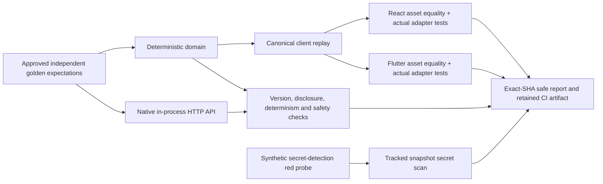

# R0–Sprint 2 quality matrix

Recovery stories #133 and #144, target `release/2026-W40`.
Master: [V9.1](https://github.com/IgnAite-Showcase/Finex/blob/docs/v9.1-master-handbook/docs/governance/FinEx_Master_Product_Design_Delivery_Handbook_v9.1.pdf), §§7, 10, 12–14, 16, 20, 24.



| Changed surface | Required evidence |
| --- | --- |
| Backend/API/configuration | Backend Quality Gates: Ruff, format, Mypy, pytest with ≥70% app coverage; stable HTTP errors and privacy tests. |
| React UI/client | React Quality Gates: locked dependency install, non-watch tests and production build. |
| Flutter UI/client | Flutter Quality Gates: pinned 3.47.2 SDK, strict analysis, tests and supported Windows build; native browser walkthrough also catches JavaScript-only faults. |
| Risk domain, questionnaire, approved contract or data fixtures | Backend path filters include these surfaces; R0-S2 Release Evidence runs the data-quality provider and independent domain/API/asset evaluation. |
| Any PR, including an otherwise undocumented path | R0-S2 Release Evidence scans the exact tracked snapshot with checksum-pinned Gitleaks. It first verifies that a nonexistent synthetic token is detected and reports are redacted. |

The release-evidence workflow runs for all PRs and feature/release pushes. Component-specific jobs stay path-aware to conserve free-tier CI usage. The additional gate intentionally sees every PR so a new path cannot bypass the snapshot secret scan. No branch-protection setting was changed; the recovery merge procedure checks every applicable exact-head run before merging.

## Reproduce without Docker or cloud

Use the repository's native bootstrap and existing virtual environment. From the repository root:

```powershell
.\scripts\verify-s2.ps1 -TestedSha (git rev-parse HEAD)
```

An existing interpreter can be selected using `-Python <venv-python.exe>`. The wrapper sets the repository import path only for the command and restores the caller's environment afterward. Linux/macOS, from `backend`:

```sh
PYTHONPATH=.. python verify_s2_risk.py --tested-sha "$(git rev-parse HEAD)"
python -m pytest tests/unit/test_s2_evaluation.py tests/contract/test_s2_risk_api.py --no-cov
python -m pytest
python -m ruff check .
python -m ruff format --check .
python -m mypy app verify_s2_risk.py verify_secret_snapshot.py
```

The evaluator covers nine valid cases (normal, reachable 32.5/35 and 65/67.5 boundaries, and two dimension tensions) and seven invalid cases. Numeric/category expectations come from the approved golden pack, not a second score formula or values computed by the tested engine. Results are checked through both domain and real in-process FastAPI routes. Reordering answers cannot change the decision. Both bundled assets must exactly match the canonical replay; real React/Flutter service tests additionally execute every vector.

Regression tests deliberately inject wrong expected scores, client-score/version/disclosure drift, unsafe explanation text, and a missing asset. Each must produce FAIL, not an implicit pass. Reports expose case IDs, boolean outcomes, version and tested SHA only; they do not print raw answer sets, real personal data, credentials or provider diagnostics.

The exact first PR #180 head `75ee6e5f19a29144fae7c5a0c1ebd41a72134593` intentionally enabled the in-memory version-drift probe. [PR workflow run 38105576465](https://github.com/IgnAite-Showcase/Finex/actions/runs/38105576465) and [push run 38105575588](https://github.com/IgnAite-Showcase/Finex/actions/runs/38105575588) failed at the golden-evaluation gate and retained the safe FAIL artifact. The corrected workflow runs without that flag. The CLI probe remains available for repeatable gate testing; it never rewrites the actual client assets. Only the corrected fully green head may be merged.

## Security gate and remaining credential action

The free [Gitleaks CLI](https://github.com/gitleaks/gitleaks/releases/tag/v8.30.0) is pinned to 8.30.0 and its downloaded archive SHA-256 is verified before execution. No commercial GitHub-action license or cloud service is required. Run `backend/verify_secret_snapshot.py --gitleaks <verified-cli-path>` to scan committed HEAD, not uncommitted edits. All scanner findings are redacted before a safe rule/file/line summary is retained. Inline allow-comments cannot bypass the gate.

A token-shaped value in historical `scripts/run_ddl.py` was removed during #163 recovery. The cloud utility now requires environment configuration plus explicit `--execute`; native development never needs it. A clean current snapshot **does not remove old Git history or revoke a credential**. Anand must revoke/rotate any active old Databricks token in its issuing account. No credential is reproduced here, and no history rewrite or cloud-account operation was performed.

## CI evidence and rollback

The workflow summary records both tested checkout SHA (the PR merge candidate when applicable) and PR head SHA. Safe JSON and JUnit reports are retained for 14 days, including failed runs. This is technical evidence under Anand's delegated recovery authority, not an invented independent human approval or a production release decision. Roll back through a new W40 PR, then rerun all relevant gates. Do not promote `dev`, `uat`, `prod`, or `main` automatically.
