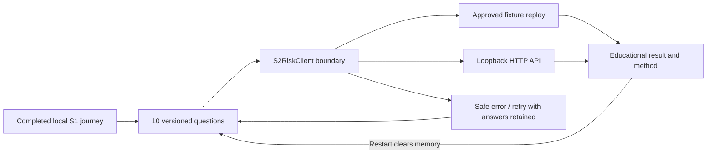

# Sprint 2 Flutter educational risk parity

Story #163 targets `release/2026-W40`. Master: [V9.1](https://github.com/IgnAite-Showcase/Finex/blob/docs/v9.1-master-handbook/docs/governance/FinEx_Master_Product_Design_Delivery_Handbook_v9.1.pdf), §§7, 10, 12–14, 16, 20, 24. It consumes `s2-risk-contract/v1.0`, `risk_questionnaire_v1` / `v1`, and `deterministic_v1.0.0`, identical to React and the native API.



## Native setup and low-memory target

Use the repository's pinned Flutter **3.47.2** / Dart **3.13** baseline. From `frontend_flutter`:

```powershell
flutter pub get
flutter analyze --fatal-infos
flutter test --concurrency=1
flutter build web --debug --no-web-resources-cdn
flutter run -d web-server --web-hostname 127.0.0.1 --web-port 3002
```

Use the browser/web-server target instead of an Android emulator on 8 GB laptops; run backend and each client sequentially when validating. The web build bundles rendering resources rather than requiring a runtime CDN. Docker, cloud, credentials and hosted databases are not required. First-time SDK/package download still requires internet.

On Windows, Flutter plugins can require **Developer Mode** for symlinks during initial `pub get`. A fresh worktree on Anand's machine exposed this prerequisite; recovery validation used the existing resolved native runtime. No OS security/settings changes were made. A laptop without symlink support must resolve that OS prerequisite before claiming its Flutter setup is ready; React remains independently usable. Windows desktop additionally requires the documented Visual Studio C++ toolchain; it is not required for the lightweight web pilot.

## Walkthrough

Complete synthetic onboarding and follow **Continue to educational risk profile**, or open **Educational Risk** in the drawer. The route `/risk` refuses to expose the questionnaire until the local completion and consent flags exist. These flags are convenience state, not authentication or server consent authorization.

Choose the midpoint approved profile, review ten questions, calculate, and confirm Moderate plus composite/willingness/capacity **50/100**. Results show the deterministic method, questionnaire/scoring versions, UTC calculation time, self-reported limitation and no-persistence notice. Restart removes all answers/results in memory, keeping only the existing S1 journey flags.

The bundled `assets/s2_risk_fixtures.v1.json` is generated from the server domain and matches the React asset. Nine valid vectors and seven invalid vectors replay exactly. No score formulas are implemented in Flutter; unknown offline combinations return an explicit fixture-unavailable error.

For other answer combinations, start the local backend described in `s2-risk-api.md` and opt in:

```powershell
flutter run -d web-server --web-hostname 127.0.0.1 --web-port 3002 --dart-define=FINEX_ONBOARDING_MODE=api --dart-define=FINEX_RISK_MODE=api --dart-define=FINEX_API_BASE_URL=http://127.0.0.1:8000
```

For browser HTTP integration, explicitly permit that exact origin in backend `ALLOWED_ORIGINS`. The adapter accepts only loopback, strict published responses, and safe error codes. It has an eight-second deadline and sends logical input only. It does not use the older, unused mock risk service or persist an assessment. Outside `APP_ENV=local`, anonymous risk API calls are denied.

## Evidence and rollback

Tests-first run failed with the missing new client/page modules. Later checks caught a real long-button overflow in S1 completion; the shared button now wraps correctly and is tested at narrow width with 150% text size. A mock HTTP UTF-8 header was corrected to represent the actual JSON transport. Final strict analysis found no issues; **67 service/widget tests passed**, including all 16 domain vectors, boundary/version errors, timeout, loading, retry, selection/back navigation, result/restart and a 390-pixel layout. The browser build and walkthrough are checked before publication. CI additionally builds the Windows target.

An actual browser walkthrough caught a VM-only testing blind spot: `1 << 32` compiled to zero in Dart JavaScript, leaving a fresh onboarding journey on its loading screen. The secure-random bound now uses the exact numeric literal `0x100000000`, retaining all 32 bits without JavaScript shift truncation. Fresh-ID regression coverage and the compiled browser walkthrough are included; final suite count is **67**.

The CI and PR identify the exact head and tested tree. Codex records technical review under Anand's delegated recovery authority, not an independent human approval. Revert through a new reviewed W40 PR and rerun the suite for rollback. No downstream branch, cloud, billing, account or production change is included.
