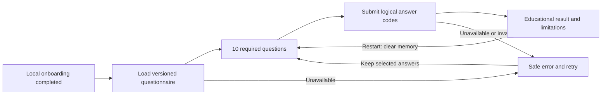

# Sprint 2 React educational risk journey

Story #162, W40 recovery. Master: [V9.1](https://github.com/IgnAite-Showcase/Finex/blob/docs/v9.1-master-handbook/docs/governance/FinEx_Master_Product_Design_Delivery_Handbook_v9.1.pdf), §§7, 10, 12–14, 16, 20, 24. Contract: `s2-risk-contract/v1.0`, questionnaire `risk_questionnaire_v1` / `v1`, scorer `deterministic_v1.0.0`.



## Run on an 8 GB or 16 GB Windows laptop

From `frontend-react`, install the lockfile dependencies with `npm ci`. Default mode is entirely offline, with no Docker, cloud, or credential required. Run one client at a time on 8 GB laptops.

```powershell
$env:NODE_OPTIONS='--max-old-space-size=1536'
npm start
```

Open `/onboarding`, use a synthetic display label, record the educational notice, and complete the profile. Follow **Continue to educational risk profile**. On `/risk`, select an **Approved synthetic profile**, review the ten questions, then calculate. The midpoint case shows Moderate, composite/willingness/capacity 50, version and UTC calculation time, method and educational limitation. Restart clears all answers and the result.

Offline mode is an exact replay of the nine approved valid vectors and seven error vectors in `src/data/s2RiskFixtures.v1.json`, generated by the domain implementation. It is **not** a client-side scoring engine. Other valid answer combinations produce an understandable fixture-unavailable message; use the local API to calculate them.

For API integration, start the native backend as documented in `s2-risk-api.md`, with `APP_ENV=local` and an explicit React origin in `ALLOWED_ORIGINS`. Then restart React with:

```powershell
$env:REACT_APP_RISK_MODE='api'
$env:REACT_APP_ONBOARDING_MODE='api'
$env:REACT_APP_FINEX_API_BASE_URL='http://127.0.0.1:8000'
npm start
```

The adapter only accepts a loopback API origin. Requests omit credentials and contain only questionnaire ID/version and logical answer codes; a journey correlation header is optional. An eight-second deadline, safe error messages, retry, and response-version validation prevent hanging or rendering malformed results. This is a synthetic, stateless, local-only pilot; the local completion flag is not authentication or server consent authorization. UAT/production risk endpoints remain denied.

## Reproduce evidence

```powershell
$env:CI='true'
$env:NODE_OPTIONS='--max-old-space-size=1536'
npm test -- --runInBand --watchAll=false --silent
npm run build
```

The complete suite passed **60 tests / 10 suites**. The build succeeded. Tests include all 16 fixtures, invalid/unavailable errors, version/metadata drift, key-order independence, required selection, preserved answers, loading/duplicate-click prevention, retry, result focus, restart, and accurate pilot navigation. Five additional tests failed before the sidebar/metadata fixes and passed afterward. Tests did not use a production service.

Final #164 acceptance adds consent-route shell regressions: the complete suite now passes **62 tests / 10 suites**, and the production build succeeds. Consent, onboarding and risk screens all use the pilot shell without a mock logged-in identity or fabricated risk label. See [Sprint 2 local acceptance](../evidence/s2-local-acceptance.md) for the live-API walkthrough and reproduction commands.

Visual walkthrough: onboarding → risk → midpoint preset → all ten questions → Moderate 50 result → restart. Desktop and 390-pixel responsive views are checked before publication. Keyboard navigation uses labeled native radios and buttons, question/result heading focus, progress, alert/live status, and explicit retry. The pilot shell does not show a fabricated logged-in identity or an unrelated stored risk category.

Answers and results are in memory only. The S1 store retains only its previously documented completion/correlation flags; this flow adds no sensitive storage. Other shell modules are pre-existing demos, not Sprint 2 delivery claims.

## Review and rollback

Review checks that no score formulas were copied into the client, both adapters use the approved versions, malformed metadata fails safely, and result disclosures match the server. Anand has delegated technical recovery review to Codex; a Codex review is recorded truthfully and is not an independent human approval. Merge only after exact-head CI passes. Roll back this feature using a new reviewed revert PR to W40; do not reset shared branches. Clear the local pilot via the onboarding restart when retesting. No downstream branch promotion or deployment is authorized by this story.
